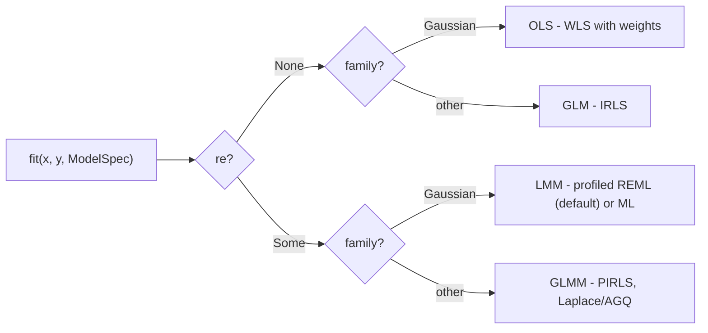

# glmm

[](https://github.com/pawlenartowicz/glmm/actions/workflows/ci.yml)
[](https://crates.io/crates/glmm)
[](https://pypi.org/project/glmm/)
[](https://pawlenartowicz.r-universe.dev/fastglmm)
[](https://docs.rs/glmm)
[](https://www.gnu.org/licenses/lgpl-3.0)


**`glmm`: mixed-model fitting in pure Rust on faer.**

**glmm** fits mixed models in Rust, Python and R, and in the browser through WASM. One `fit`
covers ordinary least squares, generalized linear models, linear mixed models and
generalized linear mixed models.

- **Accuracy first.** Gives the same or a more accurate result than lme4, glmmTMB,
  MixedModels.jl and GLMMadaptive, and converges on every model that has a solution.
- **Multi-solver.** Uses a multi-solver paradigm to get the best result more robustly:
  closed form for least squares, IRLS for GLMs, and BFGS or BOBYQA
  for mixed models, all written from scratch in Rust.
- **Fast.** Faster than every other engine on every model, usually 10 to 100 times,
  without RAM blowup.

On all tested models: a 923-model validation grid, checked for every release.

**Beta.** Some lme4 features are still missing (see [`docs`](documentation/)).
Version 1.0 will add a built-in test for whether a random effect matters —
currently you need the separate RLRsim package, and it only works for normal
(Gaussian) outcomes.

**New to the crate? Start with [`tutorial-rust.md`](documentation/tutorial-rust.md)** — a
single-page, three-layer walkthrough (cold fit → warm fit → advanced loop)
plus a short section on parsing an R-style formula string instead of building
inputs by hand. Python and R packages are also available — see
[Python and R](#python-and-r) below.

## One crate, one `fit`

A single entry point covers the whole linear-regression family. `fit` reads
`ModelSpec` and routes on family × random effects × weights:



This is the pitch view. Every branch point, solver path, and tuning knob is
traced to code in the full algorithm map:
[`documentation/algorithms.md`](documentation/algorithms.md), with the LMM
and GLMM legs detailed in
[`documentation/algorithms-lmm.md`](documentation/algorithms-lmm.md) and
[`documentation/algorithms-glmm.md`](documentation/algorithms-glmm.md).

## Documentation

The fuller map — entry point, tutorials, examples, migration guides, reference,
and internals, all in one tiered table — lives in
[`documentation/index.md`](documentation/index.md). The table below is this
README's own copy of the essentials, not the whole set.

| File | Purpose |
|---|---|
| [`documentation/tutorial-rust.md`](documentation/tutorial-rust.md) | Three-layer Rust walkthrough: cold fit → warm fit → advanced loop, plus the formula frontend |
| [`documentation/tutorial-python.md`](documentation/tutorial-python.md) | The Python package (`glmm`) walkthrough |
| [`documentation/tutorial-r.md`](documentation/tutorial-r.md) | The R package (`fastglmm`) walkthrough |
| [`documentation/supported_families.md`](documentation/supported_families.md) | Family × link support matrix, canonical-link notes, dispersion conventions |
| [`documentation/algorithms.md`](documentation/algorithms.md) | Algorithm map entry point: full dispatch graph, knob index, OLS/GLM paths |
| [`documentation/algorithms-lmm.md`](documentation/algorithms-lmm.md) | LMM: θ-Cholesky, profiled REML and ML, closed-form shortcut, BOBYQA, boundary handling |
| [`documentation/algorithms-glmm.md`](documentation/algorithms-glmm.md) | GLMM: PIRLS, Laplace vs AGQ, dense vs sparse Z, NB outer loop, warm starts |
| [`documentation/glmm-design.md`](documentation/glmm-design.md) | Algorithmic design rationale: the differences from lme4/MixedModels.jl and why each one is faster |
| [`documentation/installation.md`](documentation/installation.md) | Installing the Rust crate, Python package, and R package |
| [`documentation/formula.md`](documentation/formula.md) | What the formula parser accepts and rejects, with workarounds |
| [`documentation/conventions.md`](documentation/conventions.md) | Estimation, standard-error, dispersion, and variance-component conventions, and the flags on a fit result |
| [`documentation/validation.md`](documentation/validation.md) | How glmm is validated: the accuracy grid, its four pinned oracles, the five gates, and what's covered |
| [`documentation/coming-from-lme4.md`](documentation/coming-from-lme4.md) | Call mapping from lme4, what's deliberately missing, and behavioral differences to watch (covers both the R and Python surface) |
| [`documentation/coming-from-statsmodels.md`](documentation/coming-from-statsmodels.md) | Migrating from `statsmodels` `MixedLM`/`GLM` to `glmm.fit` (Python only) |
| [`documentation/troubleshooting.md`](documentation/troubleshooting.md) | Fixes for singular fits, non-convergence, NotImplementedError, and rejected formulas |

## Quick examples

```rust
use glmm::formula::{lower, Column, Table};
use glmm::{fit_cold, BinomialLink, Family};

let table = Table {
    columns: vec![
        ("y".into(), Column::Numeric(y)),
        ("passed".into(), Column::Numeric(passed)),
        ("x1".into(), Column::Numeric(x1)),
        ("x2".into(), Column::Numeric(x2)),
        ("subject".into(), Column::factor_from_labels(&subject)),
        ("school".into(), Column::factor_from_labels(&school)),
    ],
    n,
};

// OLS: fixed effects only
let lo = lower("y ~ x1 * x2", &table, Family::Gaussian)?;
let ols = fit_cold(&lo.x, &lo.y, lo.n, lo.p, &lo.model, &lo.ids, &lo.opts);

// LMM: correlated random intercept and slope (REML)
let lo = lower("y ~ x1 + (1 + x1 | subject)", &table, Family::Gaussian)?;
let lmm = fit_cold(&lo.x, &lo.y, lo.n, lo.p, &lo.model, &lo.ids, &lo.opts);

// GLMM: binomial with a probit link, 7-node adaptive quadrature
let probit = Family::Binomial { link: BinomialLink::Probit };
let lo = lower("passed ~ x1 + (1 | school)", &table, probit)?;
let mut opts = lo.opts.clone();
opts.nagq = 7;
let glmm = fit_cold(&lo.x, &lo.y, lo.n, lo.p, &lo.model, &lo.ids, &opts);

println!("{:?} {:?}", glmm.beta, glmm.se);           // estimates and standard errors
println!("{} {}", glmm.converged(), glmm.singular()); // result flags
```

See [`tutorial-rust.md`](documentation/tutorial-rust.md) for the full walkthrough: warm
starts, the advanced hot-loop surface, and building `x`/`ModelSpec`/`GroupIds`
by hand instead of from a formula.

## Python and R

The same kernel ships as a Python package and an R package. Both take a data
table and an R-style formula — no design matrices by hand.

**Python** (`glmm` on PyPI; Python 3.10+, NumPy is the only dependency):

```bash
pip install glmm
```

```python
import glmm

fit = glmm.fit(data, "y ~ x1 + (1 | group)")   # data: dict / pandas / polars
fit.summary()
```

See the [Python README](python/README.md) and
[`tutorial-python.md`](documentation/tutorial-python.md).

**R** (`fastglmm`, via r-universe):

```r
install.packages("fastglmm", repos = c("https://pawlenartowicz.r-universe.dev", getOption("repos")))
```

```r
library(fastglmm)

fit <- fastglmm(y ~ x1 + (1 | group), data)
summary(fit)   # plus fixef, ranef, fitted, vcov, VarCorr, confint, logLik, isSingular
```

Deliberately scoped to fast fitting — anything the engine cannot compute
honestly (`predict`) errors with the reason instead of guessing.
See the [R README](r/README.md) and
[`tutorial-r.md`](documentation/tutorial-r.md).

## Design

| Property       | Detail                                                              |
|----------------|--------------------------------------------------------------------|
| No `unsafe`    | zero `unsafe` (workspace baseline `unsafe_code = "warn"`)           |
| Deterministic  | no RNG, no global state, no I/O in the fit path                     |
| Reproducible   | the same model fitted on Linux (x86-64), macOS (Apple silicon) or in WebAssembly gives the same fit: across the 794 validation models measured (the grid before its 129 ML twins) the log-likelihoods differ by at most 3e-7 (typically 1e-11), and estimates typically agree to 8 significant digits. A WebAssembly build gives bit-identical results on both machines tested. |
| Linear algebra | [`faer`](https://crates.io/crates/faer) 0.24, pinned               |
| MSRV           | Rust 1.85 (floor set by the `bobyqa` dep)                          |

## Origin

`glmm` was carved out of [MCPower](https://github.com/pawlenartowicz/)'s
simulation engine — the numerics here are the same validation-pinned kernels
that power MCPower's Monte Carlo fits, split out so they're usable standalone.
The `loop_advanced` feature (see
[`installation.md`](documentation/installation.md)) exists specifically to serve
MCPower's warm-start hot loop as a consumer of this crate.

## Citation

If you use glmm in research, please cite:

Lenartowicz, P. (2026). glmm: Mixed-model fitting in Rust, Python and R [Computer software]. https://github.com/pawlenartowicz/glmm

```bibtex
@software{glmm2026,
  author = {Lenartowicz, Pawe{\l}},
  title  = {{glmm}: Mixed-Model Fitting in Rust, Python and R},
  year   = {2026},
  url    = {https://github.com/pawlenartowicz/glmm}
}
```

## License

`LGPL-3.0-or-later`. See [`LICENSE`](LICENSE) and [`LICENSE-GPL`](LICENSE-GPL).

---
**Paweł Lenartowicz** — [Freestyler Scientist](https://freestylerscientist.pl) · [GitHub](https://github.com/pawlenartowicz/) · [ORCID](https://orcid.org/0000-0002-6906-7217)
