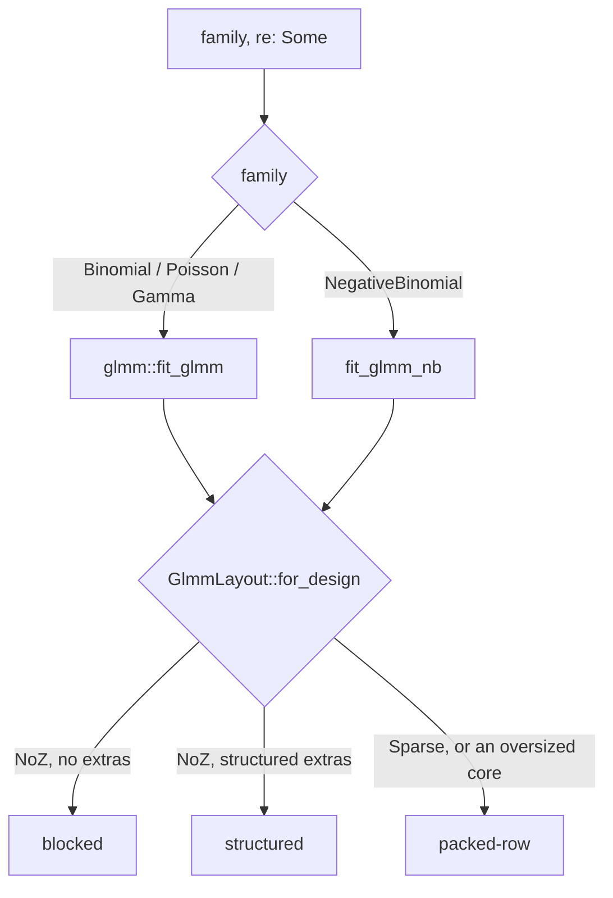
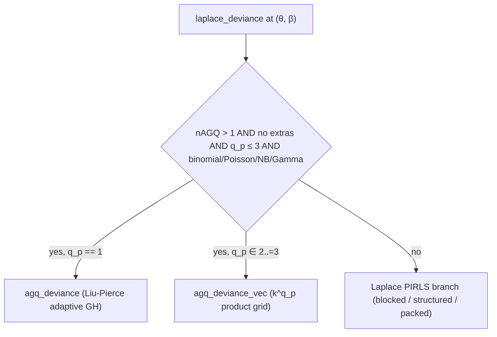

# GLMM — non-Gaussian mixed models

This is the GLMM leaf of the algorithm map: a non-Gaussian `family` with
`re: Some(..)`. It documents what `fit_cold`/`fit_warm` actually run once the
dispatch in [`algorithms.md`](algorithms.md) has selected the GLMM path — the
penalized-IRLS inner loop, the Laplace/AGQ objective, the dense/sparse solver
split, the Negative-Binomial outer θ-loop, workspace reuse, and standard errors.
Family and link coverage is tabled in [`supported_families.md`](supported_families.md).
The page ends with a [comparison](#how-the-other-engines-fit-a-glmm) against
lme4, MixedModels.jl, and GLMMadaptive.

Each section names its code, the lme4/`glmer` (or `MixedModels.jl`) semantics it
follows, and the validation rungs that pin it. Estimation is `glmer`-faithful
`nAGQ=1` Laplace by default; AGQ (`nAGQ>1`) is an opt-in on a single grouping
factor with up to 3 random effects per group, binomial/Poisson/negative-binomial/Gamma.

## Notation

The recurring symbols on this page, defined once here before first use:

- **θ** — the random-effect covariance parameter, in the same relative-Cholesky
  sense as the LMM page; the outer search optimises it (BOBYQA, or BFGS on
  the gradient route).
- **Λ = Λ_θ** — the relative Cholesky factor of the random-effect covariance.
- **Z, M** — the random-effect design and its scaled form `M = ZΛ_θ`, the design
  PIRLS actually works in.
- **u / ũ** — the conditional modes of the (reparameterized) random effects,
  with prior `u ~ N(0, I)`; ũ is the converged mode.
- **η, μ, W** — the linear predictor, the conditional mean (`link⁻¹` of η), and
  the IRLS working weights.
- **A = MᵀWM + I** — the penalized-IRLS system matrix. `W` is the exact
  curvature `W_obs = −∂²ℓᵢ/∂ηᵢ²`, both in the PIRLS step (a Newton step) and
  in the objective's `log|A|` at the mode. It is the Fisher weight on a
  canonical link and differs from it on probit, cloglog, Gamma/log and NB/log
  (see [Laplace approximation](#laplace-approximation)).
- **β** — the fixed effects. In the objective, dispersion is fixed at 1 for
  every family except Gamma, whose φ is a free parameter searched by the outer
  loop as `ln φ` (NB's θ is a shape parameter searched the same way).
- **nAGQ** — the Gauss–Hermite node count; `nAGQ=1` is the Laplace case.
- **d(y, ũ)** — the family deviance evaluated at the converged mode.

## Dispatch within the GLMM path

**Code:** `classify_design` (`src/fit/mod.rs`) and the `(family, Some(_))` arm
of the dispatch match in `build_workspace` (`src/fit/core.rs`); `assert_model_shape`
(`src/fit/common.rs`); envelope caps in `src/consts.rs` (`MAX_PRIMARY_Q`,
`MAX_EXTRA_GROUPINGS`, `MAX_EXTRA_Q`, `MAX_CROSSED_LEVELS`).

`classify_design` returns `Solver::NoZ` (the dense clustered kernel) or
`Solver::Sparse`. A design routes **Sparse** when it is over the dense envelope
(`q_p > 8`, more than 6 extra groupings, or any extra grouping with
`1 + slopes.len() > 4`), when *any* extra grouping carries a random slope, or
when the total crossed level count exceeds `MAX_CROSSED_LEVELS`; otherwise it
stays **NoZ**. (For a slope-carrying extra `Solver::Sparse` is not a speed
choice: only the packed-row `A`-layout applies a full `q_g×q_g` Λ block per
extra level.) On the non-Gaussian side `classify_design`'s answer selects the
`A`-layout, not a separate driver — every family reaches the same entry point:



(Gaussian `re: Some` is the LMM path — `fit_lmm` — covered in
[`algorithms-lmm.md`](algorithms-lmm.md), not here.) Every family that reaches
this match fits on both solver arms: there is **no reachable `unimplemented!`**
once dispatch is inside the GLMM path. The hard rejections are the shape
asserts at the stable boundary (`assert_model_shape`, `src/fit/common.rs`):
`nAGQ` must be odd in `1..=25`, and `nAGQ>1` is allowed only on a single
grouping factor (no extras), `q_p ≤ 3` random effects per group,
binomial/Poisson/negative-binomial/Gamma GLMM. The same assert also checks the engine invariants that
hold at `nAGQ = 1`: every primary/extra slope column must index within `p`,
and at most one `NestedWithin` extra grouping is accepted. It also rejects
`(Family::InverseGaussian, Some(re))` outright — a family × random-effects
gate rather than a shape gate — because the GLMM objective needs a profiled
`inverse.gaussian()$aic` term that is not built, so `InverseGaussian` never
reaches the `family` diamond above; it faults before `build_workspace`
allocates anything, and is otherwise a fixed-only GLM family (see
[`algorithms.md`](algorithms.md#full-dispatch-map)). Prior weights are **not**
a rejection anywhere on this path — `FitOptions::weights` is honored on every
GLMM shape, AGQ included (see the weights paragraph in the PIRLS section).

**Validation:** the NoZ binomial/Poisson/Gamma path is pinned by cbpp
(`fit_glmm_cbpp_matches_lme4`), grouseticks
(`fit_glmm_poisson_grouseticks_matches_lme4`) and the Gamma goldens
(`fit_glmm_gamma_sim_matches_grid_reference`, grid cell `sim_gamma`); the Sparse
arm (the packed-row layout) by `sim_binomial_slope_crossed` (a slope-carrying
crossed extra → `fit_sparse_binomial_slope_crossed_is_pinned` in
`src/sparse/tests.rs`) and the over-count rungs `sim_sparse_binomial` / `sim_sparse_poisson`
(rungs 8–9, grid cells gated against lme4, glmmTMB and MixedModels.jl).

## PIRLS inner loop

**Code:** `pirls_solve_packed` (packed-row, `src/glmm/pirls/packed.rs`),
`pirls_solve_blocked` (no extras, `src/glmm/pirls/blocked.rs`) and
`pirls_solve_blocked_extras` (structured crossed/nested,
`src/glmm/pirls/blocked_extras.rs`); caps `PIRLS_MAX_ITERS = 200`,
`PIRLS_MAX_HALVINGS = 16`, the period-2 detector's `PIRLS_OSC_RATIO = 0.8` and
`PIRLS_OSC_TRIGGER = 3`, and the tolerance selector `pirls_tol` in
`src/glmm/mod.rs`.

At a fixed θ the conditional modes ũ are found by penalized IRLS — Newton's
method on the penalized likelihood. The RE design is the scaled `M = ZΛ_θ`, and
the penalty adds a `+I` ridge; this is the standard `nAGQ=1` reparameterization,
under which the prior is `u ~ N(0, I)`. Each iteration forms `A = MᵀWM + I` and
the right-hand side `Mᵀρ − u` (ρ the row scores, `y − μ` on the canonical
links), solves `A·δu = Mᵀρ − u` by Cholesky and takes `u + δu`. This is the
IRLS step `u_new = A⁻¹(Mᵀ(W·Mu) + Mᵀρ)` written as an increment: that form
carries `(A − I)u`, of size `θ²·Σwᵢ·|u|`, whose rounding lands in `u` along
any direction `M` nearly annihilates (crossed intercepts, a slope constant
within a cluster) and stalled the solve at counts near `e³³`; in the increment
form the rounding shrinks with `δu`. `log|A|` is read off that same factor, so the
deviance term needs no re-factorization. The factor is built from W at the
iterate the last step started from, not at the returned `u` — see
[§Laplace approximation](#laplace-approximation). Three variants handle the RE
structure:

- **Blocked** (no extra groupings): `A` is block-diagonal, one `q_p×q_p` block
  per cluster, factored per cluster in `a_blocks`.
- **Structured** (intercept-only crossed/nested extras): `A` splits into a
  block-diagonal core plus a Schur complement on the crossed width. Concretely
  (`structured_factor` / `structured_ainv_solve`): per-cluster core blocks of
  width `q_core = q_p + nested-children-per-parent` (`core_blocks`), the
  cluster↔crossed coupling `C_f` (`coupling`, stored on a per-cluster CSR
  `coup_cols`/`coup_ptr` of its nonzero columns only, with each row entry's
  slot in `coup_pos`; the CSR is rebuilt only when the θ-pinning mask
  changes), and the crossed-width Schur complement
  `S = (E + I) − Σ_f C_fᵀA_f⁻¹C_f` (`schur_blk`). The determinant splits by
  the Schur identity, `log|A| = Σ_f log|A_f| + log|S|`.
- **Packed** (everything else — a slope-carrying extra, over the envelope
  caps, too many crossed levels, or an extras core too wide for the
  structured route): `M = ZΛ` in fixed-width rows and a `k×k` `A`, factored
  whole — densely, or through a sparse Cholesky on `A`'s fixed pattern (the
  union of each row's `width` RE columns plus the diagonal, AMD-ordered, one
  symbolic analysis per design, built by `fill_packed_cols`). The sparse factor
  is taken when `k ≥ PACKED_SPARSE_MIN_K` (256) and the symbolic fill
  `nnz(L)/(k(k+1)/2) ≤ PACKED_SPARSE_MAX_FILL` (0.5); both thresholds are
  provisional until a locked native and WASM timing sets them. The per-row
  scatter writes straight into whichever storage is in use, and the Rx Schur
  fill solves through that same storage: the dense `a`, re-factored, or the
  sparse factor the converged solve left in `l_values`. The dense `k×k` pair
  `a`/`a_chol` is sized only when the dense factor is chosen
  (`PackedScratch::set_factor`, called from `fill_packed_cols`), so a
  sparse-factored fit never holds a dense `k×k`. Measured on the grid's wide cells (`k` = 810–1835, `A` 0.3–17 % full),
  the dense factor was 70–91 % of the wall; the sparse one makes an evaluation
  10–30× cheaper. A real numerical change against the dense factor (another
  elimination order), agreeing to round-off
  (`packed_sparse_factor_matches_the_dense_one`).

Convergence follows the lme4 `pwrss` rule: exit when
`|mixed − mixed_prev| < tol · (1 + |mixed|)`, checked after each step, with
`tol` selected by `pirls_tol` (next paragraph). Here
`mixed = dev(uⱼ) + ‖uⱼ₊₁‖²` is the cross-step penalized deviance carried
between iterations, so the band scales with the penalized deviance itself, not
the penalty term alone.

**Newton step.** The step weight is the exact curvature of the conditional
log-density in η, `W_obs = −∂²ℓᵢ/∂ηᵢ²` (`pirls::observed_weights_in_place`,
called by all three `f64` kernels before the scatter), so `A` is the Hessian of
the penalized deviance in u and the step is Newton's. On a canonical link that
weight is the Fisher weight. On probit, cloglog, Gamma/log and NB/log it is
not, and Fisher scoring with the expected weight converges only linearly there:
a loose band leaves the outer objective too noisy for BOBYQA on wide fits, a
tight one is slow, and a cold start far from the mode can exhaust
`PIRLS_MAX_ITERS` on most of BOBYQA's first interpolation points. `W_obs` is
positive on every row there, each log-likelihood being log-concave in η, so
`A` stays positive definite. A tail row (see "Tail rows" in
[`algorithms.md`](algorithms.md#generalised-linear-models-glm)) takes the
observed weight of its η form, positive too. The mode is the same either way;
only the path to it changes. The dual derivative kernels keep the Fisher
weight in their own `A` and take the same Newton step through their observed
twin (`DualStep::observed`, see [Standard errors](#standard-errors)).

**Probit rows and the binomial deviance fold.** On a probit fit the `f64`
loops of every layout read `φ(η) = dμ/dη` for the row score, `W_obs` and pass
A's `dW_obs/dη` from `family::ProbitRows`, which fills it 64 rows at a time
through the SIMD `exp` (`simd_transcendental::exp_fill`) instead of one libm
`exp` per row and per function. Each row function keeps its generic form term
for term, a tail row calls the generic function, and the rows keep their order,
so only the `exp`'s last bits move: within 2e-15 relative on the score, 5e-14
on `W_obs` and 1.5e-12 on `dW_obs/dη` (scaled by `max(1, |value|)`),
`probit_rows_match_the_generic_row_functions`. The family pass's binomial
deviance (probit, cloglog and weighted logit; unweighted logit has its own
fused kernel) is `family::dev_resid`'s form with its two `ln_1p`s taken through
the SIMD `ln` a chunk of rows at a time (`simd_transcendental::binomial_dev_fold`),
as the NB fold already was; a tail row keeps `dev_resid_at`'s η form. A probit
deviance read off `ln Φ(±η)` instead would need a second `erfc` per row, which
the μ the family pass has already formed spares, and would leave the μ form
that `dev_resid_at` defines off the tail. The dual kernels and the SE path keep
the generic functions.

The tolerance is link-dependent. Canonical links — exactly the two
`family::is_canonical` cases, logit and Poisson-log — use
`PIRLS_TOL_REL = 1e-9`. Non-canonical links (probit, cloglog, Gamma-log/inverse,
NB-log) use `PIRLS_TOL_REL_NONCANON = 1e-8`, a decade looser. That value rests
on the accuracy grid: with the Newton step at 1e-8, the wide probit, cloglog,
Gamma/log and NB/log cells that stall under Fisher scoring (5e-5 to 5e-3
deviance units above glmmTMB), the 30000-row Gamma/log cell that stalled at its
start, and every other non-canonical mixed cell land within `dev_eps` (4e-5) of
glmmTMB's deviance; a 1e-10 band measured no better there and cost 0–60% more
wall.

**Stage-1 tolerance on the `ExactProfile` route.** Every evaluation of the
`ExactProfile` search is a PIRLS solve, and BOBYQA needs its value only to an
accuracy small next to what its model resolves at the current trust radius,
of order ρ² (inexact derivative-free optimization: Ehrhardt & Roberts 2021,
*J. Math. Imaging Vis.*, doi:10.1007/s10851-021-01020-8). So the search runs
on `Bobyqa::minimize_with_radius`, which hands each evaluation BOBYQA's ρ,
and solves at `clamp(RHO_TOL_C·ρ², pirls_tol, RHO_TOL_MAX)` (`RHO_TOL_C` =
1e-2, `RHO_TOL_MAX` = 1e-5, relative as `pirls_tol` is), at `pirls_tol` once
ρ ≤ `RHO_TOL_FULL_FACTOR`·`GLMM_RHO_END` = 3e-5, and at `pirls_tol` on the
search's first evaluation, the point the warm-start guard solves and hands
over. An incumbent found at a loose tolerance is re-solved at `pirls_tol`
before β̂ and the deviance are read, so the reported fit never rests on a
loose solve; the re-solve is not counted in `n_eval`, and a solve that runs
out its iterations counts in `Note::PirlsExhausted` as the search's own do.
`PqlThenJoint` stage 1 and the joint searches keep `pirls_tol`.

**Step-halving** mirrors lme4 `pwrssUpdate`'s 10-halving discipline, in its
retrospective form. The trial `u` is evaluated first. Only if its same-point
penalized deviance rises above the last accepted value by more than the tolerance
band is `δu = u − u_prev` halved and re-evaluated — up to `PIRLS_MAX_HALVINGS`
times, after which the solve reports failure `(NaN, NaN, NaN, false)`. A
within-band rise is treated as FP noise near the optimum and accepted without
burning a halving. A non-finite trial (an overflowed step) always counts as an
overshoot and is halved, as lme4's `ISNAN(pdev)` branch does; on the exact
profile the same holds for a non-finite merit. In Profile mode (below) the joint
`(u, β)` step is backtracked in lockstep, halving β toward `beta_prev` alongside
`u`.

**Period-2 damping.** An undamped step can overshoot the mode so that the
iteration map has an eigenvalue at or below −1, and the iterates settle into a
2-cycle: the same-point penalized deviance rises by less than the halving band
per step while `mixed` keeps alternating by more than the stopping band, so the
solve would run out `PIRLS_MAX_ITERS`. Fisher scoring does this on a
non-canonical link wherever the observed curvature exceeds twice the expected
one; the Newton step does not have that cause, and the detector stays as a
guard for any step that cycles. After `PIRLS_OSC_TRIGGER` consecutive sign
flips of `mixed − mixed_prev`, each at least `PIRLS_OSC_RATIO` times the one
before, every later step of that solve moves half way from the pre-step
iterate (β in lockstep in Profile mode), which maps an eigenvalue λ of the
undamped step to `(1 + λ)/2`. The detector is off on dual solves, whose
one-step exactness it would break. A solve that converges before it fires is
bit-identical. **Validation:** `nb_pirls_two_cycle_is_damped_and_the_fit_converges`
(grid cell `nb_cross4_g300p5_bal_base`, whose PIRLS solves two-cycle without the damping).

**Prior weights.** With `FitOptions::weights`, PIRLS folds `wᵢ` into the
working weight (`wᵢ·W̃ᵢ`), the deviance contribution (`wᵢ·devᵢ`), and the
β-gradient score (`wᵢ·ρᵢ`), so the conditional mode and curvature are those of
the weighted likelihood. One fork follows inside the shared family kernel: the
fused `2·(Σ log1pexp(η) − Σ y·η)` deviance identity holds only for unweighted
Bernoulli rows, so a *weighted* binomial-logit fit takes the weighted-logit arm
instead (`ws.weighted` gates it). The
aggregated-binomial convention (y = success proportion, `wᵢ` = trial count —
lme4's `cbind(s, m−s)`) rides this mechanism unchanged, on Laplace and AGQ
alike.

**Convention/reference:** this is `glmer`'s `nAGQ=1` inner PIRLS; the halving is
lme4's retrospective `pwrssUpdate`. **Validation:** every binomial/Poisson/Gamma
GLMM rung exercises it — cbpp, grouseticks, VerbAgg (the n=7584 individual-
Bernoulli rung whose PIRLS exit tolerance the `PIRLS_TOL_REL` doc comment tunes),
and the Gamma/NB goldens. The step-halving specifically recovers the
grouseticks 3-crossed β=0 cold start
(`fit_glmm_poisson_grouseticks_3crossed_matches_lme4`). Weighted GLMM paths are
pinned by `fit_glmm_cbpp_aggregated_matches_lme4`,
`fit_glmm_poisson_weighted_matches_lme4`, `fit_glmm_gamma_weighted_matches_glmmtmb`
(dense) and the `sparse_weighted_*` weighted-vs-replicated equivalence tests
(sparse).

### β profiling — the three outer routes

**Code:** `BetaMode::{Fixed, ProfilePql, ProfileExact}` and
`BetaStep::{Fixed, Profile { exact, .. }}` in `src/glmm/pirls/mod.rs`; the
route driver in `glmm::fit_glmm` (`src/glmm/mod.rs`), fixed per shape at
construction by `GlmmWorkspace.outer_search: OuterSearch` and
`exact_profile_shape` (`src/glmm/mod.rs`).

The outer search over θ (and β) picks one of three routes, fixed per shape and
never mixed within a fit:

- **`Joint`** runs a single BOBYQA over `[θ | β]` directly. Every objective
  eval holds β fixed (`BetaStep::Fixed`), so PIRLS solves only for ũ(β). This
  is the A/B reference the other two routes are checked against.
- **`PqlThenJoint`** follows lme4's θ-then-joint structure (Bates et al.,
  *JSS* 67(1), 2015, §3): a θ-only BOBYQA runs first (`BetaMode::ProfilePql`),
  adding a δβ Schur-border update every PIRLS iteration so it returns the
  jointly PQL-optimal `(ũ, β̂)` for that θ; this pass is purely a warm-start
  accelerant, never gates convergence, and is skipped bit-identically when
  `nAGQ>1`. A joint `[θ | β]` BOBYQA polish then runs exactly as `Joint`
  does, warm-started from the PQL pass, and its status alone decides
  `converged` — the reported `(θ̂, β̂)` is therefore always the Laplace
  optimum, not the PQL one.
- **`ExactProfile`** instead profiles β out EXACTLY at each candidate θ
  (`BetaMode::ProfileExact`): the PIRLS inner loop adds a δβ Schur-border step
  that is Newton on the Laplace profile `L(β) = dev + ‖ũ‖² + log|A|` along the
  mode ũ(β). The PQL border solves `S_β·δβ = X'ρ − B'δu₀`, with `S_β` and the
  right-hand side formed from the design residual rows `rᵢ = xᵢ − Tᵀmᵢ`
  (`T = A⁻¹MᵀWX`) as `Σᵢ wᵢrᵢrᵢᵀ + TᵀT` and `Σᵢ ρᵢrᵢ + Tᵀu`
  (`pirls::residual_border`; on the blocked layout the residual rows are built
  a tile at a time and summed into both while in cache): the forms
  `XᵀWX − BᵀT` and `Xᵀρ − Bᵀδu₀` are
  differences of terms of order `Σwᵢ` and lose all their digits when a column
  of X lies in the span of M at huge counts; the exact one takes
  log|A|'s gradient `½c_β` off the right-hand side and adds its curvature
  `½·d²log|A|/dβ²` to `S_β` (`logdet_beta_curvature` in
  `src/glmm/pirls/mod.rs` carries the derivation and the per-iteration cost).
  Without that curvature the step overshoots wherever log|A| dominates it — a
  few clusters at a large θ, where the profile is nearly flat in the intercept
  — and the solve can cycle. On a structured shape with a crossed tail the
  curvature leaves out the tail's two trace terms: both are positive
  semidefinite and enter with a minus sign, so what is added is an upper bound
  on the exact curvature (exact on the blocked layout and wherever no cluster
  couples to the tail), which keeps the step no longer than the exact Newton
  step. The curvature is computed only where the plain `S_β` step shows
  trouble (`BorderTrust::wants_curvature`): once a solve's trust radius
  shrinks, careful mode starts, the period-2 damping fires or the solve
  reaches `CURV_SLOW_ITERS` = 8 iterations, the curvature is on for the rest
  of that solve, and a per-fit memory (`ExactProfileBufs::curv_memory`, reset
  per fit) starts the next solve with it on. That solve's first step measures
  `‖δ_H − δ_S‖/‖δ_H‖`, the relative change the curvature makes to the step;
  below `CURV_RELEASE` = 0.1 it drops the curvature and clears the memory.
  Otherwise `logdet_hess` is zero and the step is the plain `S_β` step. The
  warm-start guard (below) solves each of its candidates from a cleared memory
  and hands the search the memory of the one it picks. Far from the mode even
  the exact quadratic model can be far off, so the border step runs inside a trust region
  (`BorderTrust`, `border_solve`; Nocedal & Wright, *Numerical Optimization*,
  2nd ed., ch. 4). Each trial a border step produced is judged by `ρ` = actual
  merit change / the change the model predicts; `ρ < ¼` shrinks the radius to
  a quarter of the step taken, `ρ > ¾` on a step the radius cut doubles it,
  and a disagreement inside the accept test's allowance for the merits' own
  error counts as agreement. A step from a point accepted unjudged (the first
  trial of a solve) is not judged: from a cold start the joint step's u half
  can overshoot far more than the β model says anything about. A step longer
  than the radius, or one on a curvature that is not positive definite, is the
  Levenberg–Marquardt step `(H + λI)δ = g` with `‖δ‖` on the radius, λ by Moré
  & Sorensen's safeguarded Newton iteration. The radius starts infinite (a
  solve whose steps all agree with their model takes the plain Newton step);
  where the curvature is not positive definite before any radius is set, the
  first radius is the length of the `S_β` step. Its accept/halve test runs on
  the Laplace merit `dev + ‖ũ‖² + log|A(u)| + g_u'·δu₀` — the profiled Laplace
  deviance at θ, not the PQL objective — with the correction term controlling
  for the trial `u` sitting off the conditional mode (see the PIRLS solvers'
  own comments for the full derivation: `src/glmm/pirls/blocked.rs`,
  `src/glmm/pirls/blocked_extras.rs`). Because this θ-only pass already
  reaches the Laplace optimum, no joint polish follows — its status alone
  gates convergence, on the shapes `exact_profile_shape` selects (nAGQ=1 on
  any layout but the packed one — the blocked layout with no extra groupings,
  or the structured layout within `structured_extras_eligible`; Gamma included, its `ln φ` searched beside θ
  as NB's `ln θ_NB` is, see [Gamma dispersion](#gamma-dispersion)): the kernel steps with the exact curvature, so
  its own factor gives the û-path adjoint solve its `Ã = A_obs` on every link,
  and the route carries no canonical-link restriction on either shape.

**Start radii.** Each search starts at the radius measured best for its kind
of start (`src/lmm/mod.rs`): stage 1 and the `Joint` route from the blind θ₀
at `GLMM_RHO_BEGIN` = 0.2, stage 1 from a caller's θ₀ that the start guard
kept at `RHO_BEGIN_WARM` = 0.1, and the joint polish after stage 1 at
`GLMM_RHO_POLISH` = 0.03, because it starts next to the optimum. The polish
starts at 0.1 instead when the stage-1 optimum has a diagonal |θ̃| below
`POLISH_NEAR_SINGULAR` = 1e-2: from a block near the singular boundary the
small radius can stop on the flat boundary surface short of the optimum.
`bobyqa` fixes the radius when a solver is built, so the warm stage-1 and the
near-singular polish searches run on their own solvers, built on first use.

**Saddle check after `ExactProfile`.** The deviance is even in each column of
a block's Λ (Σ = ΛΛᵀ sums `l_d·l_dᵀ` over the columns), so a zero column is a
stationary point, and a saddle where a small nonzero variance fits better.
Near it the deviance changes as ‖l_d‖⁴ along the column, too flat for BOBYQA
to see at its last radii, and a search that reaches it stops there. So when
the `ExactProfile` search converges, each nonzero column with norm below
`POLISH_NEAR_SINGULAR` is doubled while that lowers the deviance (its own
iterate points along the escape direction); if any column moved, the stage-1
search restarts from there at `GLMM_RHO_POLISH` on its own solver, built on
first use. Each tried point is a full-tolerance evaluation counted in
`n_eval`. On the grid's `pois_q2sx2_g3000p20_bal_boundary` the search had
stopped at 0.15 of the optimal column, 4.0e-6 deviance above the optimum.

**The β coordinates of the joint search.** The joint BOBYQA (`Joint`, and the
polish of `PqlThenJoint`) does not step β in the caller's units. Like θ, which
it searches as the internally scaled θ̃ (see
[`algorithms-lmm.md` §Random-effect design column scaling](algorithms-lmm.md#random-effect-design-column-scaling)),
it searches β as

```
G = Σᵢ wᵢ xᵢxᵢᵀ / Σᵢ wᵢ = L Lᵀ      β̃ = Lᵀβ      η = Xβ = (X L⁻ᵀ) β̃
```

with `wᵢ` the prior weights and `L` the lower Cholesky factor of the
design's weighted Gram matrix. That design is the standardized one
([internal standardization](algorithms.md#internal-standardization-of-the-design)),
whose continuous columns are centered and scaled, so on those `L` is close to
the identity except for the correlations between columns. A 0/1 column only
the fixed effects read (a factor dummy, a binary covariate) is left as it is,
so its row of `L` is not:
for `X = [1, d]` with `d`'s weighted share of ones `π`,
`G = [[1, π], [π, π]]` and `L = [[1, 0], [π, √(π(1−π))]]`. What follows holds
for any design `L` is built from. `X L⁻ᵀ` has the identity as its weighted Gram,
so a unit step along any β̃ axis moves η by 1 in weighted root mean square,
the scale θ̃ is searched on. The trust radii (`rho_begin`, `GLMM_RHO_END`) and
the non-finite-point radius below then mean the same thing in every unit of X:
a column `x·s` gives the same search for any `s`, and a column `x + a` next
to the intercept is searched as the centred column (for `X = [1, x]`,
`Lᵀβ = (β₀ + x̄β₁, sd(x)·β₁)`). On the diagonal this is the root mean square
about zero, the scale a 0/1 random-slope column is fitted at. The start maps forward (`β̃₀ = Lᵀβ₀`), every objective
evaluation maps its point back (`BetaScale::caller_point`), and the incumbent
maps back once the convergence read has measured its distances; `ws.params`
and everything after the search hold β on the fitted (standardized) design, and
the SE block maps them to the caller's units. The map is
linear, so it changes the path of the search and not the model or its optimum.
`G` is never formed: `L` is rebuilt every fit (`BetaScale::set`) from the
Givens QR `√W·X = Q·D·U` the LMM kernels orthogonalize by (`DesignQr`,
[`algorithms-lmm.md`](algorithms-lmm.md)), as `Lᵀ = diag(D/√Σw)·U`. If `R`
has a zero diagonal (a zero or exactly collinear column) the search runs on β
itself. `ExactProfile` has no β coordinate in its search, so this does not
apply there.
On the standardized design what it still buys is on the 0/1 columns and the
correlations: measured 2026-10-01 over five start nudges of 1e-9, `cbpp_agq7`
(the `period` dummies) takes 61 evaluations with it and 93 to 97 without,
`cbpp_probit_agq7` 68 against 86 to 93, at the same deviance to 6e-12; on the
eleven other joint-search cells measured the median counts agree to 5%, but
for one wide Gamma cell on the singular boundary (+22%), whose own count spans
16802 to 23113 across six nudges.
**Code:** `BetaScale` (`src/glmm/workspace.rs`), its call sites in
`fit_glmm` and in the SE block (`src/glmm/se.rs`). **Validation:** the Gamma GLMM cases of
`unit_invariance_on_every_route` (`src/fit/standardize_tests.rs`).

The design Gram leaves out the working weights `W`. Where they span decades
(`W = μ` on Poisson log, `W = μ²/φ` on the Gamma inverse link, with cluster
means decades apart) the deviance rises by tens of units over 1e-4 along one
β̃ axis while it barely moves along the others, and BOBYQA can stop converged
in that valley, units above the optimum. So after a converged joint search one
check runs at the incumbent: a Laplace solve at its θ and dispersion with β
re-solved jointly with the modes (PQL), and on AGQ one solve of the AGQ
objective at that β, started from the modes the PQL solve left there. At an
optimum this is no lower than the incumbent, since the PQL β is not the
Laplace or AGQ one. When it is lower by more than `JOINT_RECHECK_TOL` (1e-9
relative), capped at `JOINT_RECHECK_ABS` (one deviance unit), the search runs
a second time from that point, its incumbent modes the check's, on β̃ scaled
by the β information there instead of the design
(`BetaScale::set_info`: `L·Lᵀ = S_β/Σw`, `S_β = X'WX − X'WM·A⁻¹·M'WX` the
factor the PQL solve leaves in `border.schur`), so the deviance is isotropic in
β̃ to second order. On AGQ the check and its second pass also run after a
gradient-route finish (see
[Gradient search](#gradient-search-bfgs-on-laplace-and-scalar-intercept-agq-fits)).
The check's solves are not search evaluations; when it does
not fire the fit is the one-pass fit bit for bit. Measured 2026-10-04 on six
Poisson-log clusters with log-means spread over eight decades: the packed
layout's search had stopped 1.05 units above the exact-profile optimum and now
reaches it to 2e-8; over twelve decades packed and 7-node AGQ had stopped 800 to
1050 units above it and now end within the PIRLS exit band of it. Since
2026-10-10 the 7-node AGQ fit searches with BFGS first: over eight decades the
check's second pass takes it from a certified BFGS endpoint 4.58 units above
the optimum to the optimum, and over twelve the BFGS line search fails, the fit
hands over to the joint search with `Note::GradientSearchFallback` and, with
the hand-over's extra pass (see
[Gradient search](#gradient-search-bfgs-on-laplace-and-scalar-intercept-agq-fits)),
ends 4.6e-5 units from the joint search's former optimum. On a second
twelve-decade design the second pass alone ended 2.93 units above the
exact-profile optimum, and the extra pass reaches it (measured 2026-10-11). On the
grid's AGQ and packed cells the check never fired after the joint search
(largest value 2e-14 relative). Over 13.75 and 14 decades (|f| from 7.4e11 to
2.4e12, five designs each) the 7-node AGQ fit had stopped 1090 to 1460 units
above the exact-profile optimum, still converged: the check found the
incumbent 679 to 937 units above its point, under a relative band of 737 to
2438 units, and at 14 decades its AGQ solve, then started from the
incumbent's modes, failed outright. With the cap and the check's own modes
every fit ends within +0.31 of the exact profile, which itself stops up to
10.7 units above the Laplace optimum at 14 decades (measured 2026-10-16).
**Validation:**
`joint_search_reaches_the_optimum_when_working_weights_span_decades` and
`agq_search_reaches_the_optimum_when_working_weights_span_fourteen_decades`
(`src/fit/glmm_tests.rs`).

Whichever search gates convergence, its `Converged` status counts only when the
search saw a finite incumbent, at least two finite evaluations, and no
non-finite evaluation within `NON_FINITE_RADIUS` (0.1, a constant of its own
and not a start radius, so the check's radius does not move with the start
radii) of the point it returned, measured in the search's own coordinates
`[θ̃ | β̃]`. A failed PIRLS solve scores `+∞`, which BOBYQA moderates to
`1e30`; a search whose steps keep landing on such points shrinks its radius to
`rho_end` at the edge of the failing region and reports `Converged` there, at a
point it never compared with its neighbours. A far warm start whose first
evaluations fail and are walked away from is unaffected. lme4 has no such rule
because its `pwrssUpdate` raises an error on any PIRLS solve that does not
converge, which ends the fit. **Validation:**
`any_within_flags_an_optimum_next_to_a_non_finite_eval` (`src/glmm/tests.rs`) drives
this check directly, below the fit level: a plain 1-D `Bobyqa` run on a
synthetic objective with a `+INFINITY` region next to (but not at) its true
minimum, checked with `any_within` exactly as `fit_glmm` does.

**Warm-start guard and `PqlThenJoint` fallback.** A warm fit
(`theta_start.is_some()`) first evaluates the outer objective — the route's
own Profile mode when stage 1 runs, `BetaMode::Fixed` otherwise — at both the
caller's θ₀ and the blind cold start `GlmmWorkspace::from_groupings` would have used, and
begins the search from whichever is lower; a tie or a non-finite warm value
goes to cold. A start whose θ is the blind θ₀ bit for bit skips the guard on
every route: both candidates would be the same point `[θ₀ | β₀]`, so the
comparison is empty, and the fit runs as a cold fit from the caller's β₀. Each
candidate is solved as a fit's first evaluation is (û = 0, β₀, a cleared
curvature memory). When stage 1 runs and its first call lands on the picked
point bit for bit, the winning solve is the search's first evaluation: the
search takes its objective, û, β̂ and the curvature memory it left instead of
solving the point again. BOBYQA moves a start that lies within its initial
radius of a bound (an NB `ln θ_NB` just under its upper bound, a θ₀ above the
θ box); that first call misses the guard's point and solves its own from
û = 0, β₀ and a cleared memory, as a cold fit's first call does. So the guard
costs one extra Laplace-deviance evaluation on a warm fit when the hand-over
hits, two when it misses and two on the `Joint` route, all outside the
reported `n_eval`, and a warm fit the guard sends to the blind start runs the
cold fit's search from the same first state. Measured on the far-warm-start
scan (x86_64): all 1009 such fits are the cold fit bit for bit.
Separately, when the `ExactProfile` route ends not converged (a hard failure
or a budget-exhausted plateau), the fit reruns once on `PqlThenJoint` from the
same (possibly guard-picked) start, reusing the same stage-1/stage-2 code with
the route rebound — never twice. The rerun's result is reported when it
converges; when both attempts end not converged, the one with the lower
objective is reported, still not converged (`Note::ExactProfileFallback`,
`src/fit/mod.rs`). Both fixes address the same failure mode: on a scan of far
binary-link warm starts, most failures are a θ₀ where every PIRLS evaluation
fails, which no border-step change can recover — the guard sidesteps it by not
starting there when the cold point is better, and the fallback recovers what
the guard cannot by trying a route whose warm start matters less.
**Validation:** `far_warm_start_recovers_via_the_cold_guard`,
`warm_start_the_guard_rejects_is_the_cold_fit` and
`exact_profile_fallback_reruns_on_pql_then_joint`; the far-warm-start scan
`far_warm_start_scan` and `far_warm_start_nb_sweep` (`#[ignore]`, run by hand
in release after a change to the GLMM search; all in `src/fit/glmm_tests.rs`).

**Measured and not taken.** Three variants of the guard and of the stage-1
tolerance were measured on the loop-tier benchmark shapes and the
far-warm-start scan (aarch64) and dropped. Solving both guard candidates at a
loose PIRLS tolerance (1e-6, with a full-tolerance repeat when the two values
come within ten exit bands) saved 0 to 3% of a warm fit, nothing where the two
starts are close, because the repeat fires there. Seeding the blind candidate
from the warm candidate's mode saved 0.5 to 4% but makes the blind value
depend on the warm start, and on far starts with several β branches it lands
on another branch than the cold fit's own first solve. Both change the
curvature memory the search inherits, so both would break what the hand-over
gives a rejected warm start: the cold fit's own search. Tying the stage-1
tolerance to the distance from the incumbent, instead of BOBYQA's ρ, was a
noisy stand-in for the radius: at the setting where the radius rule saves most
(C = 1e-2) it ended a far start at a false convergence that the radius rule
avoids.

**Validation:** `two_stage_matches_single_stage_on_grouseticks` (in
`src/glmm/tests.rs`) pins `ExactProfile` against `Joint` — grouseticks
(Poisson-log, canonical, structured) routes `ExactProfile`, not
`PqlThenJoint`. No test compares `Joint` against `PqlThenJoint` on the shapes
that still take `PqlThenJoint`.
The `exact_profile_*` tests in `src/glmm/tests.rs` pin `ExactProfile` against a
β-only-BOBYQA minimum and against warm-started re-solves; cbpp and grouseticks
pin the fitted optimum. `exact_border_curvature_matches_fd_of_the_profile`
(`src/glmm/tests.rs`) computes the border's `S_β + ½·d²log|A|/dβ²` at the
profiled β̂ and holds it against a central difference of the profile: equal on
the blocked fixtures, bound minus difference positive semidefinite on the
structured ones with a crossed tail,
`nb_log_warm_start_from_theta_200_reaches_cold_optimum`
(`src/fit/glmm_tests.rs`) the far warm starts that cycled without it, and
`far_warm_starts_reach_cold_optimum_with_the_border_trust_region` the far
starts that fail without the trust region.

### Gradient search (BFGS) on Laplace and scalar-intercept AGQ fits

**Code:** `gradient_route_plan`, `GradSearch` and the gradient-route block of
`fit_glmm` (`src/glmm/mod.rs`); `assembled::gradient_at_mode`
(`src/glmm/assembled.rs`); `agq_gradient::{covers_shape, assemble}`
(`src/glmm/agq_gradient.rs`); the driver `optim::bfgs::bfgs_minimize`
(`src/optim/bfgs.rs`), shared with the LMM's per-group route
([`algorithms-lmm.md`](algorithms-lmm.md#gradient-search-on-the-per-group-route-bfgs)).

**When.** A Laplace fit (`nAGQ = 1`) of a binomial (any link), Poisson or
Gamma (log and inverse link) GLMM with at least two θ on the blocked or the
structured layout searches with projected BFGS instead of the `ExactProfile`
BOBYQA search. A warm fit (a caller's θ start the start guard keeps or
compares) does too, except one with no random-slope block whose primary
grouping averages 50 rows per level or more (`GRAD_WARM_SCALAR_ROWS_MAX`),
which stays on BOBYQA. An AGQ fit (`nAGQ > 1`) of a binomial (logit or probit
link) or Poisson GLMM with one scalar random intercept and no other grouping,
the shapes the exact AGQ gradient covers (`agq_gradient::covers_shape`),
searches with it instead of the joint BOBYQA search when its grouping averages
fewer than 50 rows per level (the same `GRAD_WARM_SCALAR_ROWS_MAX`, on cold and
warm AGQ fits alike); one θ is enough there, because the search it replaces is
the joint one, not `ExactProfile`. A warm AGQ fit routes only when every
diagonal θ₀ of its start is at least `GRAD_WARM_AGQ_THETA_MIN = 0.05`: a start
at or near a zero variance ends near θ = 0, where no endpoint is certified, and
pays the polish (step 3 below). Measured 2026-10-10 against the joint search
(whole fits, locked clock): warm starts at θ₀ ≤ 0.02 were 0.87 to 1.57 times
its time, nine of ten above 1.13; those at θ₀ ≥ 0.05 at most 1.22 times; and a
cold fit at 500 rows per level was 1.27 times. NB (its `ln θ_NB` changes the
variance function, and the gradient has no entry for it), AGQ on any other
shape (cloglog, Gamma, a random-effect vector), the packed layout and one-θ
Laplace fits keep their BOBYQA routes. The rule reads the shape, the start
kind, the rows per level and, on a warm fit, the start's θ only.

**The objective** is the fixed-β Laplace deviance over `γ̃ = [θ | β̃]`, θ on
the symmetric box `±THETA_HI`, β whitened as the joint BOBYQA search's
(`BetaScale`, `β̃ = Lᵀβ`). Every evaluation runs PIRLS at `pirls_tol` from the
incumbent's mode. A value whose PIRLS solve runs its iteration cap is a
failed trial, so an accepted point always rests on a converged mode. On a
covered AGQ shape the value is the fixed-β AGQ deviance at `nAGQ` nodes, the
joint BOBYQA search's own objective, and the gradient is the exact AGQ
gradient in `[λ | β]` (`agq_gradient::assemble`), assembled off the modes and
`η_fix` that point's value evaluation left, at about half the cost of a value
evaluation, then mapped to β̃. A row whose predictor reaches the link's clamp
leaves it undefined, a silent hand-over (step 4 below).

**The `ln φ` coordinate.** On a Gamma fit with a free dispersion the point is
`[θ | β̃ | ψ]`, `ψ = ln φ_int` on the internal weights (see
[Gamma dispersion](#gamma-dispersion)), not whitened. Its box and its start are
the BOBYQA route's: `[ln GAMMA_PHI_LO, ln GAMMA_PHI_HI]`, from the plug-in
seed `D/Σŵ` or a carried φ. A value evaluation runs PIRLS on the weights
`wᵢ/φ` and adds `Gₚ(ψ)`, as the BOBYQA objective does. The ψ entry of the
gradient has a closed form (`assembled::gamma_ln_phi_gradient`):

```text
  ∂F/∂ψ |_(θ, β) = Gₚ'(ψ) − P_φ − ½·θ·∇_θF,   P_φ = D(û)/φ + ‖û‖²
```

In `ξ = θ·e^{−ψ/2}` the objective is `F = e^{−ψ}·P(ξ, β) + log|A| + Gₚ(ψ)`,
with `log|A|` free of ψ, so at fixed ξ the derivative is `Gₚ'(ψ) − P_φ`. The
search holds θ, not ξ; ξ moves as `∂ξ/∂ψ = −ξ/2`, and `ξ·∇_ξF = θ·∇_θF`
because Λ is linear in θ. `P_φ` is the value evaluation's `dev + pen`, and
`θ·∇_θF` is a dot product of entries the same gradient call writes, so the
entry costs one O(n) sum. The θ and β entries are the binomial/Poisson ones on
the weights `wᵢ/φ`. A held φ leaves the search on `[θ | β̃]` at that φ.
The `ln φ` scale probes of the BOBYQA route (`DISP_SCALE_*`) do not run here.

**Start curvature of `ψ` on the inverse link.** The driver starts from the
identity, which treats ψ like a θ coordinate, while ψ's curvature at fixed ξ,
`Gₚ''(ψ) + P_φ`, is of order n. On the inverse link the search seeds ψ's
diagonal entry of the start inverse Hessian with `1/(Gₚ''(ψ) + P_φ)`
(`GradSearch::start_curvature`), unless a curvature hint is given. The
first-step cap and Shanno's first rescaling then read and scale only the
other coordinates, and ψ's entry keeps its value through every restart.
Without the seed the first capped step is spent on ψ, the first secant pair
is ψ's, and Shanno's scale shrinks θ and β̃ to ψ's units: the q6 and q8
inverse-link cells then ran out of iterations. Read over all coordinates,
Shanno's scale also sent a random-slope fit to a local minimum 0.029 above
the optimum (`gamma_inverse_gradient_route_matches_bobyqa_in_any_units`,
y·2⁻⁵). On the log link the seed costs warm starts more evaluations than it
saves cold ones (measured on the grid's routed Gamma/log cells), so the search
starts from the identity there.

**One mode solve per point.** The gradient at an accepted point is assembled
off the state that point's value evaluation left (`gradient_at_mode`): the
mode, the weights, the per-cluster factors and, on a structured shape, the
cached sparse Schur factor, from which `S⁻¹` is formed per tail component.
`gradient_f64`, which re-solves the mode, stays for the NB dispersion SE row.
Measured on 94 grid cells (2026-10-07): the two agree to 6e-13 absolute and
2.6e-10 relative, and a gradient costs 1.12 value evaluations (median) where
the re-solve one cost 1.83.

**Stops, certificate and fallback ladder.** The driver stops on a projected
gradient below `1e-6`, an accepted decrease below
`max(fdelta_abs = 1e-10, 16·ε·|f|)` (deviance units: a relative stop grows
with n and ended a 300k-row fit 4.7e-4 above its optimum), or at the deviance's
noise floor, every trial's predicted decrease below the same threshold. The
LMM route uses 1e-9; the GLMM route's is 1e-10 (`BfgsConfig::GLMM`). Along a
variance column collapsing to zero the deviance is nearly flat in a curved
valley, and the search descends it in waves: the decrease dips for a few
iterations and grows again. Both stops read one iteration, so at 1e-9 a dip
ended a Gamma-inverse q6 fit 2.4e-5 above its optimum, and the joint polish
then took about 13,000 evaluations to cover the rest. At 1e-10 the search
reaches it. Then:

1. the saddle walk of the `ExactProfile` endpoint runs on the BFGS endpoint's
   θ (β held): each nonzero `Λ` column below `POLISH_NEAR_SINGULAR` is doubled
   while the deviance falls;
2. an endpoint is **certified** when the search stopped on a convergence test,
   the decrement `½·gᵀHg ≤ 1e-8`, no diagonal θ is below `1e-3` and the saddle
   walk kept nothing. A certified endpoint is the fit's optimum;
3. a search that stopped on a convergence test but is not certified is
   polished by the joint BOBYQA search from the endpoint, at `GLMM_RHO_POLISH`
   on a Laplace shape and at `RHO_BEGIN_WARM` on AGQ (`solver_polish_wide`:
   AGQ has no stage 1, and its joint solver starts at `GLMM_RHO_BEGIN`); the
   polish's status is the fit's;
4. any other stop (the gradient unavailable at a clamped η row or a non-PD
   observed factor, the line search, the iteration cap of 200), and an endpoint
   with a diagonal θ at or above `GRAD_THETA_FAR = 100` (the plateau toward the
   box), hands over to the shape's BOBYQA route with its unchanged budget: from
   the incumbent, or from the search's start off the plateau. On a Laplace
   shape that route's stage 1 restarts at `RHO_BEGIN_WARM`; on AGQ, which has
   no stage 1, the joint search restarts at `GLMM_RHO_BEGIN`. Only a failed
   line search or the iteration cap raise `Note::GradientSearchFallback`; where
   the gradient is not defined the BOBYQA route is the designed handler.

On AGQ a fit that steps 2 or 3 finish then goes through the joint search's
check and second pass (`JOINT_RECHECK_TOL`, see
[β profiling](#β-profiling--the-three-outer-routes)), as a joint BOBYQA pass
does; on a Laplace shape the finish is the fit's result. Where the working
weights span decades, the design-metric β̃ that leaves the joint BOBYQA search
short leaves BFGS short too, with an endpoint its certificate accepts; the
second pass is what reaches the optimum there. After a hand-over on AGQ, a
second pass is followed by one more information-metric pass, from the check's
re-solved β at the second pass's θ and at `GLMM_RHO_BEGIN`, and the lower of
the two passes is kept. Where the working weights span many decades (|f| near
1e10) the deviance's rounding noise defeats BOBYQA's local model at small
radii, so a pass ends where its start leads it, and the fresh pass recovers
most of those ends: measured 2026-10-11 on 125 such designs, failures fell
from 31 to 16 on x86_64 and from 30 to 17 on aarch64, none worse, at about 29
evaluations more per hand-over fit. A fit that did not hand over runs no
extra pass.

A warm fit whose θ start has a diagonal above `GRAD_WARM_THETA_MAX = 10` takes
the BOBYQA route: from such far starts the joint search ended in a worse local
minimum than `ExactProfile` on 2 of 600 cloglog crossed starts
(`far_warm_start_scan`). This rule applies to AGQ unchanged. A warm Laplace
fit keeps the shape's own start guard (on the exact profile) and starts the
search from the guard's profiled β̂. A warm AGQ fit keeps the AGQ guard, which
compares the starts on the fixed-β AGQ objective at β₀ (there is no stage 1 to
profile on), and starts the search from β₀ at the guard's θ.

`converged` is the status of whichever optimizer finished, and `n_eval` counts
every value evaluation of both. The search's state is reset per fit, so a refit
on a reused workspace matches a fresh one bit for bit
(`gradient_route_refit_on_a_reused_workspace_is_bit_identical`).

**Curvature hint.** `loop_advanced::curvature_hint` after a routed pilot fit
returns the pilot search's own final BFGS inverse-Hessian estimate over
`[θ | β̃]` (a covered AGQ fit included), and over `[θ | β̃ | ψ]` on a free Gamma
dispersion, at no cost. A draw that searches with BOBYQA ignores it.
`fit_on_hinted` starts each draw's search from it; the fit only reads it, so
results do not depend on the order of the draws. After a Gamma-inverse retry
that ran more than the first search (see
[Response units on the Gamma inverse link](#response-units-on-the-gamma-inverse-link))
there is no hint: each search's BFGS state is in its own units `c`, and a later
hinted draw starts in the units of its own first search.

**Memory.** The `f64` assembly scratch (`G_γ`, `m·k`) is sized on a fit's first
gradient and kept for the next fit up to `GRAD_ASM_KEEP_BYTES = 4 MiB`;
beyond that it is released before the SE step. On AGQ the gradient's row
index and buffers (`GlmmWorkspace::agq_gd`) are built on the first covered fit
and kept, its index rebuilt per fit; the SE step's gradient-difference Hessian
reuses them.

**Validation:** `gradient_at_mode_matches_the_re_solve_gradient` and
`gradient_at_mode_matches_finite_differences_across_theta_regimes` (the
gradient, every routed family × link × layout, the sparse Schur arm included),
`gradient_route_matches_or_beats_the_bobyqa_route` (every routed gate cell,
cold and warm, at or below the BOBYQA route's deviance within `1e-6`; on AGQ
logit, probit and Poisson random intercepts at 7 nodes, logit at 11, and
`sim_binomial_zerosd` at 7, whose cold fit the polish finishes; the warm fits
of the Poisson case and `sim_binomial_zerosd`, whose optima are at θ = 0, keep
BOBYQA),
`gradient_route_plan_follows_the_rule`,
`gradient_route_keeps_bobyqa_on_cold_agq_fits_from_50_rows_per_level` (49 rows
per level route, 50 give the BOBYQA fit bit for bit, cold and warm),
`gradient_route_keeps_bobyqa_on_warm_agq_fits_starting_near_zero` (a warm
θ₀ = 0.02 gives the BOBYQA fit bit for bit, 0.06 routes),
`gradient_route_matches_the_bobyqa_route_at_a_held_gamma_dispersion`,
`gradient_route_seeds_ln_phi_on_the_inverse_link_only`,
`gradient_route_hands_over_on_the_iteration_cap`,
`gradient_route_is_unit_invariant_in_beta` and
`gradient_route_curvature_hint_is_read_only_and_order_free` (a cold 7-node
logit AGQ case among its fixtures, as in the refit test above and the
alloc-tier `gradient_route_repeat_fits_allocate_no_more`), all in
`src/glmm/tests.rs`;
`gamma_inverse_gradient_route_matches_bobyqa_in_any_units`,
`fit_glmm_gamma_weight_scale_invariant_routed` and
`fit_on_hinted_takes_a_gamma_hint_with_its_ln_phi_slot`,
`fit_glmm_binomial_agq_parallel_inner_knob_is_bit_identical` (cbpp's Bernoulli
rows, about 56 per herd, on BOBYQA; its aggregated rows on BFGS) and
`joint_search_reaches_the_optimum_when_working_weights_span_decades`
(`src/fit/glmm_tests.rs`); `bfgs_start_curvature_seeds_one_coordinate` and
`bfgs_fdelta_floor_is_finer_on_the_glmm_route` (`src/optim/tests.rs`).

## Laplace approximation

**Code:** `laplace_deviance` in `src/glmm/deviance.rs`.

The `nAGQ=1` marginal objective is the Laplace deviance
`d(y, ũ) + ‖ũ‖² + log|A|`, where `A = MᵀWM + I` at the converged mode ũ and the
`+I` is the same ridge the penalty `‖ũ‖²` carries. `W` in that `A` is the exact
curvature of the conditional log-density in η, `W_obs = −∂²ℓᵢ/∂ηᵢ²`
(`family::observed_weight`, its η form on a tail row):
the Laplace approximation is a second-order expansion of the log integrand
around ũ, and its curvature is the observed one. On a canonical link (logit,
Poisson/log, and Gamma/inverse, whose observed and Fisher weights coincide
although the crate's `is_canonical` kernel test leaves it out) it equals the
Fisher weight. On probit, cloglog, Gamma/log and NB/log
(`family::exact_curvature_differs`) it does not; PIRLS steps with `W_obs` there
too (the Newton step, see [PIRLS inner loop](#pirls-inner-loop)), and the exit
refresh (`pirls::evaluate_at_mode`) scatters `W_obs` at the returned mode and
factors `A_obs` for `log|A|`. lme4 and MixedModels.jl put the Fisher weight in `log|A|` on
every link, so on those four links their objective is a different function
from this one, and glmmTMB's (exact curvature, by automatic differentiation) is
the same one. A non-PD `A_obs` returns `+∞`, as a non-PD Fisher factor does;
there is no floor (`W_obs ≥ 0` on every row of those four links, tail rows
included, each log-likelihood being log-concave in η). The
factor and weights the refresh leaves behind are the observed ones, so the Rx
Schur fill is the observed information and the AGQ node scale is the exact
curvature. The exact β-profile (`OuterSearch::ExactProfile`) profiles β on this
same objective: its merit, exit band, leverage and adjoint solve are taken off
the kernel's own factor, which is `A_obs`, with `dW_obs/dη` from
`family::observed_weight_eta_deriv`, and so are the assembled SE engine's
`ℓ` terms. Concretely the return is
`pen_dev + 2·logdet`, with `pen_dev = dev + pen` (the deviance plus the
penalty `‖ũ‖²`) — `logdet` accumulates `Σ ln L_ii` off the
Cholesky factor, i.e. `½·log|A|`, so `2·logdet` *is* the `log|A|` of the
formula. All three terms come from the returned mode ũ: a converged PIRLS solve
ends by re-evaluating η/μ/W there, rebuilding `A = MᵀWM + I` from that W and
refactoring it, so `dev`, `pen`, `logdet` and the factor the standard-error
pass inherits describe one iterate. That last rebuild is what the objective needs:
`D + ‖u‖²` is stationary in u at the mode, so reading it a step early costs
`O(‖δu‖²)`, but `log|A(u)|` is not stationary and a lagged factor puts a
first-order error in the objective and in every lane differentiated through it.
`glmer` pairs the terms differently — its deviance and penalty sit at the new
mode and only `log|A|` lags one iteration. The data term is the bare deviance
`D` on every family (`glmer` substitutes the family `aic = D + const` on
binomial and Poisson, same minimizer, kept as `D` for byte-identity). On
**Gamma** PIRLS runs on the prior weights `wᵢ/φ` at the φ the caller passes
(`gamma_phi`), so `D` there is `D/φ` and the working weights in `log|A|` carry
the same `1/φ`; the φ-only rest of the Gamma log-density is added by the outer
search (see [Gamma dispersion](#gamma-dispersion)). No σ² scale enters the
binomial/Poisson objective (dispersion fixed at 1). Non-convergence or a
Cholesky failure returns `f64::INFINITY`, the module's failure surface.

**Convention/reference:** `glmer`'s `nAGQ=1` `devfun` (profiled Laplace
deviance) on binomial and Poisson. On Gamma the objective is the exact Laplace
log-likelihood with φ a free parameter, glmmTMB's; lme4 leaves φ out of PIRLS
and profiles it as `D/n` inside its `aic`, a different objective (see
[Gamma dispersion](#gamma-dispersion)). **Validation:** cbpp (binomial),
grouseticks (Poisson), `fit_glmm_gamma_dispersion_is_the_laplace_ml_value`, and
the white-box k=1 ≡ Laplace reduction asserted in `src/glmm/tests.rs`.

## Adaptive Gauss–Hermite quadrature (AGQ)

**Code:** `agq_deviance` and `agq_deviance_vec` in `src/glmm/agq.rs`, their
node sums in `src/glmm/agq_fast.rs`; the gate
in `laplace_deviance` (`src/glmm/deviance.rs`); GH tables
`GH_NODES`/`GH_WEIGHTS`/`GH_OFFSETS` and `MAX_NAGQ = 25` in `src/consts.rs`.

AGQ (`nAGQ>1`) applies only where the marginal likelihood factorizes into
independent per-cluster integrals: a **single grouping factor, `q_p ≤ 3`
random effects per group, binomial/Poisson/negative-binomial/Gamma GLMM**. The
gate in `laplace_deviance` requires `nagq > 1`, no extra groupings, `primary_q`
in `1..=3`, and one of those families; every other shape (and `nagq == 1`)
falls through to the Laplace path unchanged. Within the gate, `q_p == 1`
(scalar intercept) routes to `agq_deviance`; `q_p` in `2..=3` (vector RE)
routes to `agq_deviance_vec`, its sibling kernel evaluating the same
per-cluster integral over a `k^q_p` adaptive-GH product grid instead of the
scalar node set.



`agq_deviance` first converges each cluster's mode ũ_c and curvature A_c via the
same blocked PIRLS, then integrates the conditional likelihood with `k = nAGQ`
adaptive Gauss–Hermite nodes `u_cj = ũ_c + √2·σ_c·z_j` (`σ_c = 1/√A_c`),
combined by log-sum-exp with the Liu–Pierce (1994) reweight `w_j·e^{z_j²}`. At
`k = 1` the single node sits at the mode with weight √π and the bracket
collapses to the Laplace term exactly — so `nagq == 1` routes to
`laplace_deviance` verbatim. `nAGQ` must be **odd** (the GH table stores orders
`1, 3, …, 25`), enforced by `assert_model_shape`. Prior weights thread through
unchanged — the per-row `dev_resid` sums carry `wᵢ` and PIRLS folds the weights
into each cluster's mode and curvature, so aggregated binomial with AGQ
(`glmer(cbind(s, m−s) ~ …, nAGQ=k)`) is supported. AGQ runs on the blocked
layout only — the packed layout pins `nagq = 1` in `from_groupings` before
`outer_search` is computed, silently Laplace regardless of the caller's
`nagq`. `q_p ≥ 4` is refused by `assert_model_shape` as a temporary
cost/oracle-coverage boundary, not a code limit on the `k^q_p` product grid
itself (the grid cost is the user's to pay: `k=25` at `q_p=3` is already
15,625 nodes per cluster per evaluation).

`agq_deviance_vec` lays the grid at `u_cj = ũ_c + √2·L_c⁻ᵀ·z_j`, in the
standardized `u` coordinates (`b = Λ_p·u`), with `L_c` the lower Cholesky
factor of `A_c`. Any matrix `M` with `M·Mᵀ = A_c⁻¹` gives a valid adaptive
grid, but a product Gauss–Hermite grid is not rotation-invariant, so the value
at `k > 1` depends on which `M` is used. GLMMadaptive 0.9-7 (`GHfun`) uses the
upper Cholesky root of the posterior covariance in `b` instead; at one
parameter point the two rules differ by 2.6e-4 on `binb_q2s_g3000p20_bal_base`
and 7.4e-5 on `pois_q2s_g3000p20_bal_base` (see `ga_rule_dev` in
`validation/grid/dev_align.R`, which scores glmm's point under GLMMadaptive's
rule). The gap shrinks as `k` grows. It is largest near a singular `Σ`: at
`k = 7` the same point evaluated in centered and in uncentered slope
coordinates differs by up to 0.23 deviance units, against at most 3.2e-3 at
`k = 25`. The caller's centering or scaling of a slope column does not reach
the result, because the design is standardized internally before the fit and
the grid is laid in that fixed internal design. GLMMadaptive's rule does not
move with centering, but it has no limit at a singular `Σ`, where the pin
policy needs the objective; the `u`-space rule is continuous there.

**Node sums.** For the log links (Poisson, negative binomial, Gamma-log) and
the logit, both kernels sum each row's change in deviance from its cluster's
center `(η₀, μ₀)` as a function of the node shift `δ = η − η₀`, instead of
evaluating the unit deviance afresh at every node and subtracting the center
loglik afterwards (`src/glmm/agq_fast.rs` derives the four forms). Every row
term is `a·expm1(s·δ) + h·δ` or `a·log1p(p·expm1(s·δ)) + h·δ`, with the
constants computed once per call and the transcendentals taken in SIMD tiles.
No `y·ln y` constant appears, so the term is small where the change is small.
A row whose node predictors could reach the link's clamp or the log-link tail,
or whose two parts exceed `TERM_MAG_MAX = 2²⁰` (their cancellation would lose
absolute precision on large counts), takes the generic unit-deviance form.
With a scalar intercept on Poisson-log or Gamma-log, `δ` is the same for every
row of a cluster, so the cluster's terms collapse to
`expm1(s·δ)·Σaᵢ + δ·Σhᵢ`: two per-cluster sums replace a pass over its rows at
each node. A cluster takes this compression only when every row is a fast row
and both sums are finite. On the scalar kernel, probit takes its own form
(`probit_sums`): `ln Φ` has no `expm1` identity, so each row adds its loglik
change `w·[y·(ln Φ(η) − ln Φ(η₀)) + (1−y)·(ln Φ(−η) − ln Φ(−η₀))]` directly,
with every `ln Φ` from one branch-free SIMD `erfc` and one SIMD `ln`
(`simd_transcendental::ln_phi_fill`, relative-accurate on both sides: within
1.5e-15 of `family::probit_side`, measured 6.5e-16), the center values once per
call, and the second side only on aggregated rows. A row whose node predictors
could pass `|η| = 37` (inside the `erfc` kernel's certified range) takes the
generic form. Other families and links, and probit on the vector kernel, keep
the generic node loop. The node sums agree with the generic loop at round-off
level.

**Outer search.** An AGQ fit has no stage 1 (`OuterSearch::Joint`). On the
shapes the exact AGQ gradient covers (`agq_gradient::covers_shape`: binomial
logit or probit, or Poisson, with one scalar random intercept) a fit whose
grouping averages fewer than 50 rows per level searches with projected BFGS on
that gradient, cold, or warm from a start with every diagonal θ₀ at least
0.05, with the joint BOBYQA search as its polish and fallback (see
[Gradient search](#gradient-search-bfgs-on-laplace-and-scalar-intercept-agq-fits)).
Any other covered fit, and every other AGQ shape (binomial cloglog, NB, Gamma,
a random-effect vector), keeps the joint BOBYQA search over `[θ | β̃]`, with
the dispersion coordinate on NB and Gamma.

**Convention/reference:** `glmer(nAGQ=k)` with Liu–Pierce adaptive centering at
each cluster's PIRLS mode/curvature. **Validation:** in-crate goldens
`fit_glmm_binomial_agq_matches_lme4` and `fit_glmm_poisson_agq_matches_lme4`
(against `goldens/cbpp_agq_k{1,7,11}.json` and
`goldens/grouseticks_agq_k{1,7,11}.json`); the vector-RE shapes are anchored at
Laplace by validation rungs 25–27 (`sim_binomial_slope1`, `sim_poisson_slope1`,
`sim_binomial_slope2`), whose `nAGQ = 7` and `11` goldens come from
GLMMadaptive. On the accuracy grid, the 29 `*_agq7` cells fit `nAGQ = 7` and
are gated against lme4 and GLMMadaptive, each on the cells it fits (see [Validation](#validation)).

## The three `A`-layouts

**Code:** `glmm::fit_glmm` (`src/glmm/mod.rs`) with the three PIRLS variants;
`GlmmLayout::for_design` (`src/glmm/workspace.rs`); router `classify_design`
(`src/fit/mod.rs`).

No layout materializes a dense `Z`. `GlmmLayout::for_design` reads
`classify_design`'s NoZ/Sparse answer and the extras shape to pick one of three:

| layout | `A` | kernel | dual kernel | exact profile | route |
|---|---|---|---|---|---|
| blocked | block-diagonal, `q ≤ MAX_PRIMARY_Q` | `pirls_solve_blocked<T>` | yes | yes | no extras |
| structured | `[[A_cc, C], [C', S]]` | `pirls_solve_blocked_extras<T: TailKernel>` | yes | yes | extras, `q_core ≤ MAX_PRIMARY_Q`, crossed levels ≤ 500 |
| packed | one `k×k`, dense (`a`/`a_chol`) or sparse-factored (`PackedSparse`), never both | `pirls_solve_packed` (`f64`) | no | no | everything `classify_design` sends to `Solver::Sparse`, plus an extras design whose core is too wide for the structured route |

The outer search, the NB coordinate search, the SE dispatch and the
diagnostics are one code path over all three layouts: `fit_glmm` and
`fit_glmm_nb` never branch on which layout a fit took, only
`GlmmLayout::for_design` does. The packed layout has no dual kernel — its
PIRLS is `f64`-only — but its derivatives come from the assembled engine,
which rebuilds `M`, `η`, `W` and the dense `A` at `Dual<N>` around û's
explicitly solved lanes `U = −G_u⁻¹G_γ`, so its Hessian standard error is
the exact assembled one ([§Standard errors](#standard-errors)). Because the router
selects a layout rather than aborting, the envelope caps are a routing
boundary, not a panic — every family fits whichever layout it lands on.

**Convention/reference:** all three layouts target the identical `glmer` Laplace
optimum; they differ only in linear algebra, not in objective, so a BOBYQA
optimum is shared. **Validation:** the packed Schur/deviance are cross-checked
against the blocked and structured kernels on grouseticks
(`sparse_schur_deviance_equals_dense_grouseticks`,
`sparse_schur_se_equals_dense_grouseticks`); external truth is
`sim_binomial_slope_crossed` (slope-carrying crossed extra), `sim_sparse_binomial`
and `sim_sparse_poisson` (rungs 8–9, both reference engines), plus the
Gamma/NB goldens `sim_sparse_gamma` / `sim_sparse_nb` (lme4, with glmmTMB
references in `sim_sparse_gamma_tmb` / `sim_sparse_nb_tmb`).

## Negative-Binomial outer θ-loop

**Code:** `fit_glmm_nb` (`src/fit/glmm.rs`); the marginal-θ objective term
`nb_profile_loglik` and caps `NB_THETA_LO = 1e-3`, `NB_THETA_HI = 1e4` in
`src/fit/glm.rs`.

The NB shape parameter θ is not carried in the spec — the spec is θ-free. The
route maximizes the **marginal** log-likelihood over `ln θ` (the NB likelihood is
far more symmetric in `ln θ` than in θ), `logL_marginal = −½·deviance +
nb_profile_loglik(y, y, θ)`, where the second term is the NB saturated-reference
log-likelihood on the same (weighted) scale.

**`fit_glmm_nb`.** `ln θ_NB` is one more trailing coordinate of the outer
BOBYQA — `[θ_RE | ln θ_NB]` on the θ-only stage, `[θ_RE | β | ln θ_NB]` on the
joint one — minimizing `deviance − 2·nb_profile_loglik(y, y, θ_NB, w)`, which is
`logL_marginal` times −2 and so has the same optimum. β, θ_RE and θ_NB come out
of one fit: there is no bracketing search and no re-fit at θ̂, the incumbent IS
the answer. The same `[ln 1e-3, ln 1e4]` bounds serve as the coordinate's box.
A carried shape (`StartValues::dispersion`) starts the coordinate directly and
the prefit is skipped. Otherwise it cold-starts from the no-RE GLM-NB's own θ̂
(one extra fixed-effects-only `fit_glm_nb`); the method-of-moments seed charges the RE variance to the
dispersion and lands one to two orders of magnitude low, where PIRLS does not
converge on random-slope shapes. When that prefit fails, or lands within a
factor of 10 of the box floor, the coordinate starts from θ = 1 instead
(`fit::glmm::nb_glmm_seed`): measured on grid cell `nb_q2sx2_g3000p5_bal_base`, a
floor-side start converged 3808 logLik below glmmTMB.

The reported `Fit::deviance` on an NB GLMM is the search's own objective,
`deviance + (−2·saturated_loglik(θ̂))` at the fitted θ̂ — equal to `−2·logLik`
exactly, since the saturated term the marginal Laplace deviance drops is
restored here rather than inside `Fit::loglik` (`fit::common::glmm_loglik`).

Each row of
that term, `lnΓ(y+θ) − lnΓ(θ) − lnΓ(y+1) + θ·ln(θ/(θ+y)) + y·ln(y/(θ+y))`, is
formed as `½·(E(θ+y) − E(θ) − E(y)) − ln y` with `E(a) = 2a − 2a·ln a +
2·lnΓ(a)` (`family::ln_gamma_excess2`, Stirling's series above `a = 20`): the
same value, but every term stays of order `ln y`, so the objective keeps its
resolution at any count (formed directly, 200 counts near 1e10 leave it
nothing finer than 1.6e-2). θ̂ is reported as the fit's `dispersion`. (This differs from the *GLM* NB path `fit_glm_nb`, which
uses an alternating fixed-θ / profile-θ outer loop capped at
`NB_MAX_OUTER = 25` with `|Δθ|/θ < NB_THETA_TOL = 1e-6`. The GLMM coordinate
seeds from it, so a cap-exhausted prefit gives it a stale start — a start only,
which the coordinate then moves.)

**Convention/reference:** the θ profile mirrors `MASS::theta.ml`; the outer
marginal-θ maximization is glmmTMB's `nbinom2` objective (lme4's `glmer.nb`
builds its log-determinant from the Fisher weight, a different objective on this
non-canonical link; see [Laplace approximation](#laplace-approximation)). The joint
Hessian of `WaldSe::Hessian` carries the `ln θ_NB` coordinate, as glmmTMB's does
(`glmm::se::joint_hessian_cov`): its diagonal entry by a central second
difference of the full objective in `ln θ_NB`, its mixed entries by a central
difference in `ln θ_NB` of the exact Laplace gradient (`assembled::gradient_f64`;
the four-point difference of the full objective where that gradient declines,
as on AGQ), so the β SE includes θ_NB's uncertainty; lme4's
conditions on θ̂. `WaldSe::Rx` conditions on θ̂ by construction. **Validation:**
`fit_glmm_nb_sim_matches_glmmtmb` against `goldens/sim_nb_glmm_tmb.json`,
`nb_hessian_se_matches_fd_of_the_full_objective`; the packed-row layout by
`goldens/sim_sparse_nb_tmb.json`.

## Gamma dispersion

**Code:** `glmm::fit_glmm` (the `ln φ` coordinate and its seed),
`family::gamma_dispersion_term`, `assembled::gamma_ln_phi_gradient` (its
gradient entry), `GlmmWorkspace::gamma_phi` and
`GlmmWorkspace::at_fixed_dispersion` in `src/glmm/workspace.rs`, and the
dispersion row of `se::joint_hessian_cov`.

With the Gamma unit deviance `dᵢ = 2[(yᵢ−μᵢ)/μᵢ − ln(yᵢ/μᵢ)]`, `weights`
taken as precision weights (row `i`'s shape `aᵢ = wᵢ/φ`, the same convention
as `lm`, `summary(glm)` and lme4 — see
[`conventions.md`](conventions.md#prior-weights) — not glmmTMB's, which
multiplies each row's log-density by `wᵢ` instead), and `D = Σ wᵢdᵢ` the
weighted deviance, the log-density rearranges to
`−2·log f(yᵢ; aᵢ, μᵢ) = aᵢ·dᵢ + 2aᵢ − 2aᵢ·ln aᵢ + 2·lnΓ(aᵢ) + 2·ln yᵢ`, so the
Laplace deviance at `(θ, β, φ)` is

```text
  F(θ, β, φ) = D(û)/φ + ‖û‖² + log|A| + Gₚ(ln φ)
  Gₚ(ψ)      = Σᵢ 2·[aᵢ + lnΓ(aᵢ) − aᵢ·ln aᵢ + ln yᵢ],   aᵢ = wᵢ·e^{−ψ}
  ∂Gₚ/∂ψ     = Σᵢ 2·aᵢ·(ln aᵢ − ψ₀(aᵢ))
  ∂²Gₚ/∂ψ²   = −Σᵢ 2·aᵢ·(ln aᵢ − ψ₀(aᵢ) + 1 − aᵢ·ψ₁(aᵢ))
```

where the first three terms of `F` are what `laplace_deviance` returns with
PIRLS on `wᵢ/φ` — unaffected by which weight convention is in force, since
the PIRLS working weight has the same form either way — and `Gₚ` depends on
φ and the data alone. At unit weights every `aᵢ` is `1/φ`, and `Gₚ` reduces
to the uniform-shape closed form with `Σw = n`. Above `aᵢ = 20` the row term
`2aᵢ − 2aᵢ·ln aᵢ + 2·lnΓ(aᵢ)` comes from Stirling's series,
`ln 2π − ln aᵢ + 2·R(aᵢ)` with `R(a) = 1/(12a) − 1/(360a³) + 1/(1260a⁵) −
1/(1680a⁷)`: the three direct terms are each of order `a·ln a` and cancel to
order `ln a`.

Rescaling every weight by a constant leaves the likelihood unchanged but
moves φ̂ by the same constant (`aᵢ = wᵢ/φ` is invariant to `w → c·w,
φ → c·φ`), so `ln φ` — one more trailing coordinate of the outer search, as
NB's `ln θ` is of the outer BOBYQA — searches on the internal `φ_int = φ/w̄` instead,
where `w̄ = 2^round(mean(log₂ wᵢ))` is a power of two near the geometric
mean of the weights, exactly `1` when unweighted. An arithmetic mean would
let one outlier weight push `φ_int` out of its search box; a power of two
also keeps rescaling every weight by a power of two exact. `ln φ_int` is
boxed to `[ln GAMMA_PHI_LO, ln GAMMA_PHI_HI] = [ln 1e-6, ln 1e6]` and seeded
from the plug-in dispersion `D/Σŵ` (`ŵᵢ = wᵢ/w̄`) of the no-RE β start — a
fixed box and a fixed seed regardless of the weights' own scale. A held
dispersion (`FitOptions::dispersion = Some(v)`) enters the search as `v/w̄`,
and so does a carried one (`StartValues::dispersion = Some(v)`), which only
moves the start of the coordinate.
One PIRLS solve per evaluation; there
is no inner fixed point on φ. `φ_int` is the maximum-likelihood value of the
Laplace objective on `ŵ`, and `φ̂ = w̄·φ_int` is reported as
`Fit::dispersion`; the reported `Fit::deviance` is `F` at the optimum (on the
raw weights) and `Fit::loglik = −½·F` exactly.

**Scale of the `ln φ` coordinate.** On the exact-profile BOBYQA route with a
free dispersion, two probe solves at `ln φ_int ± h` (`h` the search's start radius,
and the cold radius `h₀` after a gradient search hands over)
give the coordinate's curvature `c` and slope `g` at the start. When the
conditional optimum of `ln φ`, `x₀ − g/c`, lies within one cold radius `h₀` of
the plug-in seed (`|g|/c ≤ DISP_SCALE_GATE·h₀` when the coordinate starts at
the seed, gate 1), BOBYQA searches `ln φ` divided by a
fixed `s`, the power of two nearest `sqrt(DISP_SCALE_C_REF/c)`
(`DISP_SCALE_C_REF = 16`) within `[DISP_SCALE_MIN, 1] = [1/64, 1]`: the
coordinate then has about the curvature θ has, instead of a stiff direction
that holds the trust region small. Otherwise the search runs unscaled from the
original seed. The probes count as evaluations either way, and a later call at
a probed point reuses its solve. At the grid's starts the gate measures
0.40–0.48 radii on every Gamma-inverse cell and 3.0–9.5 on every Gamma-log
cell; on `gami_cross4_g3000p20_bal_base` the scaled search takes 97
evaluations against 365 unscaled. The probes run on the BOBYQA route only; the gradient
search seeds ψ's start curvature on the inverse link instead (see
[Gradient search](#gradient-search-bfgs-on-laplace-and-scalar-intercept-agq-fits)).

The gate is the cold fit's question on every fit, whatever point the
coordinate starts from. The plug-in seed charges the random-effect variance
to φ, so its distance from the conditional optimum says how strongly φ is
coupled to θ, and the scaling pays only where it is weak. Two other readings
fail on warm starts. With `h` in place of `h₀` a warm θ (`h` is then
`RHO_BEGIN_WARM`) halves the gate and rejects a seed the cold fit accepts:
`gami_q4_g3000p20_bal_base` from a 5% perturbed optimum took 1578 evaluations
against 364 cold, and takes 368. Measuring a carried φ by its own distance
passes it whenever it is close, which it is by construction, also on
Gamma-log, where the scaled search is the slower one: from a carried φ̂,
`gaml_q2s_g3000p20_bal_base` takes 94 evaluations scaled and 44 unscaled,
against 52 cold. After a gradient search hands over, the coordinate starts at
the search's incumbent, so the gate measures from the plug-in seed as it does
for a carried φ. BOBYQA then starts at `RHO_BEGIN_WARM`, but the probes keep
`h₀`: on the 64 hand-overs of the Gamma gate cells (both links, iteration caps
1 to 8) that took 5673 evaluations, against 5781 with the probes at the warm
radius.

At the scaled coordinates `ξ = θ/√φ` (Λ is linear in θ, and `u = v/√φ` maps
the mode problem at φ onto the φ = 1 one), `log|A|` does not depend on φ and
`F = e^{−ψ}·P(ξ, β) + L(ξ, β) + Gₚ(ψ)` with `P = D + ‖u‖²` the penalized
deviance on the φ = 1 weights. The stationarity condition in ψ is then
`∂Gₚ/∂ψ|ψ̂ = e^{−ψ̂}·P̂`, i.e. `Σᵢ wᵢ·(ln aᵢ − ψ₀(aᵢ)) = P̂/2`: the same shape
equation as the GLM's, with the bare deviance `D` replaced by the penalized
deviance `P`. The left side rises strictly from 0 to ∞ in ψ, so the root is
unique.

The same form gives the gradient search its ψ entry at fixed `(θ, β)`. The
search holds θ, and ξ moves with ψ as `∂ξ/∂ψ = −ξ/2`; `ξ·∇_ξF = θ·∇_θF`
since Λ is linear in θ. So `∂F/∂ψ = Gₚ'(ψ) − P_φ − ½·θ·∇_θF`, with
`P_φ = e^{−ψ}·P = D(û)/φ + ‖û‖²` the value evaluation's penalized deviance
on the weights `wᵢ/φ` and `∇_θF` the θ block of the gradient at that φ. The
curvature at fixed ξ, `∂²F/∂ψ² = Gₚ''(ψ) + P_φ`, is the inverse-link start
curvature.

**Standard errors.** At fixed φ̂ the objective in `(θ, β)` is exactly the
Laplace deviance on the weights `wᵢ/φ̂` with the bare deviance as its data
term, so every derivative engine is entered through
`GlmmWorkspace::at_fixed_dispersion`, which puts those weights in place for the
call; no engine has a Gamma case. The Rx arm reads the factors of the pinned
re-eval, whose weights already carry `1/φ̂`, so its Schur inverse is
`φ̂·RX⁻¹` with no further factor. The Hessian arm appends the `ln φ` row: in
the coordinates `(ξ, β, t)`, `t = ψ − ψ̂`, the objective is
`e^{−t}·P̂ + L̂ + Gₚ(ψ̂+t)` on the `wᵢ/φ̂` weights, so the new entries are
`∂²F/∂γ∂t = −∇P̂` and `∂²F/∂t² = P̂ + ∂²Gₚ/∂ψ²|ψ̂`, with `∇P̂` the partial of the
penalized deviance at the mode, taken by central differences over fixed-seed
re-solves (step `1e-4·max(1, |γ̂_k|)`). The β block of the inverse is Cov(β̂)
with φ estimated; the θ-block SE maps back through `dθ = dξ + ½·θ̂·dt`.

**Convention/reference:** glmmTMB's Gamma GLMM (φ a free parameter of the
exact Laplace objective). lme4 runs PIRLS without φ, reports θ relative to σ,
profiles φ as `D/n` inside the family `aic` and carries `pwrss/n` on
`vcov(use.hessian = FALSE)`; those numbers belong to that other objective.
**Validation:** `fit_glmm_gamma_dispersion_is_the_laplace_ml_value` (φ̂
satisfies the stationarity condition on both links),
`gamma_hessian_se_matches_fd_of_the_full_objective` (the β and θ SEs against
a central-difference Hessian of `F` over `[θ | β | ln φ]`), and
`family::tests::gamma_dispersion_term_*`.

### Response units on the Gamma inverse link

**Code:** `fit::glmm::run_glmm_on`, `gamma_inverse_units`,
`gamma_inverse_retry` (`src/fit/glmm.rs`).

On the inverse link `η = 1/μ` is in the reciprocal of y's units, and so are
β, the random effects and θ, while every θ constant of the search is absolute,
as on the other links, where η has no units: the blind start `THETA0` = 1, the
box, the trust radii, `PIN_THETA` and the finite-difference step. A search on
`y/c` (`c` a power of two) is the same model with η, β, θ and the offset
multiplied by `c`; the unit deviance, φ and the weights do not move, and
`Σ ln y` drops by `n·ln c`. After the search β̂, θ̂ and the covariances are
divided back (variances by `c²`), μ̂ is multiplied by `c` and the deviance gains
`2n·ln c`.

The likelihood can have two basins whose θ live on scales decades apart:
σ = 0 near the GLM fit, with its structure on the scale of the smallest start
η (the rows that weigh most, `1/(φη²)`, and that a random effect pushes out of
`η > 0` first), and an interior one whose SD is on the scale of the largest
cluster η (`Σw/Σwy` over a primary-grouping level). Read off the data and the
GLM start, before any search:

- **The first search** runs on y as given while the largest cluster η lies in
  `[1/64, 64]`, and on y rescaled to bring it into `[4, 8]` outside. Measured
  on y·k, k over 2⁻²⁰ to 2²⁰, for a 12-row design whose four cluster means
  span up to nine decades and for 15-row corpus fits: on y as given the
  interior optimum is reached with that η from about 2 to 12, and the search
  ends converged short of it, with no sign the retry reads, mostly outside
  `[1/64, 64]`.
- **The GLM point**: the objective at θ = 0, the β start and its best φ (the
  held φ when there is one), a point every search could reach.

A first search that fails, or ends no lower than the GLM point (within
`UNITS_RETRY_TOL`, 1e-6 relative), is retried in each basin's units it did not
use: the smallest start η in `[1/2, 64]` (σ = 0; there an η of order 1e-4 is
resolved) and the largest cluster η in `[4, 8]` and in `[8, 16]` (the interior;
on the 12-row design and the corpus it is reached in one of these octaves and
missed in the next). The converged search of lowest deviance is kept. When a
lower point was seen (the GLM point, or the incumbent of a search that failed)
and a search failed, the failed search with the lowest incumbent is reported
instead, not converged: a converged σ = 0 fit is then not the optimum. Each
search but the last saves the workspace slots read after the fit
(`SearchState`), and the kept search's are put back when it did not run last;
`n_eval` and `n_grad` count every search, and the gradient search's stop and
decrement are the kept search's. A first search that ends below
the GLM point, the case of every Gamma-inverse cell of the accuracy grid, is the
fit, at no extra cost.

On the 800-case Gamma-inverse corpus (measured 2026-10-04) no fit ends at a
lower log-likelihood than before at y·k for k = 1, 1024 and 1e6, and 75, 559
and 742 end at a higher one;
evaluations drop by 17%, 46% and 68%. Left open: on the 12-row design with the
cluster means spread to the power 0.7, the interior optimum puts two clusters'
η at 1e-5 to 2e-3, next to points where PIRLS fails. The exact profile ends
not converged there, but the joint search (AGQ, packed) never reaches a point
below σ = 0 in any units tried, and reports the σ = 0 point converged, 0.46
units above the optimum.
**Validation:** `gamma_inverse_adversarial_reaches_the_glm_optimum`,
`gamma_inverse_span_reaches_the_optimum_in_any_units` and
`gamma_inverse_singular_fit_is_equivariant_in_the_units_of_y`
(`src/fit/glmm_tests.rs`).

## Warm starts and workspace reuse

**Code:** `GlmmWorkspace::for_cluster_spec` / `from_groupings` in
`src/glmm/workspace.rs`; within-fit seeding in `glmm::fit_glmm`
(`src/glmm/mod.rs`); `glm_warm_start_beta` (`src/fit/glmm.rs`). A
`loop_advanced` caller reaches this reuse through `build_workspace`/`fit_on`
(see [`tutorial-rust.md`](tutorial-rust.md) §3), which owns the `GlmmWorkspace`
rather than handing it over.

All GLMM solver scratch lives in one `GlmmWorkspace`, allocated **once per
(spec, max_n) shape** — its buffers depend only on `(groupings, family, p,
max_n, nAGQ)`, never on the data values. Inside it most of the scratch is
grouped by the stage that writes it — `PirlsScratch` (every route),
`StructuredScratch` and `StructuredPattern` (the crossed/nested route),
`PackedScratch` (the packed-row layout), `BorderScratch` (the β border and the
Schur fillers), `FdState` and `InferenceScratch` (the post-search passes; a
few buffers stay flat on the workspace, and `StructuredPattern` is a
read-mostly index pattern rather than a stage's write target) — and the derivative passes'
`GlmmDualBufs` carry the same `PirlsScratch`/`StructuredScratch` at dual
scalar types. Buffers are sized to `max_n` rows
and `k` RE columns (with `n_theta` and `p` fixed by the spec), with one
route-dependent exception: the packed `M` rows (`m_cols`, `m_vals`) and their
`k × k` products `a`, `a_chol` exist only on the packed-row
layout — the blocked and structured routes never read them and get 0-length stubs,
so the workspace's footprint stays cluster-sized rather than data-sized on
the common shapes. On the packed layout itself `a`/`a_chol` are sized `k × k`
only once `fill_packed_cols` settles on the dense factor; a sparse-factored
packed fit keeps them `0 × 0` and holds `A` in CSC form with its sparse
Cholesky (`PackedSparse`), so its footprint is the fill of `L`, not `8k²`
bytes. A single workspace is reused across every BOBYQA
evaluation and PIRLS iteration of one fit with no reallocation; the warm path
is zero-alloc (each BOBYQA solver is constructed once: the cold ones with the workspace, the warm stage-1, the near-singular polish (also the AGQ gradient route's polish) and the saddle-check restart solvers on first use). The shape-compatibility rule is a **contract, not a runtime check**: the
buffers are fixed at construction, and nothing in the crate detects a mismatch
— a `loop_advanced` caller must construct a fresh workspace whenever the row
count would exceed `max_n`, `p` changes, or the RE topology changes (any shift
in `k`, `n_theta`, the groupings, the family, or `nAGQ`). At the stable
`fit_cold`/`fit_warm` surface this is moot — the workspace is built per call.

Two seeding mechanisms feed the optimizer. Across fits, a caller-supplied
`StartValues` threads β and θ into the search (`fit_warm`; `fit_glmm`
warm-starts both, on every layout, unlike the LMM kernel which seeds θ only),
and on NB and Gamma the dispersion coordinate too (`StartValues::dispersion`,
in `Fit::dispersion`'s units; a loop-tier caller reads it off
`FitView::dispersion_start`).
The start is in the caller's units and the search runs on the standardized
design, so `fit_on` maps it forward with this draw's column statistics first:
`β̃ = B⁻¹β` and `Λ̃` the lower factor of `N⁻¹·ΛΛᵀ·N⁻ᵀ`
([internal standardization](algorithms.md#internal-standardization-of-the-design)).
A θ̂ a loop-tier caller carries from one draw to the next comes out of
`FitView::theta` in the caller's units and is mapped forward with the next
draw's statistics. When the draw's scaling is not the identity, a start of the
wrong width is dropped to a cold start for that component.
A cold start seeds
β from a full no-RE GLM fit — `glm_warm_start_beta` runs the actual IRLS GLM of
[`algorithms.md`](algorithms.md#generalised-linear-models-glm) once (with its
own scratch) before the RE structure is even considered, which is
lme4/`glmer`'s own initialization — and θ from the blind `THETA0`. When that
GLM reports `separated` (no finite maximum: separation or a category with only
zero counts), the GLMM has none either — along the direction the GLM runs off
in, every row's conditional likelihood is non-decreasing for any random
effects — so the fit stops there, before any outer search
(`glmm::separated_fit`): `converged = false`, `n_eval = 0`, β the GLM's last
iterate, every other estimate NaN. Within a
fit, `u_seed` holds the conditional-mode warm start incumbent, but it is
**reset to 0 at the start of every `fit_glmm`** and never carried across fits — a
cross-fit carry is deliberately rejected (it would break same-seed
reproducibility). Every outer-search objective evaluation, in either stage,
starts PIRLS from `u_seed` rather than from 0, and copies its mode back into
`u_seed` only on a strict improvement, so `u_seed` is always the mode at the
best point so far. The pinned γ̂ re-evaluation starts from it too. Its PIRLS
therefore begins at (or, after a pin, next to) a converged mode.
The packed-row layout seeds its FD-Hessian evaluations from 0
instead (`laplace_deviance`'s packed arm), which is the constant seed that
stencil's order-freeness rests on.

The seed is usually immaterial: where the conditional mode is unique given
(θ, β) it only shifts the stopping iterate within the PIRLS exit band. That is
not guaranteed, though, and the exception is load-bearing for the standard
errors — the hazard is about **which mode the derivative is taken at**, not
about finite differences. On a Gamma fit with the **inverse** link the mode
problem has more than one basin, and a cold solve at the converged γ̂ can land
in a different basin than the fit itself reached — measured on `sim_gamma`,
deviance 1034.57 against the fit's 936.77 at the same γ̂. `joint_hessian_cov`
therefore anchors on the fit's own converged mode on both of its arms: the FD
arm seeds every one of its finite-difference evaluations, the central one
included, from that mode rather than re-deriving it cold, and the exact rungs
differentiate the final evaluation at that same mode.
Differentiating around the wrong basin produced an indefinite Hessian and cost
the fit its SEs entirely.

**Validation:** the warm/cold equivalence is a MLE property (start-independent
optimum), exercised implicitly by every rung; the zero-alloc reuse discipline is
the `loop_advanced` MCPower hot-loop surface.

## Boundary handling and the `singular` flag

**Code:** the pin loop after the outer search converges in `glmm::fit_glmm`
(`src/glmm/mod.rs`; `PIN_THETA` imported from `src/lmm/mod.rs`); the flag
assembly and `has_negligible_component`
(`SINGULAR_REL_TOL = 1e-3`) in `src/fit/mod.rs` and `src/fit/glmm.rs`.

θ is the vech of the RE-covariance Cholesky factor Λ, searched in the box
`[−THETA_HI, THETA_HI]` on every entry, diagonals included
(`blind_theta_and_bounds` in `src/lmm/mod.rs`, shared with the LMM path — the
owning description of why the diagonals are not boxed at `0` is
[`algorithms-lmm.md` §Covariance parameterization](algorithms-lmm.md#covariance-parameterization-θ-cholesky);
the GLMM workspace appends unbounded β coordinates for the joint `[θ | β]`
stage, since any finite box on β is in the units of y and of the X columns;
the search steps them as the whitened β̃ of
[the outer routes](#β-profiling--the-three-outer-routes)).
Under this parameterization the singular boundary is a **finite, reachable
point** of the search space: a variance collapsing to zero is a diagonal
`λ_dd` at `0`, and a correlation running to `±1` is *also* a diagonal at `0`
(for `q = 2`, `ρ = λ₂₁/√(λ₂₁² + λ₂₂²)`, so `|ρ| = 1 ⇔ λ₂₂ = 0`). BOBYQA walks
through that point like through any other — no reparameterization pushes the
boundary to infinity, and no bound makes it a face to stop on.

After the outer search converges, every block column whose diagonal ended
negative is negated whole (`fix_column_signs`; Σ = ΛΛ′ and the deviance are
unchanged, so nothing is re-evaluated). The conditional modes of each negated
column are negated with it (`fix_mode_signs`), so the mode solves that follow
start next to the mode instead of at its mirror image. Then the same
per-component pin as the LMM path applies (the owning description is
[`algorithms-lmm.md` §Boundary handling](algorithms-lmm.md#boundary-handling-pin_theta)
— change together): every **diagonal** θ entry `≤ PIN_THETA (1e-4)` is set to
exactly `0.0`, the component's bit is recorded in `pinned_components`,
`boundary_hit = 1`, and the fit stays `converged`. The pinned γ̂ is then
re-evaluated once so the modes ũ, W̃ and the reported deviance are consistent
with the exact-boundary estimate — a pinned correlation is reported as exactly
`±1`, not `0.9999…`. Off-diagonals are never pinned (the Cholesky geometry
above makes the diagonal pin the complete policy).

Between the pin loop and that re-evaluation, each pinned `q ≥ 2` block is
rewritten into its canonical Σ-preserving Λ by `canonicalize_pinned_blocks`
(owning description in
[`algorithms-lmm.md` §Canonical Λ after the pin](algorithms-lmm.md#canonical-λ-after-the-pin)
— change together): the column below a pinned diagonal is unidentified, so it is
folded into the trailing diagonals by re-factoring Σ, the pin test runs again,
and the re-evaluation therefore rebuilds ũ, W̃ and the deviance at the canonical
θ. Σ is unchanged, so the reported estimates are unchanged; `pinned` becomes
truthful.

The AGQ route (`nagq > 1`, the `deviance::laplace_deviance` gate) is the
exception. The vector AGQ product grid sits in the `u = Λ⁻¹b` coordinates, so
the same Σ under a rotated Λ integrates to a different deviance. There the fold
runs on a copy that only sets the pin flags; θ, the re-evaluation and the SE
pass keep the search's own Λ, so the reported deviance is the value the search
reached, not a second quadrature of the same Σ.

Unlike the LMM path, the GLMM path then checks the pinned re-evaluation
against the search's own best objective. `PIN_THETA` is absolute on θ, but
what a θ that small is worth depends on the working weights: under very
precise data (Poisson counts near e¹⁶, working weights about 9e6) a θ̂ of 7e-5
is a real variance, and zeroing it with β held can raise the deviance by tens
of units. When the pinned deviance (with the dispersion term the search
carried) is more than `PIN_DEVIANCE_SLACK = 1e-6` above that best objective,
the pin is undone: θ goes back to the search's point, the flags are cleared,
and the fit is re-evaluated and reported there, still `converged`. On the
grid's pinned cells a pin costs at most 2.6e-8, so no pin there is undone.

A pin that *lowers* the objective by more than `PIN_POLISH_DROP = 1e-7`, or
whose corner the stationarity probe below finds off the optimum of the free
coordinates by more than that, runs one more joint search instead (the
trough polish). A variance whose optimum is 0 puts a trough
`log(1 + θ²·Σw)` in its θ, and under very precise data (Σw near 1e7) it is
so narrow that the search's trust radius shrinks to its end inside it while
the other coordinates are still off: on crossed Poisson fits near e¹⁴, σ_g
ended up to 0.08 short of the `(1 | g)` optimum, and on the fit of
`crossed_zero_variance_reaches_the_single_grouping_optimum` 0.24 short (σ_g
0.77 against 0.53, 2.6 deviance units above). An endpoint on the trough's
wall is what pinning lowers; one at the trough's bottom it does not, and
which of the two a search ends at is round-off (that fit ends at θ_h = 5e-7
on x86, a drop of 4.5e-5, and at θ_h = −1e-8 on aarch64, a drop of 3e-8;
2026-10-08). So every kept pin is also probed: each free θ coordinate is
evaluated `PIN_PROBE_STEP = 1e-3` either way on the polish's own objective
(β held, the pinned coordinates 0), and the larger of the drop to the lower
probe and the parabola's `g²/(2c)` through the three points is the predicted
gain along it; above `PIN_POLISH_DROP` the polish runs. The step is small
enough that the parabola's error (fourth power of the step) stays near 1e-11
on an endpoint the gradient search certified, where `GLMM_RHO_POLISH` read
1e-6 and polished for nothing; a starved endpoint is found by extrapolation
(the parabola predicts about 1 from 0.24 off). The probes run once per fit,
only when the drop has not already decided, and count in `n_eval` (two per
free θ coordinate). The polish is the joint `[θ | β̃]` search (`ws.solver`)
from the pinned point, with the pinned coordinates read as 0 and the
dispersion held, so the trough is gone; its point is kept only when its
deviance is lower, and then re-evaluated like the pin. A polish that finds
nothing lower, and a probe that finds the corner stationary, re-evaluate the
pinned point once more (not a search evaluation), so the reported ũ, W̃ and
`M` are the pinned point's own and not the last probed point's. β̃ is scaled
by the β information at the pinned θ, from one PQL solve there, as in the
second pass above (the design scale when that solve fails). The polish's
evaluations count in `n_eval`; the PQL solve does not. On 614 simulated
pinned fits the drop alone ran it on 190, helped 184 of them, and left 5 of
100 crossed fits more than 1e-3 above the `(1 | g)` optimum against 35
without it; those 5 were fits the drop did not run it on, which the probe
is for. No pinned grid cell runs it on the drop.

`pinned` is reported in the caller's coordinates. The pin acts on the kernel's
θ̃, on the standardized design; when a slope of the block is centered, the
caller's Λ is the lower factor of `N·Λ̃Λ̃ᵀ·Nᵀ`, and its exact zeros, which
`pinned` reads, can sit on another diagonal than the kernel's: an intercept
diagonal pinned in centered coordinates becomes a zero slope diagonal of the
caller's factor. With no centered slope the zero pattern is the kernel's. The
same centering makes vector AGQ on a block with a slope integrate in the
centered `u` coordinates, so its deviance differs from an uncentered fit's by
the quadrature error ([internal standardization](algorithms.md#internal-standardization-of-the-design)).

Right after that re-evaluation, and before the SE pass overwrites its weights,
the fit estimates the rounding error of the reported deviance as
`ε·(|D| + tr_x)` (`fit_glmm`, `extra_ztwz_trace`): `ε·|D|` for the deviance sum,
and `tr_x`, the trace of `M'WM` over the columns of the extra grouping factors,
for `log|A|`, whose eigenvalue of exactly 1 (two factors' intercept columns
both add up to the all-ones column) the factor finds as a difference of
entries of that size. Above `DEVIANCE_FLOOR_MAX` (1e-2 deviance units, about a
tenth of a standard error in θ̂) the fit carries `Note::PrecisionLimited`;
nothing else changes. The read costs one pass over the rows and no
evaluation; `tr_x` is 0 on the blocked layout and for a pinned extra factor.

`Fit::diagnostics.singular` is `boundary_hit == 1` **or** the post-hoc
`has_negligible_component()` check at `Fit` assembly (`src/fit/glmm.rs`,
identical in `src/fit/lmm.rs`): any RE standard deviation
`≤ SINGULAR_REL_TOL (1e-3) ×` the largest RE standard deviation. The relative
check catches scale-degenerate fits the absolute θ pin cannot see.

Both tests read the **internal** θ and standard deviations: the pin the kernel's
θ̃, the negligible-component check the row norms of the kernel's Λ (σ cancels in
the ratio). Those are taken on the standardized design, so on a predictor whose
mean is far from zero the intercept's standard deviation is the one at the
mean, not at `x = 0`. This is what keeps their verdicts independent of the
units a random-slope covariate is expressed in — the owning description is
[`algorithms-lmm.md` §Random-effect design column scaling](algorithms-lmm.md#random-effect-design-column-scaling).
The GLMM path fits the same standardized design, its fixed and random parts
alike, so it scales its RE design the same way and by the same code. The joint Hessian
is taken in the internal θ̃ on every arm (the FD stencils perturb it, the
assembled and hyper-dual passes differentiate with respect to it), so
`stddev_se` is mapped before it is reported: the SE of each reported stddev
`√Σ_kk`, `Σ = N·Λ̃Λ̃ᵀ·Nᵀ`, by the delta method on θ̃ with that covariance
([internal standardization](algorithms.md#internal-standardization-of-the-design)).

**Convention/reference:** lme4 searches the same linear-scale Cholesky with
the diagonals boxed at `≥ 0` (`glmer`'s θ lower bounds) and flags the same
fits via `isSingular` (θ diagonal `< 1e-4`), but reports the raw converged
θ rather than pinning; MixedModels.jl searches the unbounded box glmm does
and reports negative diagonals as they come. The two engines flag
near-identical boundary sets on identical data (see the engine comparison
below). **Validation:** the LMM τ̂≈0
tests in `src/lmm/tests.rs` pin the shared pin loop; the accuracy study
(`validation/campaigns/monte_carlo/`) exercises the GLMM boundary at scale.

## Standard errors

**Code:** the `WaldSe` arms in `glmm::fit_glmm` and `joint_hessian_cov` /
`rx_cov_into` in `src/glmm/se.rs`; the assembled exact-Hessian engine
`assembled::joint_hessian` (body `joint_hessian_columns`, `f64` gradient
`packed_gradient`, routing gate `assembly_routes`, memory guard
`PACKED_ASSEMBLY_MAX_BYTES`) in `src/glmm/assembled.rs`; the AGQ
gradient-difference Hessian `agq_gradient_difference_hessian`
(`AGQ_GD_STEP_REL`, `AGQ_GD_ASYM_MAX`) in `src/glmm/se.rs` over the `f64` AGQ
gradient `agq_gradient::assemble` (gate `agq_gradient::covers`) in
`src/glmm/agq_gradient.rs`; the hyper-dual fallback `laplace_hessian` in
`src/glmm/derivative.rs`; the packed-row stencil
`packed_fd_hessian_cov` and `packed_schur_fill` in `src/glmm/se.rs`;
`FD_STEP_BASE = 1e-2` and `PIRLS_TOL_REL_FD = 1e-8` in `src/glmm/mod.rs` (both
scoped to the FD arm only); `SPARSE_FD_STEP_REL = 1e-4` in `src/glmm/se.rs`.

Two genuinely different Wald covariances are offered, selected by `WaldSe`:

- **`WaldSe::Hessian`** (the default, matching `glmer` `vcov(use.hessian =
  TRUE)`): the fixed-effect covariance is the β-block of `2·H_dev⁻¹`. Here
  `H_dev` is the Hessian of the joint `(θ, β)` Laplace deviance at the
  converged point. The factor of 2 arises because the deviance is −2·logL, so
  the observed information is `H_dev/2`. Four rungs produce `H_dev` (1, 2a, 2
  and 3 below), each answering only what the rung above it declines; a
  decline is a routing answer, not a failure.

  **Rung 1 — the assembled pass** (`assembled::joint_hessian`), the default on
  all three `A`-layouts and at every `m = n_theta + p`. The total derivative of
  the profiled Laplace deviance `D*(γ) = F(γ, û(γ))` is closed form in the
  objective `F`, the mode equation `G = D_u + 2u` that PIRLS drives to zero,
  and one adjoint solve — no derivative of `û` appears:
  `D*_γ = F_γ − adj'·G_γ` with `adj = G_u⁻ᵀF_u` (Skaug & Fournier 2006;
  Kristensen et al. 2016; the adjoint itself is Griewank & Walther 2008
  ch. 3–4, the `log|A|` differential Giles 2008 and Magnus & Neudecker 2019
  ch. 8). That expression is written once, generically over the scalar type,
  out of row quantities the exact β-profile already forms — the RE leverage
  `hᵢ = mᵢ'A⁻¹mᵢ`, the Fisher-weight derivative `dw/dη`, the observed weight —
  and is then evaluated at `Dual<N>`. The identity holds at every γ in a
  neighbourhood and not only at γ̂, so those **first-order** lanes are the exact
  joint `(θ, β)` Hessian: no step, no stencil, no per-cell PIRLS re-solve, and,
  first-order lanes being chunkable in `⌈m / MAX_DUAL_N⌉` passes, no `m` refuses
  this rung. The blocked and structured kernels supply their own dual twin; the
  packed-row kernel is `f64`-only and is not differentiated at all — there the
  engine rebuilds `M`, `η`, `W` and the dense `k×k` `A` at `Dual<N>` around û's
  explicitly solved lanes `U = −G_u⁻¹G_γ`.

  A tail row (see "Tail rows" in
  [`algorithms.md`](algorithms.md#generalised-linear-models-glm)) needs no
  special case: its deviance, score (`family::row_score`), weights and their
  η-derivatives are the η forms of one smooth row deviance, so the kernel's
  score is the deviance's exact slope and `G = 0` is the mode equation PIRLS
  solved. On the blocked and structured layouts the dual kernel's own step
  is inexact only on a non-PD observed factor (`DualStep::exact`); then
  `run_assembled_hessian` re-enters the kernel from the returned `u` until
  the assembled columns stop moving (band `1e-10·(1 + |h|)` per entry, at
  most `MAX_DUAL_REFINEMENTS` calls, a spent cap is `NotConverged`); a clean
  fit takes one call.

  It declines in four cases. An AGQ-routed shape, which is rung 2a's or rung
  2's: the identity above is the Laplace one. A row on one of `family::clamp_eta`'s
  bounds (`assembled::eta_clamped_rows`): η is a constant there, which the
  per-row derivatives do not model. A non-positive-definite
  observed factor `A_obs`, which the adjoint equation needs and which is never
  silently replaced by the Fisher factor. And, on the packed-row layout alone,
  a working set over `PACKED_ASSEMBLY_MAX_BYTES` (256 MiB; the widest corpus
  rung, `sim_sparse_binomial_bigsd` at `k = 356`, sits 5.4× under it).

  Its scratch holds per row only what the dual PIRLS kernel reads: `η`, `μ`,
  `W` and the packed `M` at `Dual<N>`, plus `M`'s core slice on the
  structured layout alone. The observed factor `A_obs` is sized only on a
  non-canonical link, the crossed values of `M` once per grouping (every row
  holds the same `θ` there), and the assembly's own row values (`ρ`, `w'`,
  `w_obs`, `h`) are formed and dropped in one fused walk over the rows, which
  sums every term in the same order as three separate passes, so the
  Hessian is bit-identical. The lane width comes from
  `NLanes::pick_assembled`, a pinned table measured on x86 and an Apple M4:
  two `Dual<8>` passes at `m` 13–16 and three `Dual<6>` at 17–18 instead of
  two `Dual<12>`, two `Dual<5>` at 9–10 instead of one `Dual<12>`, the
  covering rung everywhere else, with identical Hessians on every rung. On a binomial fit with four random effects per group
  (`m = 14`) at 3M rows the fit with Hessian SEs peaks at 4.4 GB of live
  allocations, against 10.7 GB before these changes, and the SE step
  takes about half its former time. The one memory-for-speed trade is the
  `m` 9–10 row: `Dual<5>×2` is 0.93–0.96 of the `Dual<12>` pass on x86
  blocked shapes and 1.006 on `cross4`, but up to 1.12 on the Apple M4, for
  54% less dual scratch. There is no other slower memory-lean route.

  On the blocked layout (one grouping, no extras) above `SE_ROW_BLOCK` (4096)
  rows, the pass runs one block of whole primary clusters at a time
  (`run_assembled_hessian_blocked`). With β fixed, the blocked `A`, the mode
  equation and the adjoint are block-diagonal over clusters and the
  objective is a sum over them, so each block's dual PIRLS solve and
  assembly see only its own rows and RE columns, and the chunk's columns are
  the sum of the blocks'. Nothing is recomputed: the per-row and per-cluster
  dual values live only in the block-sized scratch (`RowBlockBufs`, built
  once with the dual scratch), and the only state shared across blocks is
  the `k`-length mode `u`, which the settle loop carries forward as before.
  The SE scratch is then about 150 MB at 3M rows of the `m = 14` binomial
  fit (3.2 GB whole), its peak within 1% of the same fit with `WaldSe::Rx`,
  and the SE step 0.61 to 0.79 of the whole-data pass from 30k to 3M rows on
  a locked clock (same instruction count; the gain is cache residency and the
  first-touch page faults the scratch no longer takes). Each block's PIRLS
  exit test reads its own block, and the columns are summed per block, so
  the Hessian moves at round-off (at most 3e-13 relative on the covariance at
  3M rows); a fit with `n` at or below the block takes the whole-data pass,
  bit-identical.

  On the structured layout above `SE_ROW_BLOCK` rows the pass streams instead
  (`GlmmDualScratch::for_shape_streamed`): the crossed Schur couples every
  cluster, so the solve cannot be split, but within one PIRLS iteration every
  per-row value is formed and consumed between the `η` pass and the scatter,
  and only cluster- and pair-level sums cross the solve. The dual PIRLS
  (`pirls::structured_stream_deviance`) runs each iteration as one sweep over
  row blocks (`x'β`, the core `M` slice, `η`, the family pass, `ρ` and the
  scatter per block, then the accept or halve test and the unchanged factor
  and solve), and the assembly re-forms each block's `η`, `p`, `W_obs` and
  core `M` slice at the returned iterate (`pirls::stream_fill`). The dual row
  buffers and `m_core_buf` are never sized whole; `core_blocks`, `coupling`,
  `schur_blk` and `asm.tail_h` stay whole. Every per-row value is the same
  arithmetic and every accumulator takes its rows in ascending order, so the
  gradient and the Hessian are bit-identical to the whole-data pass; only the
  PIRLS deviance is summed per block. The recompute (one more `η` and family
  pass in the assembly, `x'β` and the core slice per sweep) costs what the
  first-touch page faults it removes save: the SE step is 0.98 to 1.01 of the
  whole-data pass from 10k to 300k rows of a four-grouping crossed binomial,
  and its scratch 1.4 to 2.2 times smaller (902 MB instead of 2.0 GB at 3M
  rows, where the pair-level `coupling` and `tail_h` are most of what is
  left). Its coupling-shaped twins (`coupling`,
  `tail_h` and their observed copies) are sized by the design's own coupling
  pattern (`derivative::dual_coupling_pairs`, one `q_core` run per distinct
  crossed level a cluster's rows touch) once the fit has built it, rather
  than by the `rows · MAX_EXTRA_GROUPINGS` bound, with identical results.

  **Rung 2a: the AGQ gradient-difference Hessian**
  (`agq_gradient_difference_hessian`), on the AGQ shapes the `f64` AGQ
  gradient covers (`agq_gradient::covers`: the blocked layout with one scalar
  random intercept and no extra groupings, binomial logit or probit, Poisson
  log). The gradient of the scalar-intercept AGQ deviance in `[λ | β]` is
  closed form in the converged modes `û_c` and `η_fix`, including the terms
  through `û` and the node scale `σ_c` that do not cancel at a finite number
  of nodes (derivation in the module header; Liu & Pierce 1994). Column `g` of
  `H_dev` is the central difference of that gradient at
  `γ̂ ± AGQ_GD_STEP_REL·max(1, |γ̂_g|)·e_g`, each point one PIRLS mode solve
  seeded from the fit's own mode and one gradient assembly; the matrix is then
  symmetrized. Every column is a function of `γ` alone, so the result does not
  depend on evaluation order. The rung holds nothing per row beyond the `f64`
  fit's own buffers and has no lane cap, so it also takes these shapes above
  `MAX_DUAL_N`, where rung 2 refuses and the stencil used to answer. It
  declines to rung 2 on a non-finite value or gradient, on a row at the link's
  clamp (Poisson-log's `ETA_MAX`), and on an asymmetry above
  `AGQ_GD_ASYM_MAX = 1e-6` relative to `√(|H_rr·H_cc|)`. SEs agree with rung
  2's to about 1e-11 (β) and 1e-10 (θ) relative. Measured 2026-10-07 (pawel,
  locked P-core, `nAGQ = 7`, whole fit with Hessian SEs): faster than rung 2
  at every size measured, 1,200 to 300,000 rows, on all three families (0.83
  to 0.95 of the fit at `m` 3 to 8), and at 300,000 rows the fit peaks at 63
  to 84 MB against 296 to 464 MB. Above `MAX_DUAL_N` it takes 0.25 to 0.36 of
  the fit the stencil took, and its SEs sit about 3e-6 relative from the
  stencil's, the stencil's own error.

  **Rung 2 — the hyper-dual pass** (`laplace_hessian`), one
  `HyperDual<N, H>` pass that differentiates the deviance twice at once and
  reads the packed second-derivative block. It is the route of the AGQ shapes
  rung 2a does not cover (cloglog, NB, Gamma, vector random effects) and of
  what rung 2a declines (it differentiates the AGQ deviance where the fit used
  AGQ), and it is the
  per-cell fallback for what rung 1 declines on a layout that has a dual twin
  of its PIRLS kernel (`derivative::supports_shape`: blocked and structured,
  never packed; its `k_crossed ≤ DUAL_TAIL_MAX` clause is unreachable while
  `DUAL_TAIL_MAX` equals `MAX_CROSSED_LEVELS`). It refuses
  `m > MAX_DUAL_N` (12), because a second-order pass cannot be chunked: a
  cross-chunk second-derivative block needs both coordinates' first-order lanes
  live in the same pass. The dual PIRLS steps with the exact `½h_uu` — the
  Fisher `A` on a canonical link, the observed-information
  `A_obs = M'W_obs M + I` on a non-canonical one — so the implicit-function
  lanes are exact after one step; `log|A|` is taken off `A_obs` by the exit
  refresh on the links where the two differ (see
  [Laplace approximation](#laplace-approximation)). `A_obs` is built twice over, once per packing: a single `q_p ×
  q_p` block on the blocked path (`pirls::DualStep`, `family::observed_weight`),
  and, on the structured-extras path, the same twin packed as `s` core
  blocks plus the coupling and `e×e` Schur blocks — both paths take this
  step on every link.

  **Rung 3 — the finite-difference stencils**, what neither exact rung
  answered. On the packed-row layout that is `packed_fd_hessian_cov` at its own
  step constant; on the blocked and structured layouts it is the grid in
  `joint_hessian_cov` at `FD_STEP_BASE`, reached by a cell both exact rungs
  declined and by the `force_fd_hessian` A/B switch the crate's own
  FD-vs-exact comparisons run. The rung stays because a fit the exact engines
  refuse keeps a finite-difference Hessian standard error instead of dropping
  to Rx. Both stencils take single-step central second differences, and each
  has its own step rule. The dense grid applies the base step
  asymmetrically across the joint vector: `h_θ = FD_STEP_BASE` **absolutely** on
  the θ block, `h_β = FD_STEP_BASE · max(1, |β̂_k|)` relatively on the β block.
  β enters through η = Xβ and wants relative stepping; θ does not — scaling h_θ
  with the random-effect SD widens the differencing window exactly where the
  deviance profile in θ flattens, and the O(h²) truncation error then grows as
  θ̂² (measured: dropping the scaling divides the error by θ̂² to within 6% on
  every rung with θ̂ > 1, at every nAGQ). Every rung with θ̂ ≤ 1 is unaffected,
  `max(1, ·)` having been exactly 1 there. No Richardson extrapolation — the
  deviance is step-invariant over `h ∈ [1e-4, 1e-1]`
  on the committed fixture. Every FD deviance eval re-runs PIRLS at
  `min(PIRLS_TOL_REL_FD, pirls_tol(family))` — the FD ceiling capped by the
  family's own fit tolerance, so the stencil is never looser than the fit that
  produced the point it differences — and the second differences are
  step-invariant by construction rather than by luck. Whichever rung produced
  it, the β block of `H_dev` is a Gram in `X` (its leading term is `2·X'W̃X`).
  When `X'W̃X` has a pivot ratio below `lmm::GRAM_PIVOT_MIN`, every rung runs
  in the joint search's own β coordinates (`BetaScale`, `β̃ = Lᵀβ` on
  `X̃ = XL⁻ᵀ`, whose weighted Gram is the identity) and
  `Cov(β̂) = L⁻ᵀ·Cov(β̃)·L⁻¹` maps back, so a nearly collinear `X` keeps its
  digits and the stencil's β steps follow the design's own scale; random-effect
  slopes are still read from `X`, through `z_buf` on every layout.
  If the joint Hessian is non-PD, or a perturbed deviance is non-finite
  (the few-cluster failure mode), the covariance falls back to the Rx/Schur one
  and reports `FdHessianStatus::NonPdFellBackToRx`.

- **`WaldSe::Rx`** (conditional on θ̂): inverts the Schur complement of the β
  block of the information at the mode — the observed information on the links
  where it differs from Fisher, as in `log|A|` — directly (`rx_cov_into`, via `blocked_` /
  `structured_` / `packed_schur_fill`). This is fast — one closed-form Schur
  solve, reusing the factors PIRLS left behind. The Schur is a Gram in `X`;
  when its factor shows a pivot ratio below `lmm::GRAM_PIVOT_MIN`, it is
  rebuilt on `X·U⁻¹`, `U` from a QR of the prior-weighted design
  (`rx_schur_llt`), so a nearly collinear `X` keeps its digits. Its cost is an assumption of
  β–θ orthogonality: exact for the Gaussian LMM, but anticonservative for a
  GLMM, where the IRLS weights couple β and θ. No scale factor on any family:
  on Gamma the Schur is built from weights that already carry `1/φ̂`, so its
  inverse is `φ̂·RX⁻¹` (see [Gamma dispersion](#gamma-dispersion)).

When the Rx Schur is not positive definite either (under `WaldSe::Hessian`,
after the joint Hessian failed), no covariance is reported: β̂, θ̂, the
deviance and `converged` stay as the search left them, the SE outputs are
`NaN`, and the fit carries `Note::SeUnavailable`. The curvature is read after
the search and cannot change its optimum, so a failure there does not discard
it.

Each arm also records the scale-invariant pivot ratio (`min_pivot_ratio`) of
the β information it factored, on the fitted design's own columns, and the fit
carries `Note::IllConditioned` when it is below `lmm::PIVOT_MIN` (1e-12, the
LMM's floor; its doc has the GLMM sweep). Under `WaldSe::Rx`, and on the
Hessian arm's Rx fallback, that is the Rx Schur complement: the ratio its
routing test already read where the direct factor is kept, `Uᵀ·L̃` (the rebuilt
factor mapped back) where it was rebuilt. Under `WaldSe::Hessian` it is rows and
columns `n_theta..n_theta + p` of the joint Hessian's Cholesky factor, the β
block with θ profiled out, mapped back through `BetaScale` (`L·F`) when the
rungs ran in its coordinates. No arm refuses a design over it.

Both are computed on the deviance/log-odds scale (the fit's linear-predictor
scale), and both are emitted on every layout. The packed-row stencil's step is
its own constant, `SPARSE_FD_STEP_REL = 1e-4` — deliberately not the `1e-2`
the other layouts' grid takes; the two sit on opposite sides of the
truncation-vs-noise trade and must not be folded together. It also keeps the
relative `h_k = SPARSE_FD_STEP_REL · max(1, |γ̂_k|)` rule on **every**
coordinate, θ included: the θ-step rule above does not transfer, because a
step already calibrated on the noise side gets pushed further into noise by
shrinking it. Large-θ̂ calibration of that step is open work. A stencil costs
≈ O(m²) deviance re-solves, which is why it sits last: the two rungs above it
differentiate a single evaluation at the converged mode.

**Convention/reference:** `WaldSe::Hessian` ≡ `glmer` `vcov(use.hessian = TRUE)`
in *convention* — the same quantity, the same factor of 2 — but not in
*method* on any layout: glmer differentiates numerically (numDeriv), and the
two exact rungs above differentiate the Laplace deviance itself, leaving a
stencil only for the cells both of them decline. `WaldSe::Rx` ≡
`vcov(use.hessian = FALSE)` and the MixedModels.jl vcov. **Validation:** the committed fixture
`tests/fixtures/glmm_hessian_vcov.json` (n=96 / 12-cluster `y ~ x1 + (1|grp)`)
pins the scheme. On the accuracy grid the two methods are compared
separately, as parameter quantities: each passes when it is in band against
the nearest oracle, and a larger divergence passes only once registered in
`validation/grid/divergences.json`. `se_rx` is compared against lme4 and
MixedModels.jl (cbpp, grouseticks; glmm sits on the MixedModels value, ~6e-7
on cbpp), `se_hessian` against lme4 (`use.hessian = TRUE`), glmmTMB
(`vcov(m)$cond`) and GLMMadaptive (`n/a` for MixedModels, which has no
Hessian vcov), each at relative `1e-3` (`validation/grid/tol.R`; the AGQ
cells' `se_hessian` at `2e-2`), with lme4's references generated at a tightened
`tolPwrss = 1e-13`.

## Opt-in parallelism (`parallel` + `parallel_inner`)

**Code:** the rayon arms in `src/glmm/agq.rs` (cluster-outer AGQ over
`ClusterRowIndex`) and `src/glmm/se.rs::joint_hessian_cov` (the FD grid over
`(i, j)` Hessian cells), both gated on the `parallel` cargo feature **and**
`FitOptions::parallel_inner` at runtime. Neither exact Hessian rung has rayon
in it — the assembled pass and the hyper-dual pass are one deterministic call
each — so the FD grids (the `FD_STEP_BASE` one in `joint_hessian_cov`, the
packed-row one in `packed_fd_hessian_cov`) run only on what is left: a cell
both exact rungs declined, and the `force_fd_hessian` A/B switch.

The two parallel surfaces are exactly the embarrassingly-parallel outer loops —
per-cluster AGQ integrals and per-cell FD deviance evaluations. The design
constraint is **bit-identity with serial**: every parallel closure reads only
shared immutable state and writes exactly one pre-assigned output slot, and the
combining sums are performed in a fixed order after the parallel section — so
the result is bitwise equal to the serial run under any thread schedule. This
is what lets the parallel feature share the serial goldens instead of needing
its own.

## Validation

The GLMM paths are held to the accuracy grid (`validation/grid/`, see
`validation/README.md`): 923 cells, each fitted on the same CSV by glmm and by
the pinned oracles that can fit it — lme4, glmmTMB, MixedModels.jl and
GLMMadaptive. glmm's deviance gates hard against the best converged oracle on
the cell; a worse deviance fails, with no escape. β, the SEs and the variance
components are compared against the nearest oracle, and a divergence beyond
the band passes only once it is registered in
`validation/grid/divergences.json`. The oracle runs are frozen and never
regenerated to absorb a divergence. The Laplace cells compare like-to-like
across the oracles; the 29 `*_agq7` cells fit `nAGQ = 7` and are gated against
lme4 and GLMMadaptive, each on the cells it fits. The rung manifest (`validation/manifest.json`, read by
the in-crate tiers) carries 49 datasets, all but InstEval also grid cells; the
GLMM ones among them include cbpp, grouseticks, VerbAgg, Arabidopsis,
cbpp_probit, `sim_crossed_at_cap`, `sim_poisson_nested`,
`sim_binomial_slope_crossed`, `sim_gamma`, the over-count pair
`sim_sparse_binomial` / `sim_sparse_poisson`, the sparse Gamma
`sim_sparse_gamma` (rung 24), the vector-RE anchors `sim_binomial_slope1` /
`sim_poisson_slope1` / `sim_binomial_slope2` (rungs 25–27), the offset rung
`sim_poisson_offset` (rung 28), the weighted `glmm_poisson` / `glmm_binomial`
(rungs 37–38), the large-SD rungs `sim_binomial_bigsd` / `sim_poisson_bigsd` /
`sim_sparse_binomial_bigsd` (rungs 44–46), `sim_probit_large` (rung 48) and
`sim_cloglog_nested_crossed` (rung 49). Directly relevant rungs and goldens:

| Path | Rung / golden | Reference | Status |
|---|---|---|---|
| Binomial GLMM, dense | cbpp (rung 5) | grid: lme4, glmmTMB, MixedModels.jl | landed |
| Poisson GLMM, dense | grouseticks (rung 6) | grid: lme4, glmmTMB, MixedModels.jl | landed |
| Sparse over-count binomial | `sim_sparse_binomial` (rung 8) | grid: lme4, glmmTMB, MixedModels.jl | landed |
| Sparse over-count Poisson | `sim_sparse_poisson` (rung 9) | grid: lme4, glmmTMB, MixedModels.jl | landed |
| Binomial, individual 0/1 | VerbAgg (rung 12) | grid: lme4, glmmTMB, MixedModels.jl | landed (used to tune `PIRLS_TOL_REL`) |
| Poisson, real nested | Arabidopsis (rung 14) | grid: lme4, glmmTMB, MixedModels.jl | landed |
| Sparse binomial, slope-crossed | `sim_binomial_slope_crossed` (rung 18), `goldens/sim_binomial_slope_crossed.json` | grid: lme4, glmmTMB, MixedModels.jl; golden: lme4 | landed; in-crate golden gated |
| Probit GLMM (non-canonical) | `goldens/cbpp_probit_glmm_tmb.json` (`fit_glmm_probit_cbpp_matches_glmmtmb`) | glmmTMB (lme4's golden: registered divergences) | in-crate golden |
| Cloglog GLMM (non-canonical) | `goldens/sim_cloglog_glmm_tmb.json` (`fit_glmm_cloglog_matches_glmmtmb`) | glmmTMB (lme4's golden: registered divergences) | in-crate golden |
| Gamma GLMM, dense | grid cell `sim_gamma` (`fit_glmm_gamma_sim_matches_grid_reference`), `goldens/sim_gamma_glmm_tmb.json` | glmmTMB (lme4's golden: registered divergences) | in-crate golden |
| NB GLMM, dense | `goldens/sim_nb_glmm_tmb.json` (`fit_glmm_nb_sim_matches_glmmtmb`) | glmmTMB (lme4's golden: registered divergences) | in-crate golden |
| AGQ (nAGQ 1/7/11) | `goldens/{cbpp,grouseticks}_agq_k{1,7,11}.json`; the grid's 29 `*_agq7` cells | goldens: lme4; grid: lme4 and GLMMadaptive | in-crate golden; grid |
| Vector-RE Laplace anchors | `sim_binomial_slope1` / `sim_poisson_slope1` / `sim_binomial_slope2` (rungs 25–27) | grid: lme4, glmmTMB, MixedModels.jl | landed |
| Poisson with offset | `sim_poisson_offset` (rung 28) | grid: lme4, glmmTMB, MixedModels.jl | in manifest |
| Sparse Gamma / NB | `sim_sparse_gamma` (rung 24); `goldens/sim_sparse_gamma_tmb.json`, `goldens/sim_sparse_nb_tmb.json` | grid: lme4, glmmTMB; goldens: glmmTMB (lme4's goldens: registered divergences) | landed; in-crate golden |

The intercept-only nested/crossed *structured* non-Gaussian branch has no
standalone golden; the grid's non-Gaussian crossed and nested cells fit it
directly, beside the grouseticks dense-vs-sparse cross-checks.

## How the other engines fit a GLMM

lme4, MixedModels.jl and `glmm` share the PIRLS + Laplace design;
GLMMadaptive is quadrature-first.

| | lme4 (`glmer`) | MixedModels.jl | GLMMadaptive | `glmm` |
|---|---|---|---|---|
| Default objective | Laplace (`nAGQ=1`) | Laplace | **adaptive GH quadrature** (default 11 points for ≤ 2 REs) | Laplace (`nAGQ=1`) |
| AGQ shapes | single **scalar** RE only | single scalar RE only | vector REs, product grid (its core feature) | single grouping, `q_p ≤ 3` product grid, binomial/Poisson/NB/Gamma (opt-in `nagq`) |
| Grouping structure | multiple, crossed/nested | multiple, crossed/nested | **single grouping factor only** | multiple, crossed/nested (dense/sparse routing) |
| Outer optimisation | derivative-free, θ-then-joint two-stage (BOBYQA/Nelder-Mead) | NEWUOA via NLopt (v5.0.0 default; θ unconstrained, Λ canonicalised to non-negative diagonals post-fit; BOBYQA kept for scalar RE); `fast=true` θ-only or joint | hybrid: EM first, then quasi-Newton over all parameters | projected BFGS on the analytic gradient over `[θ\|β]` (and Gamma's `ln φ`) on binomial, Poisson and Gamma Laplace fits with `n_θ ≥ 2` on the blocked or structured layout, and on the exact AGQ gradient on binomial logit/probit and Poisson AGQ fits with one scalar random intercept and fewer than 50 rows per level (a warm one from θ₀ ≥ 0.05), BOBYQA as its polish and fallback; elsewhere derivative-free BOBYQA, one of three routes fixed per shape: joint `[θ\|β]`, θ-only PQL profile then joint polish, or θ-only EXACT Laplace profile alone |
| Fixed-effect vcov | Hessian (default) or RX | RX-style only | observed information (numeric), sandwich available | both arms: `Hessian` (default, ≡ `use.hessian=TRUE`) and `Rx` (≡ MixedModels) |
| Families beyond binomial/Poisson | Gamma, NB (`glmer.nb`), … | limited | broad: NB, beta, Student-t, zero-inflated/hurdle, censored, user-defined density | Gamma, NB (marginal-θ as a BOBYQA coordinate) |
| RE-covariance boundary (singular fits) | bounded linear-scale Cholesky, θ diagonals `≥ 0`: boundary reachable; flagged via `isSingular` (θ `< 1e-4`), raw θ reported | same bounded Cholesky, boundary reachable | **log-Cholesky** (`chol_transf`: Cholesky diagonal on the log scale), unconstrained — the boundary sits at `−∞` and is unreachable | bounded Cholesky as lme4, plus the exact-`0` pin (`PIN_THETA`) and `Diagnostics::singular`/`Diagnostics::boundary`/`Diagnostics::pinned` |

In practice:

- **GLMMadaptive** fits by quadrature by default, which is more accurate than
  Laplace for small-cluster binary data (where Laplace is known to bias
  variance components), and its multivariate quadrature covers random-slope
  models the lme4-family engines do not reach with AGQ. The cost is the
  single grouping factor (no crossed or nested designs) and optimisation over
  the full parameter vector rather than a profiled θ.
- **Singular-fit rates differ by parametrization, not accuracy.** On
  boundary-prone data (small clusters, weak RE signal) the true MLE often sits
  on the boundary. Engines whose search space contains the boundary (`glmm`,
  lme4, MixedModels.jl) land on it and flag the fit; GLMMadaptive's
  log-Cholesky can only asymptote toward it, so its optimizer stops at an
  interior point and rarely reports a singular fit even when the MLE is
  singular. Measured rep-by-rep on identical data in the accuracy study
  (`validation/campaigns/monte_carlo/`), `glmm` and lme4 flag near-identical boundary sets (AGQ:
  identical; Laplace: 297 of 301 shared over 1069 matched fits), while
  GLMMadaptive reports 8 boundary fits where `glmm` reports 346 — and an
  engine-independent Gauss–Hermite referee of the exact marginal likelihood
  scores `glmm`'s boundary estimate above GLMMadaptive's interior stall on
  91% of the disagreements where both engines report convergence (the rest
  are near-ties). A higher singular rate therefore means the
  optimizer *reached* the boundary MLE, not that it failed more often.
- **lme4** is the semantics reference: `glmm` matches its Laplace deviance on
  the canonical links, its step-halving, cold-start, Hessian vcov, and
  rank-deficiency behaviour by construction, byte-for-byte where possible. On
  probit, cloglog, Gamma/log and NB/log `glmm`'s `log|A|` is the exact
  curvature and lme4's the Fisher one, and on mixed Gamma φ is a free
  parameter; there the reference objective is glmmTMB's.
- **MixedModels.jl** implements the same derivative-free profiled design in
  Julia; its `fast=true` θ-only mode is what `glmm`'s `PqlThenJoint`/`ExactProfile`
  θ-only pass runs, and its vcov is what `glmm`'s `Rx` arm reproduces (~6e-7 on cbpp).
- **`glmm`** follows lme4 semantics with two extensions: the AGQ gate covers
  vector REs up to `q_p = 3` (past lme4/MixedModels' scalar-only AGQ, while
  keeping the crossed/nested Laplace designs GLMMadaptive cannot fit), and
  both Wald vcov arms are available where each reference engine offers one.
  The full list of differences from the other engines, with justification,
  is in [`glmm-design.md`](glmm-design.md).

## References

- Bates, D., Mächler, M., Bolker, B. & Walker, S. (2015). Fitting Linear
  Mixed-Effects Models Using lme4. *Journal of Statistical Software*, 67(1),
  1–48. — the PIRLS/Laplace `devfun`, the θ-then-joint two-stage structure
  (§3), and the `pwrssUpdate` step-halving discipline.
- Giles, M. B. (2008). Collected Matrix Derivative Results for Forward and
  Reverse Mode Algorithmic Differentiation. In *Advances in Automatic
  Differentiation*. Springer. — the `log|A|` differential the assembled
  gradient carries.
- Griewank, A. & Walther, A. (2008). *Evaluating Derivatives: Principles and
  Techniques of Algorithmic Differentiation* (2nd ed.). SIAM, ch. 3–4. — the
  adjoint `adj = G_u⁻ᵀF_u` and why the profiled derivative needs no `dû/dγ`.
- Kristensen, K., Nielsen, A., Berg, C. W., Skaug, H. & Bell, B. M. (2016).
  TMB: Automatic Differentiation and Laplace Approximation. *Journal of
  Statistical Software*, 70(5). — the same Laplace-gradient assembly, in the
  engine this one is measured against.
- Li, X. & Signorelli, M. (2026). A Comparison of R Packages for Estimating
  Generalized Linear Mixed Models. *arXiv:2606.15933v1*. — the accuracy
  study `validation/campaigns/monte_carlo/` mirrors: the DGP, cell grid, and
  the published bias/RMSE baselines it validates `glmm` against.
- Liu, Q. & Pierce, D. A. (1994). A note on Gauss–Hermite quadrature.
  *Biometrika*, 81(3), 624–629. — the adaptive-GH centering/reweighting
  `agq_deviance` implements.
- Magnus, J. R. & Neudecker, H. (2019). *Matrix Differential Calculus with
  Applications in Statistics and Econometrics* (3rd ed.). Wiley, ch. 8. — the
  matrix differentials the `log|A|` and `A⁻¹` terms are written from.
- Powell, M. J. D. (2009). *The BOBYQA algorithm for bound constrained
  optimization without derivatives*. Report DAMTP 2009/NA06, University of
  Cambridge. — the derivative-free outer optimizer (both stages off the
  gradient route, and its polish and fallback).
- Rizopoulos, D. *GLMMadaptive: Generalized Linear Mixed Models using Adaptive
  Gaussian Quadrature*. R package (CRAN). — the quadrature-first comparison
  engine.
- Skaug, H. J. & Fournier, D. A. (2006). Automatic approximation of the
  marginal likelihood in non-Gaussian hierarchical models. *Computational
  Statistics & Data Analysis*, 51(2), 699–709. — the `F`/`G` adjoint identity
  `D*_γ = F_γ − adj'G_γ` the assembled gradient is written from.
- Venables, W. N. & Ripley, B. D. (2002). *Modern Applied Statistics with S*
  (4th ed.). Springer. — `MASS::theta.ml`, the NB θ-profile convention.
