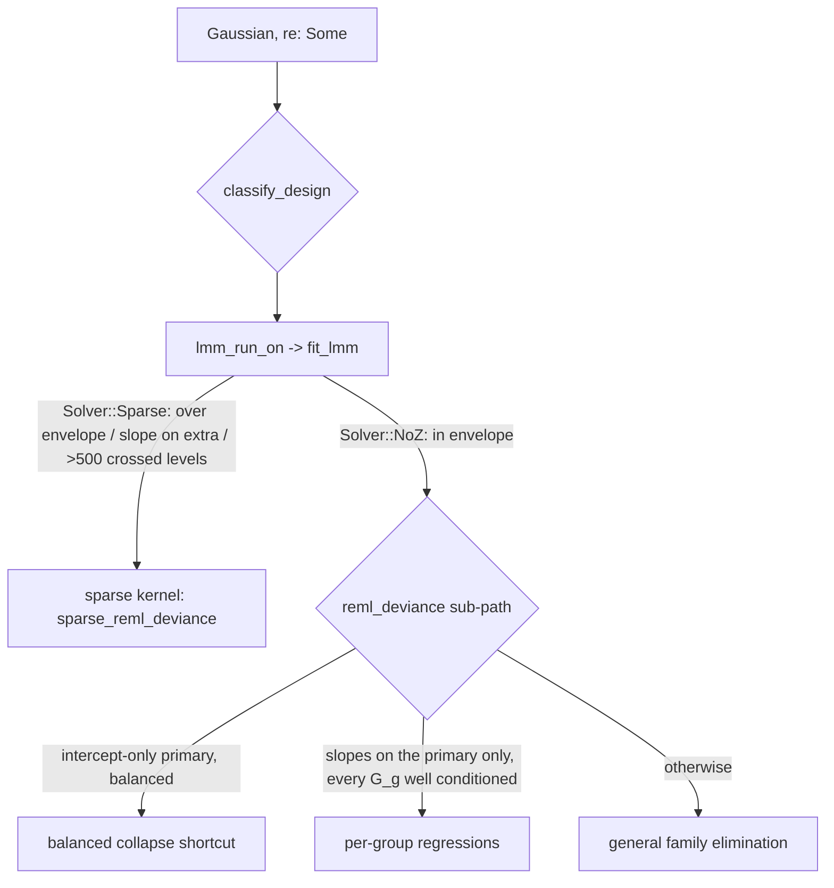

# LMM — Gaussian mixed models

This is the LMM page of the algorithm map — the path taken when
`ModelSpec.family == Family::Gaussian` and `re: Some(..)`. It documents only
what the code does. For the dispatch overview, the knob index, and the
OLS/GLM paths, start at [`algorithms.md`](algorithms.md); for the family table
see [`supported_families.md`](supported_families.md). The page ends with a
[comparison](#how-the-other-engines-fit-an-lmm) against lme4 and
MixedModels.jl.

An LMM here is a Gaussian response with one or more grouping factors, each
carrying an intercept and optionally random slopes. Estimation is **REML only**
(there is no ML switch on this path — `src/fit/lmm.rs` hardcodes
`reml: true`): every objective below is the profiled REML deviance, so the
validation rungs are all fit `reml = true`. The fixed effects β and the residual
scale σ² are profiled out analytically; the optimiser sees only the relative
covariance parameter θ.

## Notation

The recurring symbols on this page, defined once here before first use:

- **θ** — the relative covariance parameter; the vector the outer search
  optimises (BFGS on the per-group route, BOBYQA everywhere else; see
  `lmm_outer_optimizer`). It is the `vech` of Λ stacked across grouping factors.
- **Λ = Λ(θ)** — the lower-triangular *relative* Cholesky factor of a grouping
  factor's random-effect covariance; "relative" means scaled by the residual
  variance σ². Each factor's absolute covariance is `σ²·ΛΛ′`.
- **`vech`** — the column-major stacking of a lower triangle into a vector; the
  `q(q+1)/2` entries that make up θ per factor.
- **q_p / q_g** — the random-effect width of the primary grouping / of an extra
  grouping (1 for intercept-only, 2 for intercept+slope, and so on).
- **β, σ²** — the fixed-effect coefficients and the residual variance; both are
  profiled out analytically, leaving the objective a function of θ alone.
- **N, P** — the row count and the fixed-effect count; `N − P` is the raw-row
  residual degrees of freedom.
- **V** — the marginal covariance of the response. The deviance is read off an
  augmented Cholesky rather than by forming V.

## Dispatch within the LMM path

Three real routing decisions sit between `fit_cold`/`fit_warm` and a returned
`Fit`:

1. **Solver class** — `classify_design` (`src/fit/mod.rs`) returns
   `Solver::NoZ` (dense, bounded stack scratch) or `Solver::Sparse` (heap
   sparse-Z). A design routes to `Sparse` iff it is over the dense envelope
   (`extra_groupings.len() > MAX_EXTRA_GROUPINGS`, primary width
   `q_p > MAX_PRIMARY_Q`, or any extra grouping width `q_g > MAX_EXTRA_Q` — the
   caps in `src/consts.rs`), **or** any extra grouping carries a random slope,
   **or** the total `Crossed` level count exceeds `MAX_CROSSED_LEVELS` (500).
   Otherwise `NoZ`.
2. **Kernel** — every Gaussian design goes to `accumulate_lmm_rows` +
   `lmm_run_on` (`src/fit/lmm.rs`) → `fit_lmm` (`src/lmm/mod.rs`), which
   evaluates the profiled-REML objective through the dense sufficient
   statistics (`NoZ`) or the sparse-Z Gram/Schur workspace (`Sparse`,
   `src/sparse/mod.rs`). One seed, one θ search, one recovery block over both;
   the sparse kernel is a superset that reproduces the
   dense fit to machine precision on any in-envelope design (see
   [the sparse section](#the-sparse-kernel-two-level-schur-block-cholesky)
   for why that equivalence is structural, not approximate).
3. **Deviance sub-path** (inside `fit_lmm`'s `reml_deviance`, `src/lmm/kernel.rs`) —
   an intercept-only primary with a balanced level structure takes the
   closed-form collapse shortcut; random slopes on the primary grouping alone
   take the per-group regression route when every level's random-effect Gram
   is well conditioned; everything else takes the general
   family-by-family elimination. `reml_deviance` also has a
   `reml_deviance_blocked` branch for extra-grouping random slopes, but
   decision 1 sends every such design to `Sparse`, so from `fit_cold`/`fit_warm`
   that branch is unreachable; only in-crate tests call it.



The blocked sub-path (test-only from the public entry points, see decision 3)
is a different, more expensive factorization, not a
variant of the general one. The general path
eliminates family-by-family and never materialises a joint RE system; the
**blocked** path builds the full `k_total × k_total` block-diagonal Λ
(component-scattered for the primary, contiguous per-level for nested/crossed
extras), forms the raw RE Gram `G = ZᵀZ`, and takes **one dense Cholesky** of
`P = ΛᵀGΛ + I` augmented with `[X y]` — `O(k_total³)` per evaluation.

**Code**: `classify_design` (`src/fit/mod.rs`); `build_workspace`/`fit_on`
(`src/fit/core.rs`); `accumulate_lmm_rows`, `lmm_run_on` (`src/fit/lmm.rs`);
`fit_lmm` (`src/lmm/mod.rs`); `reml_deviance`, `reml_deviance_blocked`,
`precompute_balanced_collapse`, `precompute_group_regressions` (`src/lmm/kernel.rs`); `SparseLmmWorkspace`,
`sparse_reml_deviance` (`src/sparse/mod.rs`); caps in `src/consts.rs`.
**Convention**: the NoZ/Sparse split is a scratch-capacity boundary, not a model
limit — lme4 and MixedModels.jl fit any of these designs with one solver; `glmm`
picks the faster kernel per shape and both give the same REML fit.
**Validation**: Dyestuff (rung 1, single intercept), sleepstudy (rung 2,
intercept+slope), Penicillin (rung 3, crossed), Pastes (rung 4, nested) exercise
the NoZ kernel; sim_slope_extra (rung 7, a slope-carrying crossed extra) is the
landed Gaussian rung that routes to `Sparse`.

## Covariance parameterization (θ-Cholesky)

Each grouping factor's `q×q` random-effect covariance is written `σ²·Λ(θ)Λ(θ)′`,
where Λ is the lower-triangular **relative** Cholesky factor — relative to the
residual scale σ², exactly lme4's `Λ_θ` convention. The optimiser works on θ, the
column-major `vech` of the lower triangle of Λ: `q(q+1)/2` entries per factor,
packed `[primary, extras in declaration order]`. For an intercept-only factor
(`q = 1`) θ is a single scalar (the relative standard deviation); a `q = 2`
slope factor contributes three entries (two diagonal, one off-diagonal
covariance), and so on.

Diagonal `vech` entries are the relative variances — they carry a start of
`THETA0 = 1.0`. Off-diagonal entries are signed covariances — they start at
`0`. Every entry, diagonal included, is searched in the symmetric box
`[−THETA_HI, THETA_HI]` with `THETA_HI = 1e3`: `Σ = ΛΛ′` does not change when a
whole column of Λ is negated, so the deviance is even in each block column, and
a diagonal boxed at `≥ 0` would make the face `Λ_jj = 0` a place the search can
stop on from the wrong sign half (every in-box move raises the deviance there).
A diagonal that ends the search negative has its whole column negated at exit
(`fix_column_signs`, `src/lmm/mod.rs`; same Σ, same deviance), so the reported
Λ has non-negative diagonals. MixedModels.jl searches the same unbounded box;
lme4 keeps the diagonals at `≥ 0`.

After the fit, the absolute covariance is recovered per grouping factor by
`assemble_varcorr` (`src/fit/common.rs`): it walks the θ vector in
`[primary_q, extra_q…]` declaration order, unpacks each factor's Λ
(`primary_lambda`), and reports the `vech` of
`D[r][c] = σ̂²·Σ_{k ≤ min(r,c)} Λ[r][k]·Λ[c][k]` — i.e. `σ̂²·ΛΛ′` block by
block (`tau2 = θ²·σ̂²` in the scalar case).

**Code**: `LmmGroupings` (θ-layout: `n_theta`, `diagonal_theta`,
`blind_theta_and_bounds`), `primary_lambda`, constants `THETA0`/`THETA_HI`
(`src/lmm/mod.rs`); `assemble_varcorr` (`src/fit/common.rs`). **Convention**: lme4's
relative Cholesky factor `Λ_θ`; θ is σ-relative, so σ² factors cleanly out of
the objective. **Validation**: the covariance recovery is checked by the varcomp
std-dev gate (relative ~1e-3) on sleepstudy (a full `2×2` Λ with a correlation),
Penicillin, and Pastes.

## Random-effect design column scaling

The θ search is made independent of the units of the random-effect columns.
A random slope is a column of the fixed-effect design, and every route fits the
standardized design
([internal standardization](algorithms.md#internal-standardization-of-the-design)),
so the slope's block reads the same transformed column `x̃` the fixed effects
do. A continuous slope is centered and scaled. A 0/1 (or constant) slope
column, which the standardization would otherwise leave as it is, is scaled
without being centered, by `s = √(Σ wᵢxᵢ² / Σ wᵢ)`, its prior-weighted
root-mean-square about zero, so its zeros stay exact zeros. The implicit
intercept subcolumn is never scaled.

The scaling part is an exact model identity, not an approximation. Scaling a
block's design `Z` by `diag(1/sᵢ)` and the matching rows of its relative
Cholesky factor by `sᵢ` leaves `ZΛ`, and so the whole criterion, unchanged:

```
Z̃ = Z·diag(1/sᵢ)      Λ̃[i][j] = sᵢ·Λ[i][j]      Z̃Λ̃ = ZΛ
```

What changes is the coordinate BOBYQA searches: it minimises over `θ̃ = s·θ`, so
a slope whose column is in the thousands and an intercept no longer sit decades
apart in θ, and one global trust radius can resolve both. Without it a column of
sd ~10³ against an intercept of 1 puts the two fitting θ components four decades
apart, and the search freezes the intercept directions before the slope
direction becomes resolvable at all. The fixed-effect side of the same column
is mapped back by `B` (`βⱼ = β̃ⱼ/sⱼ`), and the LMM's REML deviance adds back
`2·ln sⱼ` for it as for every scaled column.

Everything derived from θ̂ is mapped back on the way out by the block's column
map `N`: for a slope that is only scaled, `varcorr` as
`D[i][j] = D̃[i][j]/(sᵢ·s_j)`, conditional modes as `b = b̃/sᵢ`, `tau2` by
the same row-wise division; a centered slope adds the shift onto the
intercept row. The GLMM `stddev_se` is the SE of each reported stddev
`√Σ_kk` (`Σ = N·Λ̃Λ̃ᵀ·Nᵀ`), by the delta method on θ̃ on every block. A caller's warm-start θ is in the
design's own units and is forward-mapped before the solve. `Fit` exposes no θ,
so nothing else needs the map; the loop tier's `FitView::theta` maps it back
for the warm-start carry.

The scale is a property of the data, not of the model shape, so it is
recomputed per draw with the rest of the column statistics, at the start of
`fit_on`.

**Code**: `ColumnScaling::with_re_slopes` / `compute` (`src/standardize.rs`);
the random-effect maps (`src/lmm/re_map.rs`); the back-maps in `varcorr_block` /
`assemble_ranef_sparse` / `assemble_ranef_dense` (`src/fit/common.rs`).
**Convention**: lme4 leaves the RE design alone and warns on badly scaled
predictors instead (`checkScaleX`); `glmm` scales internally and reports the
fit in the caller's units.

## Fixed-effect orthogonalization

Both kernels work from Gram matrices of the fixed-effect design (`X'X`, `Z'X`),
and a Gram squares the condition number of `X`. On a nearly collinear `X` that
costs about half the digits of `log|X'V⁻¹X|`, of the RSS and of β̂. So before
any row is accumulated, each fit orthogonalizes its design once. That design is
the standardized `X`
([internal standardization](algorithms.md#internal-standardization-of-the-design)),
written `X` in the rest of this section:

```
√W·X = Q·R          (QR, Givens rotations one row at a time)
U = D⁻¹·R           (D = diag(R); U unit upper triangular)
X̃ = X·U⁻¹           (columns orthogonal in the W metric)
```

The kernels then accumulate `[X̃ y]` wherever they accumulated `[X y]`:
`c`, `s`, the sparse kernel's `Z'[X y]` and `[X y]'[X y]`. The substitution
`X = X̃·U` is an exact reparametrization, and `det U = 1`, so the REML criterion
needs no correction term. The augmented factor maps back after the fit:

```
L_XX = Uᵀ·L̃_XX      (y row unchanged)
β̂ = U⁻¹·β̃
```

so β̂, `Var(β̂)`, the joint Wald statistic and the ill-conditioning pivot are all
read off the `[X y]` factor as before. The conditional modes are recovered on
`X̃` with `β̃`, since that is what the Grams hold. Random-slope covariates are
Z entries, not fixed effects, so they are always read from `X` (standardized,
not orthogonalized); the dense accumulator keeps an `X` twin of `s` (`s_raw`)
for the slope-covariate Gram entries it reads.

Why `U` and not `R`: with `R` the intercept column becomes `1/√N`, and its Gram
entry `Σ 1/N` carries a rounding error of order `N·ε` that the fitted mean then
multiplies into the RSS (on InstEval, `N = 73421`, that is 3e-7 on the
deviance). With `U` a leading intercept column stays exactly 1 and the large-`N`
error matches the raw-`X` Gram (8e-9 there, against a long-double reference).

The dense kernel reaches `U` in one of two ways. It accumulates its rows once
on the unorthogonalized `X` and takes the Cholesky factor of the accumulated
`X'WX`, which in exact arithmetic is the QR's `R` (`X'WX = RᵀQᵀQR = RᵀR`).
When every pivot ratio `R_jj²/(X'WX)_jj`, the share of column j's weighted
squared length that the earlier columns do not explain, is at least
`GRAM_PIVOT_MIN` = 1e-3, it keeps that `U` and maps what it accumulated:
`X̃'X̃ = D²` exactly, `X̃'y = U⁻ᵀX'y`, each `s` column's `x` part `U⁻ᵀ·Σx`.
The Gram squares the condition number of `X`, so a pivot at ratio `τ` carries
the Gram's round-off amplified by about `1/τ`: three digits at the threshold.
Under it the kernel runs the Givens pass and accumulates again through it, so a
collinear design gets exactly the `U` of the QR. The sparse kernel always runs
the Givens pass first and then scatters its rows once through it. A
well-conditioned design thus costs no extra pass over the rows, and the step
costs no copy of `X`. It is always on. When `R` has a zero or non-finite
diagonal (an all-zero weighted column, fewer rows than columns) `U` stays the
identity and the kernels see the standardized `X` unorthogonalized. On
`fit_cold` / `fit_warm` the pre-dispatch alias gate (`detect_aliased`) drops
exactly redundant columns first. On the loop tier they reach the kernel: their
pivot ratio is at round-off level, so they take the Givens pass.

**Code**: `DesignQr` (`set_from_rows`, `solve_row`, `map_factor`, `map_beta`),
`LmmSuffStats::set_design_qr` / `add_rows_multi`,
`LmmSuffStats::orthogonalize_from_gram`, `GRAM_PIVOT_MIN` (`src/lmm/kernel.rs`);
`accumulate_lmm_rows` (`src/fit/lmm.rs`); `SparseLmmWorkspace::new`
(`src/sparse/mod.rs`); the back-map in `fit_lmm` (`src/lmm/mod.rs`).
**Convention**: lme4 and MixedModels.jl factor crossproducts of the raw `X`
(lme4's `RX` comes from `X'X`). On `sim_entangled_pair_lmm` the reported REML
criteria of lme4 and glmmTMB are off the 60-digit value by −1.4e-4 and
−6.0e-4; glmm's is off by 2e-10. **Validation**: `lmm_entangled_pair_reml_is_exact_and_invariant`
(`src/fit/lmm_tests.rs`) fits the `sim_entangled_pair_lmm` design (`t` and `v`
collinear to 3e-6) and pins its REML criterion to the 60-digit value in
`validation/grid/dev_ref.json` and β_t to its 60-digit value.

## Profiled REML objective

Given θ, β̂ and σ̂² are their closed-form REML solutions, so the objective is a
function of θ alone:

```
dev(θ) = log|V| + log|X'V⁻¹X| + (N − P)·log(σ̂²)
```

read directly off an augmented Cholesky rather than by forming the `N×N` marginal
covariance V. The kernel factors Ω_θ over the stacked
`[primary | nested children | crossed | X̃ y]` system (`X̃` is the
orthogonalized design of
[the section above](#fixed-effect-orthogonalization); `log|X̃'V⁻¹X̃| =
log|X'V⁻¹X|` because `det U = 1`): `log|V|` comes from the
random-effect pivots (family blocks plus the crossed-tail diagonal),
`log|X'V⁻¹X|` from the trailing fixed-effect factor `L_XX`, and `(N − P)·log σ̂²`
from the residual entry `L[p,p]²` — no per-evaluation β backsolve. `N − P` is
the raw-row residual degrees of freedom.

The design the kernel fits is the standardized one, and
`log|X̃'V⁻¹X̃| = log|X'V⁻¹X| − 2·Σⱼ ln sⱼ` against the caller's `X` (a shift has
determinant 1). The criterion is reported for the caller's design:
`lmm_view_to_fit` adds `2·Σⱼ ln sⱼ` to the deviance and the loglik
([internal standardization](algorithms.md#internal-standardization-of-the-design)).

**Prior weights.** With `FitOptions::weights`, the sufficient-statistics
accumulator (`LmmSuffStats::add_rows_multi`, `src/lmm/kernel.rs`) folds `√wᵢ` into
every accumulated quantity exactly once per side, so every Gram product carries
`wᵢ` — but the level counts and df stay raw-row (`n − p`). The θ search runs
on `ŵᵢ = wᵢ/s` (`accumulate_lmm_rows`), where `s = family::weight_scale(w)` is
the power of two nearest the geometric mean of the weights and exactly `1`
when unweighted. This keeps θ's internal box (`PIN_THETA`, `THETA_HI`)
meaningful whatever the raw scale of `w`. Only σ̂² moves with that scale, so
`lmm_view_to_fit` reports `σ̂²·s`; β̂, the SEs, τ² and varcorr need no
correction, since the factors of `s` in the internal θ̂ and σ̂² cancel. The weighted
Gaussian deviance needs one further θ-independent term, `−Σ log wᵢ`; because it
does not move the optimum, `lmm_view_to_fit` (`src/fit/lmm.rs`) applies it to
the deviance (and recomputes the loglik) *after* optimization rather than paying
it per evaluation. It sits in the `Fit` assembly, the one site every caller
reaches, so no caller applies it a second time.

**Offset.** A `FitOptions::offset` is an exact response shift under the
identity link: the core's `Lmm` arm accumulates `y − o` and nothing
downstream needs to know (same convention as the OLS path).

The objective returns `f64::INFINITY` on any Cholesky failure or non-positive σ̂²
(every kernel — dense, blocked and sparse — also on a residual r² ≤ dim·ε·yᵀy,
an exact fit whose last pivot is round-off of either sign) — that value is the deviance failure surface BOBYQA is driven over.

**Code**: `reml_deviance`, `reml_deviance_blocked`, `LmmSuffStats::add_rows_multi`
(`src/lmm/kernel.rs`); `accumulate_lmm_rows` (`src/fit/lmm.rs`); `sparse_reml_deviance`
(`src/sparse/mod.rs`).
**Convention**: lme4's profiled REML `devfun` — β and σ² profiled out, optimiser
on θ. **Validation**: the loglik gate is near-exact for LMM rungs (absolute
`2e-6` on the shared scale, `loglik_abs_lmm` in `validation/grid/tol.R`; ~1e-9 observed) across Dyestuff, sleepstudy,
Penicillin, Pastes; sim_slope_extra pins the sparse objective against the same
references.

## Closed-form single-intercept shortcut

The shortcut fires when the primary grouping is intercept-only (`q_p = 1`) and
its level structure is **balanced** — equal per-level row counts over an active
prefix. In that case the family-by-family loop collapses to closed-form
arithmetic. `precompute_balanced_collapse` runs once per fit: it scans the
per-level counts for an equal-count active prefix starting at family 0, and
additionally requires the *nested-child* counts to match one common template
across the active families and to be exactly zero outside it — any hole in the
prefix silently disarms the collapse (`collapse_n_active = 0`) rather than
producing a wrong answer. The collapse is a reassociation of the same
criterion, not a different one, so it moves the deviance only in its last
ulps. No analytic gradient reads it: the shortcut needs an intercept-only
primary, and the per-group gradient route needs slopes, so a collapsed fit
always searches θ with BOBYQA. The value finite differences of the
[Satterthwaite pass](#satterthwaite-degrees-of-freedom) do evaluate on it, at
every stencil point: the arming depends only on the level counts, so a pass
runs on one route from its first point to its last. When armed,
it accumulates the θ-independent
cross-Grams `G_rr′` once; each θ-evaluation then replaces the per-family loop
with three cheap pieces: a single Crout of the common block `A(θ)`, an
`n_active·log|L|` term for the family log-determinant, and one θ-independent
Gram combine for the tail downdate. This reduces to the per-cluster
shrink-downdate arithmetic up to floating-point re-association, so the `q = 1`
corpus reproduces on this machine. Unbalanced counts, or any slope on the
primary, fall back to the loop.

## Random slopes on the primary alone: per-group regressions

With random slopes on the primary grouping (`q_p ≥ 2`) and no other grouping,
each level `g` is its own small regression. Write `G = ZᵀZ` for its `q×q`
random-effect Gram, `C = Zᵀ[X̃ y]` and `D = ΛΛᵀ`. When `G` is invertible, the
Woodbury identity (Henderson & Searle 1981) rewrites the level's contribution
with `K = D + G⁻¹` and `A = G⁻¹C`:

```text
log|I + ZDZᵀ|                     = log|G| + log|K|
[X̃ y]ᵀ(I + ZDZᵀ)⁻¹[X̃ y]           = ([X̃ y]ᵀ[X̃ y] − CᵀG⁻¹C) + AᵀK⁻¹A
```

valid for every positive-semidefinite `D`, zero and rank-deficient included.
The first bracket is the within-level residual cross-product, free of θ;
summed over levels it is `P₀`. `precompute_group_regressions` runs once per fit
and stores `B_g = G_g⁻¹`, `A_g`, `P₀` and `Σ log|G_g|`. Each θ-evaluation then
forms `D` once, and per level only `K_g = D + B_g`, its Cholesky `L_g` and
`M_g = L_g⁻¹A_g`; the tail is `P₀ + Σ_g M_gᵀM_g` (one stacked GEMM), which the
shared tail Cholesky reads exactly as it reads the family loop's tail. The loop
instead assembles `I + ΛᵀG_gΛ` and `ΛᵀC_g` per level and subtracts `ΣB_fᵀB_f`
from `[X̃ y]ᵀ[X̃ y]`; the route skips both assemblies and adds positive-semidefinite
terms, so at large θ it does not cancel where the loop does. Nothing requires
the random-effect columns to span the fixed ones. When a fixed column does lie
in every level's span, its row and column of `P₀` are zero in exact arithmetic,
and the precompute sets them to exactly zero (residual share at most `1e-11`).

The route is armed only when every non-empty level's `G_g` passes the
pivot-ratio test of the fixed-effect Gram route (`GRAM_PIVOT_MIN`); a level
with fewer rows than `q_p`, or a slope constant within a level, keeps the loop.
Weighted fits take it unchanged: the sufficient statistics are already
`√w`-scaled. The conditional-mode recovery still rebuilds the loop's per-level
factors at θ̂, so it is shared with the loop.

**Code**: `precompute_group_regressions`, `group_regression_tail`,
`reml_deviance` (`src/lmm/kernel.rs`). **Validation**:
`slope_deviance_matches_brute_force` and `multislope_deviance_matches_brute_force`
check both eliminations against the dense observation-space deviance at fixed
θ, including `D = 0`, rank-one `D` and θ at `THETA_HI`.

## Gradient search on the per-group route (BFGS)

Where the per-group regression route is armed for the dataset (random slopes
on the primary grouping only, so `n_θ ≥ 3`, and every level's `G_g` passes the
pivot test), `fit_lmm` searches θ with a projected BFGS on the analytic
gradient instead of BOBYQA. Every other LMM shape searches with BOBYQA as
before. The rule is a function of the shape and the data's level Grams, not of
the start, so cold and warm fits route alike (`lmm_outer_optimizer`).

**Gradient.** With `K_g = L_gL_gᵀ`, `M_g = L_g⁻¹A_g` (the value pass's `bt`
block), `L_xx` the leading block of the tail factor, `N_g = M_{g,x}L_xx⁻ᵀ`,
`m_g = M_g e` with `e = [−β̂; 1]`, `r² = l_yy²` and `ν = n − p`:

```text
∂f/∂D = Σ_g L_g⁻ᵀ (I − N_g N_gᵀ − (ν/r²) m_g m_gᵀ) L_g⁻¹,    ∂f/∂Λ = 2 (∂f/∂D) Λ
```

read off the lower triangle in vech order. It is taken from the state the
last value evaluation left (`L_g` kept in `pg_l`, `bt`, the tail factor): one
stacked triangular solve for every `N_g`, in blocks of `PG_GRAD_BLOCK = 512`
groups so its scratch does not grow with the group count, plus a per-group
kernel monomorphized over `q = 1..8`. A value plus its gradient costs 1.35 to
2.0 values (`q = 2` to `q = 8`, measured 2026-10-07).

**Search.** The shared optimizer layer (`src/optim/`) runs it: Armijo
backtracking (`c = 1e-4`, halving, at most 30 trials) on value-only
evaluations, the gradient once per accepted point; coordinates held on a bound
the gradient pushes against; Shanno scaling at the first update; the first
step after a (re)start capped at 0.5 in max norm. Stops: projected gradient
below `1e-6`; an accepted decrease below `max(fdelta_abs = 1e-9,
16·ε·|f|)` after the second iteration (absolute, because the deviance is O(n)
and a relative stop grows with it); a line search whose every trial's
predicted decrease is below that floor with the decrement below `1e-8` (the
noise floor, where a warm start at the optimum stops after one value and one
gradient).

**Certificate and fallback.** A BFGS endpoint is accepted when it stopped on a
convergence test, its decrement `½·gᵀHg ≤ 1e-8` (deviance units), and no
diagonal θ ended below `1e-3` in absolute value (near a variance collapse the
decrement can understate the remaining gain). Otherwise BOBYQA runs from the
endpoint at `RHO_BEGIN_WARM`: as a polish when BFGS had converged, and as a
fallback (`Note::GradientSearchFallback`) after a failed line search, an
unavailable gradient or the iteration cap. The status and `converged` are the
finishing optimizer's; `n_eval` counts the value evaluations of both (the
gradients reuse them and are not counted). The pin, canonicalization and
recovery below run unchanged on the endpoint.

**Curvature hint** (`loop_advanced`). `curvature_hint` takes the inverse of a
forward-difference Hessian of the gradient at a pilot fit's θ̂, and
`fit_on_hinted` starts each later draw's BFGS from it instead of the identity.
The fit only reads it, so a loop's results depend on (data, start, hint) and
not on the order of the calls.

**Code**: `search_theta`, `lmm_outer_optimizer`, `LmmObjective`,
`lmm_curvature_hint` (`src/lmm/mod.rs`); `pg_gradient` (`src/lmm/pg_grad.rs`);
`bfgs_minimize`, `BfgsConfig::LMM`, `CurvatureHint` (`src/optim/`).
**Convention**: lme4 and MixedModels.jl search every LMM with a
derivative-free optimizer (BOBYQA / NLopt); glmmTMB uses `nlminb` on an
AD gradient. **Validation**: `pg_gradient_matches_finite_differences` (q = 2,
3, 4, 8; near-singular, rank-one, small and large θ; weighted; across solve
blocks), the `optim` unit tests (contract, certificate, state reuse, hints),
and the grid and stress cells of the route, where every endpoint is equal or
better than BOBYQA's within `dev_eps`.

## General path: BOBYQA over θ

For everything the shortcut and the gradient route do not cover (unbalanced
designs, slope primaries the per-group route refuses, crossed and nested
extras), and as the gradient route's polish and fallback, `fit_lmm` minimises
`reml_deviance` over the box-bounded θ with **BOBYQA** (Powell 2009), a derivative-free trust-region method over an
interpolation set. `Bobyqa::new` is the only allocation site; `minimize` is
zero-alloc on the warm path.

The schedule set by `LmmWorkspace::for_cluster_spec_ext` (the shipped `fit_cold`
route) is:

| Parameter | Value | Source |
|---|---|---|
| `rho_begin` (initial trust radius) | `RHO_BEGIN = 0.5` from the blind start; `RHO_BEGIN_WARM = 0.1` from a caller's θ₀, on a second solver built at the first warm fit | `for_cluster_spec_ext`, `fit_lmm` |
| `rho_end` (final trust radius) | `RHO_END = 1e-6` | `src/lmm/mod.rs` |
| `npt` (interpolation points) | `2·n_θ + 1` for `n_θ < 3`, else `⌈3·n_θ/2⌉ + 1` (`(3·n_θ).div_ceil(2) + 1`) | `for_cluster_spec_ext` |
| `max_fun` | `1000·n_θ` (twice PRIMA's default; with the restart trigger at 1/8 of the remaining budget, the first cycle restarts at 750 evaluations for n_θ = 6) | `apply_campaign_overrides` |
| `prima_parity` | `false`: Powell's RESCUE factor `0.5` on a fully determined model (every n_θ = 1 search), where PRIMA's test is decided by rounding; every other `npt` runs PRIMA's path bit for bit | `apply_campaign_overrides` |

The blind start's radius is 0.5 and a warm start's 0.1: a search from far
needs a wide first model, one from near the optimum spends evaluations on it.
Measured on aarch64 against 0.1 everywhere, 0.5 takes 0.78 to 0.95 of the
evaluations per n_θ band on a stratified sample of the Gaussian grid cells and
0.66 to 0.88 on the widest cells, at the same optimum; from a warm start, 0.1
is the best of 0.03 to 0.2. PRIMA nudges any start that lands within `rho_begin` of a bound, and
the box is `2·THETA_HI` wide on every coordinate, so no start is near one. `RHO_END = 1e-6` was measured equivalent to
`1e-8` on every validation check under the crate's absolute floors, at ~25% fewer
evals. (The neighbouring constant `GLMM_RHO_END` in the same file is the GLMM
outer loop's own, separately-swept schedule — it never applies here.)

The `npt` mid-size (`⌈1.5n⌉+1`, used from `n ≥ 3`) beats Powell's `2n+1` on every
measured dimension ≥ 3; below that it *is* `2n+1`. PRIMA requires
`n+2 ≤ npt ≤ (n+1)(n+2)/2`, which the formula respects.

One alternate seed exists alongside the shipped schedule: `bobyqa_config`
(tests only), `RHO_BEGIN` with PRIMA's default `npt = 2n+1`.

The dev-only env campaign hooks are no-ops unless set, and are not part of the
shipped behaviour. `LMM_NPT_FORMULA` and `LMM_MAX_FUN_FORMULA` override single
numeric knobs.

**Code**: `fit_lmm`, `LmmWorkspace::for_cluster_spec_ext`,
`bobyqa_config`, constants `RHO_BEGIN`/`RHO_BEGIN_WARM`/`RHO_END`/`THETA0`
(`src/lmm/mod.rs`); the external `bobyqa` crate supplies the solver.
**Convention**: derivative-free BOBYQA over relative-Cholesky θ, as in lme4's
default `nloptwrap`/`bobyqa` optimiser for `lmer`. **Validation**: sleepstudy
(`n_θ = 3`, correlated slope), Penicillin (crossed), Pastes (nested) drive the
general elimination; sim_slope_extra drives the sparse variant. The tuning
constants were swept against the validation corpus (the 49 rungs of
`validation/manifest.json` and the accuracy grid in `validation/grid/`).

## Boundary handling (PIN_THETA)

A singular fit — a variance component collapsing to zero — presents as a diagonal
θ entry driven to zero. After BOBYQA converges, `fit_lmm` first negates every
block column whose diagonal ended negative (`fix_column_signs`; the box lets a
diagonal cross zero — see
[Covariance parameterization](#covariance-parameterization-θ-cholesky) — and
Σ is unchanged by the negation), then applies a
deterministic per-component pin: every **diagonal** variance component `≤
PIN_THETA (1e-4)` is set to exactly `0.0`, the fit is still counted as converged,
and the component's bit is recorded in `pinned_components`. Off-diagonal
covariances are never pinned — a correlation running to `±1` shows up as the
*diagonal* `λ_dd → 0` under the Cholesky parameterization, so pinning the
diagonal is the complete policy. `PIN_THETA = 1e-4` is kept at the value the
scalar q=1 Brent kernel used for its τ̂≈0 detection threshold. The test is on the **internal**
(scaled) θ — see
[Random-effect design column scaling](#random-effect-design-column-scaling) — so
its verdict does not change when a random-slope covariate is re-expressed in
different units. lme4 applies the same 1e-4 to θ in the caller's units, so on a
badly scaled design the two can flag different terms. The `Fit::diagnostics.singular` flag is set when any
component was pinned (`boundary_hit == 1`) **or** by the post-hoc
`has_negligible_component()` check at `Fit` assembly (`src/fit/mod.rs`,
`SINGULAR_REL_TOL = 1e-3`): any RE standard deviation `≤ 1e-3 ×` the largest —
a relative check that catches scale-degenerate fits the absolute θ pin misses.
It compares the **internal** standard deviations for the same reason the pin
does: an intercept's standard deviation is in response units and a slope's is in
response per covariate unit, so their raw ratio moves with the covariate's
units, while the internal one does not.
The sparse path applies the identical pin, and the GLMM path mirrors the whole
policy after its stage-2 BOBYQA
([`algorithms-glmm.md` §Boundary handling](algorithms-glmm.md#boundary-handling-and-the-singular-flag)
— change together).

### Canonical Λ after the pin

On a `q ≥ 2` block, a pinned diagonal `λ_jj = 0` leaves the entries *below* it in
column `j` unidentified: rotating that column changes θ but not `Σ = ΛΛ′`, so it
changes neither the deviance nor β̂, `varcorr` or `ranef`, and BOBYQA can stop
anywhere on that flat circle. So the pin loop is followed by
`canonicalize_pinned_blocks` (`src/lmm/mod.rs`), which rebuilds `Σ` from each
pinned block's Λ and re-factors it with a semidefinite-tolerant lower Cholesky —
a pivot at or below `q·ε·tr Σ` zeroes that whole column. The variance that was
sitting below a pinned diagonal folds into the trailing diagonals, where it is a
component the caller can read, and the pin test then runs again on the new
diagonals. Because Σ is preserved, the reported answer does not move; what
changes is θ itself (and `tau2`, which is per-θ). A block with no pinned diagonal
is skipped untouched, so a non-singular fit is bit-identical.

`Diagnostics::pinned` depends on this canonical form: a zero θ diagonal now has
an exactly zero column, so it marks a rank-deficient direction of Σ̂ (zero
variance conditional on the earlier components of the block), which on a
non-canonical Λ it need not. It is not in general a zero standard deviation: at
a correlation boundary (`|ρ| = 1`) the trailing diagonal pins while that
component's own variance, the rest of its Λ row, stays positive. The GLMM
path runs the same step, except on its AGQ route, where only the pin flags use
the canonical form ([`algorithms-glmm.md`](algorithms-glmm.md) has the reason).
`canonicalize_pinned_blocks` itself skips a block
whose `q` is past `MAX_PRIMARY_Q` (`src/lmm/mod.rs`), which only the sparse
route ever builds, so on that route a pinned diagonal can sit above a live
off-diagonal after all.

A truth-seeded warm start is clamped to `THETA_TRUTH_FLOOR = 0.01` first, so a
near-zero true θ never begins the search on the boundary itself.

Distinct from a pin, the failure/cap-out outcomes (`boundary_hit == 2`) split
into two cases — the **plateau policy**, pinned by
`maxfun_cap_reports_honest_endpoint` (`src/lmm/tests.rs`):

- A `MaxFunReached` cap-out runs the full β̂/σ̂²/SE recovery and returns **real
  finite numbers** with `converged: false` — the best point found is reported
  rather than discarded, with no rank check on its factor. (When BOBYQA hits
  `max_fun` on a flat deviance plateau, that point is usually close to the
  optimum.)
- `ModelDegenerate` (no accepted endpoint), or a non-finite deviance at the
  endpoint, yields the NaN-filled, non-converged fit. The endpoint's factor
  carries no rank guard: `fit_lmm` fits a near-singular but
  finite endpoint instead of refusing it.

Both kernels run the same pin loop and plateau policy — it is one copy, in
`fit_lmm`.

**Code**: the pin loop and endpoint recovery in `fit_lmm`, constants
`PIN_THETA`/`THETA_TRUTH_FLOOR` (`src/lmm/mod.rs`). **Convention**:
lme4 reports such fits as `isSingular`; `glmm` pins to exactly `0` (FP-stable
across platforms) and still returns the fit. **Validation**: Dyestuff sits near
the interior; the boundary behaviour is pinned by in-crate τ̂≈0 tests
(`src/lmm/tests.rs`) that assert `boundary_hit == 1` and `θ̂ == 0.0`, the plateau
policy by `maxfun_cap_reports_honest_endpoint`, and the singular-fit handling
by the reference engines flagging the same data.

## The sparse kernel: two-level Schur-block Cholesky

`fit_lmm`'s sparse kernel (`src/sparse/mod.rs`) minimises the same objective
but factorises a differently-shaped system, in an elimination order chosen for
sparse Z. Per θ-evaluation, `sparse_schur_factor` runs:

1. **Family blocks** — a per-family `w×w` Crout for `L11`, whose pivots
   accumulate `log|L_ZZ|²`;
2. **Coupling** — per-family `e×w` triangular solves for `L21`;
3. **Schur tail** — the downdate `S22 = A22 − L21·L21ᵀ`, then an LLT of `S22`
   that is itself dense-or-sparse: past the `TAIL_SPARSE_MIN` threshold it
   switches to fill-reducing compact panels and faer's AMD sparse LLT — the
   same analyze-once/factorize-per-eval split CHOLMOD gives lme4;
4. **Fixed tail** — a forward-solve-only `U = L⁻¹B` (never backsolved — the
   deviance and recovery need only `BᵀA⁻¹B = UᵀU`), and a final Crout of
   `S = C_xy − UᵀU` into the augmented `[X y]` factor.

The dense-equivalence claim from the dispatch section is structural: at the
same θ both kernels factor the same SPD system, and by
Cholesky uniqueness the sparse factor equals the dense path's augmented factor
— so the two fits agree to machine precision wherever both apply, and the
sparse kernel can serve as the superset solver without a separate tolerance.
The sparse kernel's caller is `fit_lmm` through
`LmmKernel::Sparse`, built by `accumulate_lmm_rows` and refilled in place when
a call brings the same rows (`same_rows`). The search
around them is one copy: the seed, the BOBYQA schedule, the pin loop, β̂ and
`Var(β̂)` off the factor, and the joint Wald statistic are `fit_lmm`'s,
whichever kernel evaluates the objective. The ill-conditioning policy is one
copy too: `min_pivot_ratio` measured off whichever factor the kernel left is
flagged `IllConditioned` below `lmm::PIVOT_MIN`, never refused. The one thing
the sparse kernel does not carry is the per-group analytic gradient
(`pg_gradient` reads dense-kernel state), so a sparse fit always searches θ
with BOBYQA.

**Code**: `sparse_reml_deviance`, `sparse_schur_factor`,
`schur_phase_b`, `TAIL_SPARSE_MIN` (`src/sparse/mod.rs`). **Validation**:
sim_slope_extra (rung 7) externally; the dense-vs-sparse deviance equivalence
by in-crate cross-checks.

## Standard errors

The LMM standard error is the profiled REML SE — one method, not the
Hessian/Rx split that the GLMM path carries (`Fit.stddev_se` is empty for an LMM,
and `FitOptions::wald_se` is ignored here). At θ̂, `Var(β̂_j) = σ̂²·‖L_XX⁻¹ e_j‖²`
from a forward solve against the fixed-effect Cholesky factor, and the squared
Wald statistic is `t² = β̂_j² / Var(β̂_j)`. `L_XX` here is the factor already
mapped back to `X` (`Uᵀ·L̃_XX`, see
[Fixed-effect orthogonalization](#fixed-effect-orthogonalization)). SEs are computed only for the columns in
`FitOptions::target_indices`. A joint Wald χ² over the target set is available via
the shared `joint_wald_chi_sq` helper, `W = ‖R⁻ᵀβ̂_T‖²/σ̂²` from a QR `C_T = Q·R` of
the same forward-solve columns `C_T = [L_XX⁻¹bₜ]`, so no Gram is formed.

**Code**: the recovery block in `fit_lmm`, `joint_wald_chi_sq`
(`src/lmm/mod.rs`). **Convention**:
lme4's profiled fixed-effect covariance `σ̂²·(X'V⁻¹X)⁻¹`; all engines compute
the LMM SE identically. **Validation**: the LMM `se` gate is tight (~1e-3)
across Dyestuff, sleepstudy, Penicillin, Pastes; on the grid lme4, glmmTMB
and MixedModels.jl all report it. The t test on this SE takes its degrees of
freedom from the next section.

## Satterthwaite degrees of freedom

The t test of a fixed-effect contrast `lᵀβ` uses lmerTest's Satterthwaite
degrees of freedom (Satterthwaite 1946; Giesbrecht & Burns 1985; Fai &
Cornelius 1996; Kuznetsova et al. 2017), computed by one derivative pass at θ̂
after the fit, with no refit. The pass fills `Fit::coef_df` (the df of each
unit contrast `e_j`, the `df` column of the summaries) and leaves a private
state that `Fit::contrast_t` (one contrast) and `Fit::contrast_f` (a contrast
matrix) read. It runs by default on the stable path (`fit_cold`, `fit_warm`)
while the fit's workspace still lives; `FitOptions::satterthwaite = false`
skips it. On the loop tier it runs only when called:
`loop_advanced::satterthwaite(&mut ws, &mut df_out)` after `fit_on` or
`fit_on_hinted`, with the view dropped; its buffers live on the workspace, so
a call after the first allocates only the pseudo-inverse's blocks.

**The identity.** lmerTest differentiates the REML deviance in `(θ, σ)` with
σ not profiled: for `v = lᵀCl`, `C = Var(β̂)`, it takes `g_k = lᵀ(∂C/∂φ_k)l`
over the variance parameters `φ = (θ, σ)`, `A = 2H⁻¹` from the Hessian `H` of
that deviance, and `df = 2v²/(gᵀAg)`. The crate minimizes the deviance with
`τ = σ²` profiled out, `d_p(θ)` (see
[Profiled REML objective](#profiled-reml-objective)), and the two are related
exactly. `τ̂(θ)` is the exact minimizer at every θ, so the Schur complement of
the τ block of `H` is the profiled Hessian `H_p = ∇²d_p`, and τ's own term
has a closed form (`g_τ = v/τ̂` and `H_ττ = ν/τ̂²` at τ̂). Together:

```text
df = v² / ( g_pᵀ H_p⁺ g_p + v²/ν ),     g_p = ∇_θ (lᵀ C_p(θ) l)
```

with `C_p(θ) = σ̂²(θ)·(X′V⁻¹X)⁻¹` the profiled covariance the fit reports and
`ν` the divisor of `σ̂²`: `N − P` on the REML criterion, `P` the retained
(non-aliased) columns. So the pass differentiates only the profiled deviance
the search minimized, and needs no derivative coordinate for σ. `1/df` is
`g_pᵀH_p⁺g_p/v² + 1/ν`, so `0 < df ≤ ν` whenever `H_p⁺` is positive
semidefinite; a fit with no free variance parameter gets `ν` exactly (the
code returns it directly), and every other df is capped at `ν`, which the
division does not always round back to. The state stores the equivalent
lmerTest form over `(θ_free, τ)`: `A_eff = 2·blockdiag(H_p⁺, τ̂²/ν)` and
`Jac_eff = [∂C_p/∂θ_k …, C/τ̂]`, so lmerTest's `contest1D`, `contestMD` and
`get_Fstat_ddf` port line for line with `A_eff` and `Jac_eff` in place of its
`vcov_varpar` and `Jac_list`. Every `p × p` matrix in the state is in the
caller's column order, with the standardization and the fixed-effect
orthogonalization mapped out.

**Two derivative routes.** Both run on the kernel's θ̃ (the relative Cholesky
factor on the standardized design, see
[Random-effect design column scaling](#random-effect-design-column-scaling)),
a fixed smooth reparameterization of the caller's θ; at a stationary θ̂ the
quantity `gᵀH⁻¹g` does not depend on it. Each coordinate's step is
`h_k = η·max(|θ̃_k|, 1)`, one η per route because θ̃ is unit-free.

- **Value route** (every kernel and every shape; the reference). `H_p` comes
  from central finite differences of the same `f64` profiled deviance the
  search minimized (`LmmKernel::deviance`), and `∂C_p/∂θ_k` from central
  differences of `C_p` at the axis points. The stencil is the axis pairs
  `θ̃ ± h_k e_k` plus, for each pair of coordinates, the two points
  `θ̃ ± (h_i e_i + h_j e_j)` (numDeriv's `genD` pairing without its Richardson
  ladder): `n² + n + 1` deviances for `n` free coordinates, `θ̂` included,
  re-evaluated at the start so the pass never depends on what an earlier call
  left in the kernel. The step factor is `ETA = 3e-4`, pinned by a step sweep
  over which the df stay flat.
- **Gradient route** (where the per-group gradient is armed for the fit: the
  dense kernel on the
  [per-group regression route](#random-slopes-on-the-primary-alone-per-group-regressions),
  the shapes the search runs BFGS on). Column `k` of `H_p` is
  `(∇d_p(θ̃ + h_k e_k) − ∇d_p(θ̃ − h_k e_k))/(2h_k)` on the free coordinates,
  symmetrized, from the analytic gradient of
  [Gradient search on the per-group route](#gradient-search-on-the-per-group-route-bfgs)
  (`pg_gradient`). Each axis point is one deviance, which leaves the factor
  and `σ̂²` the gradient reads, and one gradient, so `∂C_p/∂θ_k` comes from the
  same points: `2n + 1` evaluations and no mixed points. Its step factor is
  its own, `ETA_GRAD`, set by the gradient route's step sweep. A non-finite
  deviance or an unavailable gradient at any axis point sends the whole pass
  to the value route.

The route is chosen per fit, from the kernel's arming for that dataset, so
loop draws of one shape can take different routes. On the dense kernel the
balanced collapse and the per-group route stay armed after the fit, so every
stencil point evaluates on the route the search used.

**What each point evaluates.** `C_p` at a point is
`C̃ = σ̂²(L̃_XX L̃_XXᵀ)⁻¹`, formed from the augmented factor and `σ̂²` the
kernel's evaluation left, in the kernel's coordinates, and mapped once to the
caller's columns (`C = M·C̃·Mᵀ`, `M` the standardization times the inverse of
the orthogonalization factor `U`); the pass never maps the factor in place.
No prior-weight factor enters `C`: the kernel's `σ̂²` and its
`(L̃_XX L̃_XXᵀ)⁻¹` carry the weight scale in opposite directions. The stencil
evaluates on the response shifted by the fit's own fitted fixed part
(`y − X̃β̂`, exact algebra on the sufficient statistics): the profiled deviance
does not depend on the shift, but its round-off does, because each
evaluation reads `r²` off a downdate of `y′y`, and the second differences
divide that round-off by `h²`. The statistics are restored bit for bit
afterwards. The pass reads θ̂ from `LmmWorkspace::theta` and never writes it,
like the curvature hint, so the two run in either order. Steps across zero
are interior evaluations: the box is symmetric
([Covariance parameterization](#covariance-parameterization-θ-cholesky)) and
the deviance is even in each Λ column. A step past `THETA_HI` is evaluated as
is.

**Boundary fits and the note.** The deviance and `C_p` depend on Λ only
through `ΛΛᵀ`, so both are even in each Λ column. At a column that is exactly
zero in θ̂ (a pinned component after
[the canonical Λ](#canonical-λ-after-the-pin)), the gradient on that column's
coordinates and every mixed second derivative between them and the rest
vanish, so the pass drops those coordinates, leaving `gᵀH⁺g` unchanged; their
own curvature block can be singular, which is the second reason to drop them.
The test is on the value of the column, not on the pinned bit. The remaining
`H_p` is inverted by an eigendecomposition that keeps only eigenvalues above
`1e-8·λ_max`, counts those below `−1e-8·λ_max` as negative and the rest as
dropped, as lmerTest inverts only its positive eigenvalues (lmerTest's own
threshold is absolute, `1e-8` on its `(θ, σ)` Hessian). On a block wider
than `MAX_PRIMARY_Q`, which the canonical form skips, a pinned diagonal can
sit above a live entry; the flat rotation direction there is a zero
eigenvalue that the pseudo-inverse removes. The pass raises
`Note::SatterthwaiteCurvature { dropped, negative, converged, nonfinite }`
when a direction was dropped or negative, when the endpoint did not converge
(a `MaxFunReached` endpoint, where the df are computed at the last point), and
when the pass failed. It fails for the whole fit when a deviance or `C` on
the stencil is not finite, when the eigendecomposition fails, or when the fit
has no finite endpoint at all (no pass runs then): every `coef_df` is NaN,
`nonfinite` is set, and the contrasts return `NoDfReason::Failed`. The ports
then test with z and give normal intervals (`df_method = "failed"`).

**Contrasts.** `contrast_t(l)` and `contrast_f(l, rows)` take `l` over all
`p` caller columns (row-major for `L`) and read only the state: no data, no
refit. `contrast_t` returns lmerTest's `contest1D`: the estimate, its SE, t,
`df = 2v²/(gᵀ·A_eff·g)` and the two-sided p. For `e_j` this equals
`coef_df[j]` to rounding (the latter is the pass's own form, capped at ν).
`contrast_f` is `contestMD`: one row gives `F = t²`; otherwise
`L·C·Lᵀ = P·D·Pᵀ`, the rank `q` counts the eigenvalues above
`√ε_mach·d₁`, `F = Σ_m (PᵀLβ̂)_m²/d_m/q`, each retained direction has its own
`ν_m`, and the denominator df follows `get_Fstat_ddf`: one ν gives ν, equal
ν (within `1e-8`) give their mean, any `ν_m ≤ 2` gives 2, otherwise
`2E/(E − q)` with `E = Σ ν_m/(ν_m − 2)`. A rank below the row count adds
`ContrastNote::RankDeficientL`. The denominator df depends on the basis of
`L`, not only on its row space, so an F row matches lmerTest only on
lmerTest's own hypothesis matrix. On a rank-deficient fit the state covers
the retained columns: a contrast with a non-zero entry on an aliased column
gives NaN fields and `ContrastNote::AliasedColumn` (estimability is not
tested). Where there is no df the methods return `ContrastError::NoDf` with
the reason (`NotGaussianMixed`, `Disabled`, `StateMissing` for a Gaussian LMM
`Fit` the loop tier's `FitView::into_fit` built, `Failed`), never a z test.

**Other families.** OLS and the Gamma and inverse-Gaussian GLMs with φ
estimated carry a residual-only record: the full `C` and `ν = n − P`, no
variance parameters, so every `coef_df` is `n − P`, `contrast_t` is the
classical t and `contrast_f` the classical F, whatever
`FitOptions::satterthwaite` says. A dispersion held through
`FitOptions::dispersion` keeps z, as `summary.glm(dispersion = )` does.
Binomial, Poisson, negative binomial and every GLMM have no df.

**Intervals.** The ports' `confint` (R `confint()`, Python `Fit.confint()`)
call one Rust function, `orchestrate::confint`: `β̂_j ± q·se_j`, with `q` the
Student t quantile on `coef_df[j]` where that df is finite and positive and
the normal quantile otherwise (a z row, a pass switched off or failed),
taken at `(1 − level)/2` and its complement as `confint.lm` takes them.

**Code**: `pass`, `pass_targets`, `stencil`, `assemble`, `ETA`, `ETA_GRAD`
(`src/lmm/satterthwaite.rs`); `contest_1d`, `contest_md`, `fstat_ddf`
(`src/inference/contest.rs`); `Fit::contrast_t`, `Fit::contrast_f`
(`src/inference/contrast.rs`); `attach_satterthwaite`, `satterthwaite`
(`src/fit/core.rs`); `confint` (`src/orchestrate.rs`). **Convention**:
lmerTest 3.2-1's `summary()`, `contest()` and `anova()` df; its Hessian is
numDeriv's Richardson extrapolation on `(θ, σ)`, the crate's a single-step
central stencil on the profiled θ̃. **Validation**: the contest layer
reproduces lmerTest's frozen `contest1D`, `contestMD` and `get_Fstat_ddf`
outputs from its own frozen inputs (`src/inference/contest_tests.rs`); the
pass at lme4's θ̂ is checked against lmerTest's df on every frozen REML
fixture, within a band that adds lmerTest's own finite-difference spread, and
on the three boundary fixtures the directions it drops are checked against
lmerTest's (`gate1_at_lme4_theta`, `--features oracle-tests`); the df and
the interval bounds at the crate's own θ̂ are gated end to end in
`tests/inference_oracle.rs`, registry-backed like the SEs; the two routes
agree on the same fit (`gradient_route_agrees_with_value_route`), the dense
and sparse kernels agree (`dense_and_sparse_kernels_agree`), and the step
sweep pins `ETA` (`step_sweep_is_flat_at_eta`). On the accuracy grid the
`lmerTest` engine fits every Gaussian mixed cell, and `compare.R` gates
`coef_df` against it. Every band is in `validation/grid/tol.R`.

## Validation

The accuracy grid (`validation/grid/`) fits each Gaussian cell on the same CSV
with three of the four pinned oracles — lme4, glmmTMB and MixedModels.jl
(GLMMadaptive fits only non-Gaussian cells) — and with `glmm`. The REML
deviance gates hard against the best converged oracle on the cell; β and
varcomp std-devs (relative `1e-3`) and the LMM `se` (relative `1e-3`) are
compared against the nearest oracle, and a difference beyond the band passes
only once it is registered in `validation/grid/divergences.json`. The in-crate
oracle tier (`cargo test --features oracle-tests`) checks the frozen goldens
at the same bands, with the REML loglik at absolute `2e-6`. The committed data
plus the reference results are frozen and never regenerated to absorb a
disagreement. The rung manifest (`validation/manifest.json`) carries 49
datasets. The core Gaussian LMM rungs:

| Rung | Dataset | Structure | Path exercised |
|---|---|---|---|
| 1 | Dyestuff | single random intercept | NoZ, balanced-collapse shortcut |
| 2 | sleepstudy | intercept + correlated slope (`q_p = 2`) | NoZ, general elimination |
| 3 | Penicillin | crossed factors | NoZ, crossed tail |
| 4 | Pastes | nested factor | NoZ, nested family block |
| 7 | sim_slope_extra | slope-carrying crossed extra | Sparse kernel |

Further Gaussian rungs in the corpus (Machines `q = 3`, Oats real nesting, cake
interaction grouping, sim_three_level, sim_max_q_slope at the `q = 8`
`MAX_PRIMARY_Q` boundary, sim_unbalanced_nested, sim_nested_crossed_mix) are
landed and green — they exercise the same kernels through the same gates.

## How the other engines fit an LMM

All three engines that fit LMMs share Doug Bates' formulation: the relative
Cholesky `Λ_θ`, the profiled deviance with β and σ² eliminated analytically,
and an optimiser over θ alone — derivative-free in lme4 and MixedModels.jl,
and in `glmm` everywhere except the per-group route, where BFGS uses the
analytic gradient. The differences are defaults, optimiser and linear
algebra, not objective. (GLMMadaptive does not appear on this page — it
targets non-Gaussian GLMMs and defers Gaussian LMMs to nlme/lme4.)

| | lme4 (`lmer`) | MixedModels.jl | `glmm` |
|---|---|---|---|
| Criterion default | REML (ML switch) | **ML** (REML switch) | **REML, locked** — no switch |
| Optimiser | BOBYQA via nloptwrap (default) | NEWUOA via NLopt (v5.0.0 default; θ unconstrained, Λ canonicalised to non-negative diagonals post-fit; BOBYQA kept for scalar RE) | BFGS on the analytic gradient where the per-group route is armed (slopes on the primary only, `n_θ ≥ 3`); BOBYQA (PRIMA) elsewhere and as its polish/fallback, tuned `npt`/ρ schedule |
| Linear algebra per eval | sparse Cholesky of `ΛᵀZᵀZΛ + I` (CHOLMOD), Z materialised | blocked/amalgamated Cholesky, Z materialised | dense path: **no Z at all** — sufficient statistics + family-block elimination, with a closed-form collapse for balanced single-intercept designs; sparse path: Schur-block Cholesky (AMD sparse tail) |
| Singular fit | fits, `isSingular` warns | fits, flags | pins diagonal components ≤ `1e-4` to exact `0`, still `converged`, sets `Diagnostics::singular`/`Diagnostics::pinned` |
| Optimiser cap-out | warns, returns last point | warns, returns last point | returns the best finite point, `converged: false`, `Diagnostics::boundary == Boundary::NoOptimum` (the same on the dense and the sparse kernel, since `fit_lmm` sets it once with no kernel branch); the Python and R packages raise a `search_limit` warning there |
| BLUPs / `ranef` | yes | yes | yes — `Fit::ranef`, recovered once at θ̂ by back-substitution on converged fits (`lmm_view_to_fit` → `assemble_ranef_sparse`) |

The rows that matter in practice: the **criterion lock** (comparing `glmm` to
MixedModels.jl at defaults differs by REML-vs-ML variance-component bias, not
by a bug — set `REML=true` on the Julia side to match), and the
**singular-fit reporting** (the information lme4 puts in a warning, `glmm`
puts in flags a caller must read; the estimate itself is the same pinned-zero
fit all engines return). The no-Z sufficient-statistics evaluation is why
refit loops are cheap: each dense θ-evaluation works on per-cluster Grams, so
its cost scales with the cluster count rather than the row count. The full
list of differences from the other engines, with justification, is in
[`glmm-design.md`](glmm-design.md).

## References

- Bates, D., Mächler, M., Bolker, B. & Walker, S. (2015). Fitting Linear
  Mixed-Effects Models Using lme4. *Journal of Statistical Software*, 67(1),
  1–48. — the relative-Cholesky `Λ_θ` parameterization, the profiled REML
  objective, and the singular-fit conventions this page follows.
- Bates, D. et al. *MixedModels.jl* (Julia package). — the second reference
  engine; same profiled objective, ML default; NEWUOA over unconstrained θ
  since v5.0.0 (BOBYQA retained for scalar RE).
- Fai, A. H.-T. & Cornelius, P. L. (1996). Approximate F-tests of multiple
  degree of freedom hypotheses in generalized least squares analyses of
  unbalanced split-plot experiments. *Journal of Statistical Computation and
  Simulation*, 54(4), 363–378. The multi-df F test's denominator df from
  per-direction Satterthwaite df, which lmerTest's `contestMD` follows.
- Giesbrecht, F. G. & Burns, J. C. (1985). Two-stage analysis based on a
  mixed model: large-sample asymptotic theory and small-sample simulation
  results. *Biometrics*, 41(2), 477–486. The Satterthwaite df of a fixed-effect
  contrast in a mixed model, through the covariance of the variance
  parameters.
- Henderson, H. V. & Searle, S. R. (1981). On deriving the inverse of a sum
  of matrices. *SIAM Review*, 23(1), 53–60. — the Woodbury forms behind the
  per-group regression route.
- Kuznetsova, A., Brockhoff, P. B. & Christensen, R. H. B. (2017). lmerTest
  package: Tests in linear mixed effects models. *Journal of Statistical
  Software*, 82(13), 1–26. The `summary()`, `contest()` and `anova()` df the
  Satterthwaite pass reproduces, and the reference engine it is gated
  against.
- Powell, M. J. D. (2009). *The BOBYQA algorithm for bound constrained
  optimization without derivatives*. Report DAMTP 2009/NA06, University of
  Cambridge. — the θ optimizer; the `npt` bounds cited in the schedule table
  are Powell's.
- Satterthwaite, F. E. (1946). An approximate distribution of estimates of
  variance components. *Biometrics Bulletin*, 2(6), 110–114. The approximate
  degrees of freedom of a linear combination of variance estimates, behind
  every df of [Satterthwaite degrees of freedom](#satterthwaite-degrees-of-freedom).
