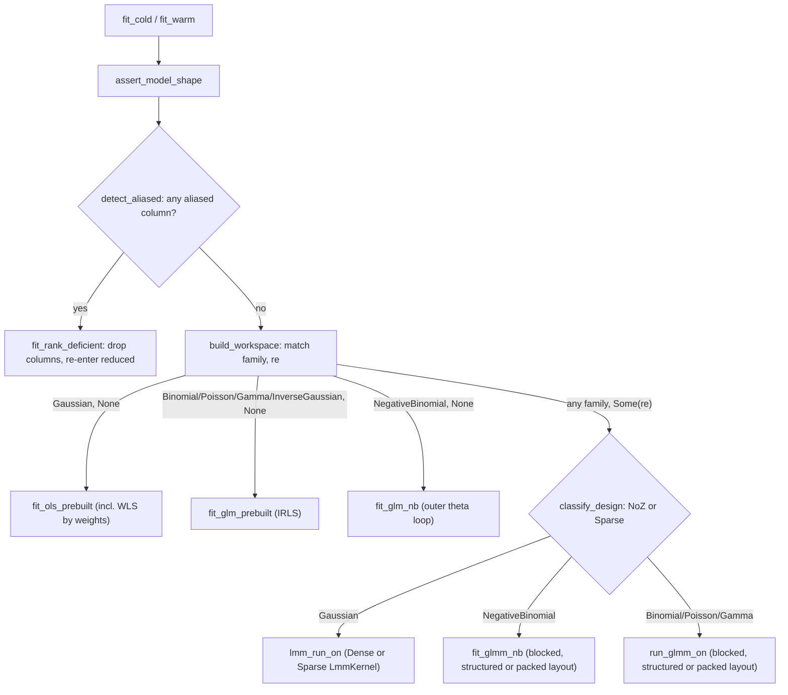

# Algorithm map — dispatch, knobs, OLS & GLM

This is the entry point of the `glmm` algorithm map. It documents, strictly as
built, how a call to `fit_cold`/`fit_warm` reaches a terminal solver, indexes
every tuning knob, and covers the two fixed-effect-only paths (OLS and GLM). The
mixed-model leaves get their own pages:

- [`algorithms-lmm.md`](algorithms-lmm.md) — Gaussian mixed models (LMM).
- [`algorithms-glmm.md`](algorithms-glmm.md) — non-Gaussian mixed models (GLMM).

Family and link coverage is tabled in
[`supported_families.md`](supported_families.md). Each page ends with a
comparison against lme4, MixedModels.jl, and (on the GLMM page) GLMMadaptive;
[`glmm-design.md`](glmm-design.md) summarises the algorithmic differences from
the other engines and the reasoning behind them.

## Full dispatch map

Every real fit enters through `fit_warm` (`fit_cold` is exactly
`fit_warm(.., None, ..)`). It shape-checks the inputs (`assert_model_shape`,
followed by the finiteness/shape asserts on `weights`, `offset`, and any
`StartValues`), runs the rank-deficiency salvage, sizes the spec from the group
ids, then hands off to the unified fit core in `src/fit/core.rs`:
`build_workspace` matches on `(family, re)` — the mixed arm routing through
`classify_design` to a dense (`NoZ`) or sparse (`Sparse`) solver, and within
each solver the family selecting the kernel — and `fit_on` solves on the
workspace it allocated. This is the whole as-built decision tree — one graph, no
unreachable arms.

The core is the *only* dispatch body. `fit_warm` allocates a throwaway
workspace per call and always assembles the full `Fit`; a `loop_advanced`
caller builds once per shape and reads the lean `FitView` per draw. Both walk
the identical tree, so routing cannot drift between the two tiers. The
`orchestrate` feature (`src/orchestrate.rs`, off by default, no semver
guarantee) is a third caller and not a fourth tier: it lowers a formula and a
data table, calls `fit_warm`, and flattens the result for the Python and R
packages, so it enters the tree at the same door `fit_warm` does.



**Rank-deficiency salvage.** Before any solver runs, `detect_aliased` forms the
lower-triangular Gram `XᵀX` and rank-reveals it (`ols::aliased_columns`, drop
tolerance `ALIAS_EPS = 1e-14`); if any fixed column is aliased on an earlier one,
`fit_rank_deficient` drops those columns, fits the reduced full-rank model
through a recursive `fit_warm`, and scatters β/SE back to full width with the
dropped slots left `NaN` (lme4's `NA`-coefficient behaviour — the fit still
converges). The rank reveal is deliberately **left-to-right with no pivoting**,
matching R/lme4's `dqrdc2` convention: of a collinear pair, the *later* column
is always the one dropped, regardless of magnitude (the per-column pivot test
`piv ≤ eps·G_dd` is scale-invariant), so the `NaN` slots land exactly where
lme4 puts its `NA`s. The reduced design is full rank, so the recursion never
re-enters this branch. An aliased column that is also an RE slope is faulted
rather than mis-indexed. This preprocessing is path-agnostic: it serves OLS,
GLM, LMM and GLMM alike.

**`classify_design` routing (mixed arm only).** A mixed design routes to
`Solver::Sparse` when it is over the dense envelope (primary width
`q_p > MAX_PRIMARY_Q`, more than `MAX_EXTRA_GROUPINGS` extra groupings, or any
extra grouping width `1 + slopes.len() > MAX_EXTRA_Q`), **or** any extra
grouping carries a random slope, **or** the total `Crossed` level count exceeds
`MAX_CROSSED_LEVELS`; otherwise it stays `Solver::NoZ`. The caps are a
scratch-capacity boundary, not a model limit — the router redirects rather than
aborts, so every wired family fits on whichever side it lands and there is **no
reachable `unimplemented!` / panic** in the mixed dispatch. Two of the clauses
have non-obvious reasons:

- *Slope-carrying extras always go Sparse* for two independent reasons. On the
  Gaussian side it is a measured performance crossover (the sparse kernel won
  4–13× on the 2026-07-02 sweep). On the non-Gaussian side it is the only
  implementation: only the packed-row `A`-layout applies a full `q_g×q_g` Λ
  block per extra level, so the blocked and structured layouts stay
  intercept-only on extras.
- *`MAX_CROSSED_LEVELS` (500) is a performance boundary, not a scratch
  ceiling*: the dense crossed tail is cubic in the total crossed column count
  (a measured 22,714-level crossed factor cost ~10¹³ flops and ~6 GB of
  scratch per deviance eval), while at 500 levels the cubic term is
  negligible. The other three caps size stack buffers and are hard.

The one hard rejection is a shape assert: `assert_model_shape` still panics on
true invariant violations (a bad `nagq`, an out-of-range slope column, more
than one nested grouping) — and, as a family × random-effects gate, on
`(Family::InverseGaussian, Some(re))`: the GLMM objective needs a profiled
`inverse.gaussian()$aic` term that is not built, so `fit_warm` faults there
before `build_workspace` allocates anything (`InverseGaussian` reaches only
the fixed-only GLM arm above). The level-count clause reads real
`Crossed { n_clusters }`, so the entry sizes the spec from the row ids
(`spec_sized_from_ids`) before classifying.

**Code:** `fit_warm`/`fit_cold`, `Solver`, `FitOptions` (`src/fit/mod.rs`);
`detect_aliased`, `fit_rank_deficient`, `assert_model_shape`,
`spec_sized_from_ids` (`src/fit/common.rs`); `aliased_columns`, `ALIAS_EPS`
(`src/ols.rs`); envelope caps in `src/consts.rs`. **Convention:** lme4's
rank-deficiency handling (drop aliased columns, `NA` coefficient, still
converge); the `NoZ`/`Sparse` split is a per-shape kernel choice invisible to
the model — both target the identical lme4/MixedModels.jl optimum.
**Validation:** the salvage is pinned by
`fit_rank_deficient_drops_and_matches_reduced` (`src/fit/common_tests.rs`); the
routing boundary and both solver arms are pinned across the mixed corpus — see
the LMM and GLMM pages for the per-kernel rungs (Dyestuff, sleepstudy,
Penicillin, Pastes, sim_slope_extra on the Gaussian side; cbpp, grouseticks,
`sim_sparse_binomial`, `sim_sparse_poisson` on the non-Gaussian side).

## Internal standardization of the design

Every fit runs on a transformed fixed-effect design and reports in the caller's
units. At the start of `fit_on`, before any route reads `X`, each column `j`
gets two statistics from this draw's data and prior weights `wᵢ` (1 when
absent; binomial trial counts as they are):

```
mⱼ = Σwᵢxᵢⱼ / Σwᵢ          if X has an intercept, else 0
sⱼ = √(Σwᵢ(xᵢⱼ − mⱼ)² / Σwᵢ)
x̃ᵢⱼ = (xᵢⱼ − mⱼ) / sⱼ
```

Left as they are (`mⱼ = 0`, `sⱼ = 1`): the intercept (the first column whose
entries are all exactly 1), every 0/1 column (factor dummies, binary
covariates), and every column whose `sⱼ` is zero or not finite. Without an
intercept nothing is centered and `sⱼ` is the weighted RMS about zero. One
exception: a 0/1 (or constant) column that a random-effect block reads as a
slope is scaled without being centered, `mⱼ = 0` and `sⱼ` its weighted RMS
about zero, so its zeros stay exact zeros and the random-effect search sees
the slope in units of its root mean square
([random-effect design column scaling](algorithms-lmm.md#random-effect-design-column-scaling)). The
response, the offset and the weights are not transformed, except on a Gamma
GLMM with the inverse link, where the response can be rescaled by a power of two
([response units](algorithms-glmm.md#response-units-on-the-gamma-inverse-link)). The statistics are
applied inside the column-major fill every route already does, so no extra
copy of `X` is made: every route, the NB ones included, reads the same
column-major `x̃` buffer of the workspace.

Centering is exact only where an intercept absorbs the constant `−mⱼβⱼ` it
adds. In `X` that is the intercept column. A random slope is a column of `X`
too, so its block reads the same `x̃ⱼ`, and there the block's own random
intercept absorbs the shift: every random-effect block has one, in the same
unrestricted covariance. `y ~ 0 + x + (1 + x | g)` therefore scales `x` without
centering it.

The transform is a preconditioner, not a model change. The fit is the same
model in other coordinates, nothing downstream assumes `x̃` has mean 0 or
standard deviation 1, and the results map back exactly:

- **Fixed effects.** `β = Bβ̃`, with `B` the identity except `Bⱼⱼ = 1/sⱼ`
  and, on the intercept row, `B₀ⱼ = −mⱼ/sⱼ`. Every SE path forward-solves
  against row `t` of `B` where it solved against `eₜ` (one solve per target,
  as before), so `se`, `vcov`, the per-target `t²` and the joint Wald
  statistic come out in the caller's units. The GLMM Hessian arm maps its
  covariance as `B·Ṽ·Bᵀ`.
- **Random effects.** Per block `b = N·b̃`, where `N` has the shape of `B` on
  the block's coordinates. `varcorr` is `N·Σ̃·Nᵀ` and `ranef` is `N·b̃`. The
  caller's relative factor `Λ` (`tau2`, and the loop tier's `FitView::theta`)
  is the lower Cholesky factor of `N·Λ̃Λ̃ᵀ·Nᵀ`, taken with the semidefinite
  factorization that canonicalizes pinned blocks, so a rank-deficient `Λ̃`
  maps to a `Λ` of the same rank with exact zeros: the factorization is capped
  at Λ̃'s rank, so a dependent column's rounding residual is not taken for a
  direction. With no centered slope `N` is diagonal and no factorization runs.
  `stddev_se` is the SE of each reported stddev `√Σ_kk`, by the delta method
  on θ̃: `Σ_kk` is a polynomial in θ̃, so one formula serves every block and
  no factorization is differentiated.
- **REML deviance.** `ln|X̃ᵀV⁻¹X̃| = ln|XᵀV⁻¹X| − 2·Σⱼ ln sⱼ` (a shift has
  determinant 1), so a REML LMM fit adds `2·Σⱼ ln sⱼ` back to its deviance
  and log-likelihood (the ML criterion has no `X` term), and the OLS REML
  log-likelihood adds it as well. No other criterion contains an `X` term.
- **Warm starts.** A `StartValues` is in the caller's units and is mapped
  forward per draw: `β̃ = B⁻¹β`, and `Λ̃` the lower factor of
  `N⁻¹·ΛΛᵀ·N⁻ᵀ`. Its `dispersion` (NB shape, Gamma φ) needs no map: neither
  depends on the design's column scales. On the loop tier a θ̂ carried from one draw is mapped forward
  with the next draw's statistics. A start component of the wrong width is
  dropped, a cold start for that component (`fit_on`).

Three diagnostics read the fit's own coordinates. `pinned` is reported in the
caller's: under a centered slope a zero can move from the intercept diagonal
to the slope diagonal. `singular` compares the kernel's internal standard
deviations, so on a predictor whose mean is far from zero the intercept's is
taken at the mean, not at `x = 0`. `ill_conditioned` is measured on the
standardized design, so a column that is ill-conditioned only through its
distance from zero is not flagged. Vector AGQ (`nagq > 1` on a block
with a slope) takes its quadrature in the centered coordinates: the model is
the same, and the reported AGQ deviance differs from the uncentered one by the
quadrature error. Laplace, the Gaussian LMM and scalar AGQ are exact under
centering.

On the loop tier, `FitWorkspace::set_prestandardized(true)` skips the
transform: the design is fitted as given, except that every random-slope
column is scaled by its weighted RMS about zero, as a 0/1 slope is above, and
every other map is the identity.

**Code**: `ColumnScaling` (`src/standardize.rs`); the
random-effect maps (`src/lmm/re_map.rs`); `fit_on`, `FitView::new`
(`src/fit/core.rs`); `fill_col_major_std`, `vcov_from_chol`, `varcorr_block`
and the ranef assemblers (`src/fit/common.rs`). **Convention**: lme4 fits the
design as given and warns on badly scaled predictors (`checkScaleX`).

## Legend

- **Node** = a named function the dispatch actually calls; the terminal leaves
  (`fit_ols_prebuilt`, `fit_glm_prebuilt`, `fit_glm_nb`, `lmm_run_on`,
  `run_glmm_on`, `fit_glmm_nb`) are the solvers.
  **Diamond** = a real branch in the code (`match`, `classify_design`, a guard).
  **Edge label** = the condition under which that branch is taken.
- **Code citations** across all three pages use the form `src/path/file.rs` plus
  the item name (fn/struct/const) — never line numbers, so a citation survives
  edits to the file. When an item name is unique in the crate the file alone
  locates it. (The `fit` and `sparse` modules are directories: the entry and its
  preprocessing live in `src/fit/mod.rs` and `src/fit/common.rs`, the dispatch
  itself in `src/fit/core.rs`, the per-path entry points in
  `src/fit/{ols,glm,lmm,glmm}.rs`, their tests in the sibling `*_tests.rs`
  files, and the sparse solver in `src/sparse/`.)
- The map grows with the crate: future optimizer tiers and additional families
  will add leaves and edges, but this document tracks only what currently ships.

## Knob index

Every tuning surface, one line each, pointing at the page that owns it. Public
`FitOptions` knobs are documented at their use site; internal constants are
tuned on the crate's validation corpus (the 49 rungs of `validation/manifest.json`
and the accuracy grid in `validation/grid/` — see the LMM/GLMM validation sections)
and are not user-facing.

### Public `FitOptions` fields (`src/fit/mod.rs`, `struct FitOptions`)

| Knob | Meaning | Owned by |
|---|---|---|
| `target_indices` | fixed-effect columns to compute SE for | [OLS](#ordinary-least-squares-ols) / [GLM](#generalised-linear-models-glm) here; LMM SE in [`algorithms-lmm.md`](algorithms-lmm.md#standard-errors); GLMM SE in [`algorithms-glmm.md`](algorithms-glmm.md#standard-errors) |
| `wald_se` | `Hessian` (default) vs `Rx` Wald covariance | GLMM only — [`algorithms-glmm.md`](algorithms-glmm.md#standard-errors) (ignored on OLS/GLM/LMM) |
| `nagq` | AGQ node count, default 1 (Laplace) | GLMM only — [`algorithms-glmm.md`](algorithms-glmm.md#adaptive-gausshermite-quadrature-agq) |
| `dispersion` | Gamma or inverse-Gaussian φ directive: `None` estimates, `Some(v)` fixes | [GLM Gamma and inverse-Gaussian](#generalised-linear-models-glm) here; Gamma GLMM in [`algorithms-glmm.md`](algorithms-glmm.md#laplace-approximation) |
| `weights` | per-row prior weights `wᵢ`: precision weights on every family with an estimated dispersion (row `i` has dispersion `φ/wᵢ`) — Gaussian, Gamma, inverse-Gaussian; trial counts on aggregated Binomial; same fit either way on Poisson; multiply the log-likelihood on NB. See [`conventions.md`](conventions.md#prior-weights) | every path — [OLS](#ordinary-least-squares-ols)/[GLM](#generalised-linear-models-glm) here, mixed paths in the LMM/GLMM pages, **including** AGQ (`nagq > 1`) on the binomial/Poisson/NB/Gamma shapes AGQ covers |
| `offset` | per-row offset `oᵢ` added to the linear predictor | every path — [OLS](#ordinary-least-squares-ols)/[GLM](#generalised-linear-models-glm) here, mixed paths in the LMM/GLMM pages |
| `parallel_inner` | experimental opt-in to parallel inner kernels | GLMM only — AGQ/FD-Hessian, [`algorithms-glmm.md`](algorithms-glmm.md#standard-errors) (off by default, bit-identical to serial) |
| `satterthwaite` | run the Satterthwaite pass after a Gaussian LMM fit (`Fit::coef_df`, `Fit::contrast_t`, `Fit::contrast_f`); default `true`, `false` leaves `coef_df` NaN and the contrasts return `NoDfReason::Disabled` | LMM only, [`algorithms-lmm.md`](algorithms-lmm.md#satterthwaite-degrees-of-freedom); OLS and the dispersion GLMs keep their residual df `n − p` whatever it says |
| `reml` | the Gaussian criterion: `None` (default) and `Some(true)` fit a Gaussian mixed model by REML, `Some(false)` by ML; frozen on the workspace at build, and `Fit::reml` reports the resolved value. On OLS the estimates are the same under every value and `Some(true)` reports the REML log-likelihood. On a GLM or GLMM every value is the ML fit (`Some(true)` is ignored silently; the ports' `orchestrate::run_fit` strips it and sets `FitResult::reml_warning`) | LMM, [`algorithms-lmm.md`](algorithms-lmm.md#profiled-reml-and-ml-objectives); OLS, [OLS](#ordinary-least-squares-ols) here |

### Loop-tier settings (`loop_advanced`, no semver guarantee)

| Knob | Meaning | Owned by |
|---|---|---|
| `FitWorkspace::set_prestandardized` | `true` fits the design as given, skipping the per-draw standardization except the random-slope scale; default `false`. `fit_cold`/`fit_warm` always standardize | [internal standardization](#internal-standardization-of-the-design) |
| `FitWorkspace::set_fixed_design` | `true` promises the same `x`, ids and weights on every following `fit_on` (only `y` and the offset change): the column statistics, the design fill and, on the dense LMM route, the fixed-effect factor and the design part of the sufficient statistics are reused; bit-identical; a debug build checks the promise by a hash; default `false` | [internal standardization](#internal-standardization-of-the-design), [`algorithms-lmm.md`](algorithms-lmm.md#fixed-effect-orthogonalization) |
| `curvature_hint` / `fit_on_hinted` | a frozen inverse Hessian at a pilot fit's optimum that each later draw's BFGS search starts from (LMMs on the per-group route, over θ; binomial, Poisson and Gamma Laplace GLMMs and binomial logit/probit and Poisson AGQ GLMMs with one scalar random intercept on the gradient route, over `[θ \| β̃]`, and `[θ \| β̃ \| ln φ]` on a free Gamma dispersion, the pilot search's own estimate); read only, so results do not depend on call order; a hint of another search dimension panics | [`algorithms-lmm.md`](algorithms-lmm.md#gradient-search-on-the-per-group-route-bfgs), [`algorithms-glmm.md`](algorithms-glmm.md#gradient-search-bfgs-on-laplace-and-scalar-intercept-agq-fits) |
| `satterthwaite(&mut ws, &mut df_out)` | the stable path's Satterthwaite df of the last `fit_on` draw, on demand (the loop tier runs no pass otherwise, so a `Fit` from `FitView::into_fit` carries no df); Gaussian LMM workspaces only; reads θ̂ without writing it, so it and `curvature_hint` run in either order; its buffers live on the workspace | [`algorithms-lmm.md`](algorithms-lmm.md#satterthwaite-degrees-of-freedom) (`src/fit/core.rs`) |

### Internal tuning constants

| Knob | Value / formula | Owned by |
|---|---|---|
| BOBYQA `npt` | `2·n_θ + 1` for `n_θ < 3`, else `(3·n_θ).div_ceil(2) + 1` | [`algorithms-lmm.md`](algorithms-lmm.md#general-path-bobyqa-over-θ) (`src/lmm/mod.rs`) |
| `rho_begin` per search | LMM `RHO_BEGIN = 0.5` blind, `RHO_BEGIN_WARM = 0.1` warm; GLMM stage 1 and the `Joint` route `GLMM_RHO_BEGIN = 0.2` (stage 1 from a kept warm θ₀ 0.1), the polish `GLMM_RHO_POLISH = 0.03` (0.1 after a stage-1 optimum with a diagonal below `POLISH_NEAR_SINGULAR = 1e-2`, and 0.1 for the polish of an AGQ gradient-search endpoint) | [`algorithms-lmm.md`](algorithms-lmm.md#general-path-bobyqa-over-θ), [`algorithms-glmm.md`](algorithms-glmm.md) (`src/lmm/mod.rs`) |
| `rho_end` | LMM `RHO_END = 1e-6`; GLMM searches `GLMM_RHO_END = 3e-6` | [`algorithms-lmm.md`](algorithms-lmm.md#general-path-bobyqa-over-θ), [`algorithms-glmm.md`](algorithms-glmm.md) (`src/lmm/mod.rs`) |
| BOBYQA `prima_parity` | `false` on every search: Powell's RESCUE factor at a fully determined model (one-dimensional searches); no effect at any other `npt` | [`algorithms-lmm.md`](algorithms-lmm.md#general-path-bobyqa-over-θ) (`apply_campaign_overrides`, `src/lmm/mod.rs`) |
| LMM outer optimizer | BFGS where the per-group regression route is armed (slopes on the primary only, `n_θ ≥ 3`), BOBYQA elsewhere and as its polish/fallback | [`algorithms-lmm.md`](algorithms-lmm.md#gradient-search-on-the-per-group-route-bfgs) (`lmm_outer_optimizer`, `src/lmm/mod.rs`) |
| GLMM outer optimizer | BFGS over `[θ \| β̃]` on binomial (any link), Poisson and Gamma (log and inverse link) Laplace fits with `n_θ ≥ 2` on the blocked or structured layout (a warm fit with no slope block only below 50 rows per primary level), with a free Gamma `ln φ` as one more coordinate (its start curvature seeded on the inverse link), and on the exact AGQ gradient on binomial logit/probit and Poisson AGQ fits with one scalar random intercept below 50 rows per primary level, cold or warm (a warm one only from every diagonal θ₀ ≥ 0.05); BOBYQA elsewhere and as its polish/fallback; 200 iterations | [`algorithms-glmm.md`](algorithms-glmm.md#gradient-search-bfgs-on-laplace-and-scalar-intercept-agq-fits) (`gradient_route_plan`, `src/glmm/mod.rs`) |
| BFGS stops and certificate | projected gradient `< 1e-6`; decrease `< max(fdelta_abs, FDELTA_ULPS = 16 · ε·\|f\|)`, `fdelta_abs` = 1e-9 on the LMM route, 1e-10 on the GLMM route; accepted when the decrement `½·gᵀHg ≤ CERT_DECREMENT = 1e-8` and no diagonal θ `< CERT_NEAR_ZERO = 1e-3`; Armijo `c = 1e-4`, 30 halvings, first step capped at 0.5; 1000 iterations on the LMM route, 200 on the GLMM route | [`algorithms-lmm.md`](algorithms-lmm.md#gradient-search-on-the-per-group-route-bfgs), [`algorithms-glmm.md`](algorithms-glmm.md#gradient-search-bfgs-on-laplace-and-scalar-intercept-agq-fits) (`BfgsConfig`, `src/optim/bfgs.rs`) |
| `GRAD_WARM_THETA_MAX` / `GRAD_THETA_FAR` | `10` / `100` (`0.1·THETA_HI`): a warm GLMM fit whose θ start has a diagonal above 10 takes the BOBYQA route; a gradient-search endpoint with a diagonal θ at or above 100 hands over to BOBYQA | [`algorithms-glmm.md`](algorithms-glmm.md#gradient-search-bfgs-on-laplace-and-scalar-intercept-agq-fits) (`src/glmm/mod.rs`) |
| `GRAD_WARM_AGQ_THETA_MIN` | `0.05`: a warm AGQ fit on a covered shape whose θ start has a diagonal below 0.05 keeps the joint BOBYQA search: from at or near a zero variance the endpoint is never certified and the polish costs more than warm BOBYQA | [`algorithms-glmm.md`](algorithms-glmm.md#gradient-search-bfgs-on-laplace-and-scalar-intercept-agq-fits) (`src/glmm/mod.rs`) |
| `PG_GRAD_BLOCK` | 512 groups per stacked solve of the LMM gradient | [`algorithms-lmm.md`](algorithms-lmm.md#gradient-search-on-the-per-group-route-bfgs) (`src/lmm/pg_grad.rs`) |
| Satterthwaite steps `ETA` / `ETA_GRAD` | the pass's step on each free θ̃ coordinate, `h_k = η·max(\|θ̃_k\|, 1)`: `ETA = 3e-4` on the value route (central differences of the deviance), pinned by a step sweep over which the df stay flat; `ETA_GRAD` on the gradient route (central differences of the per-group gradient), set by that route's own sweep. The pseudo-inverse of the profiled Hessian keeps eigenvalues above `1e-8·λ_max` | [`algorithms-lmm.md`](algorithms-lmm.md#satterthwaite-degrees-of-freedom) (`src/lmm/satterthwaite.rs`) |
| `THETA0` / `THETA_HI` | `1.0` — blind θ start on each diagonal entry (off-diagonals start at `0`); `1e3` — the symmetric search box `[−THETA_HI, THETA_HI]` on every θ entry | [`algorithms-lmm.md`](algorithms-lmm.md#covariance-parameterization-θ-cholesky) (`src/lmm/mod.rs`) |
| `THETA_TRUTH_FLOOR` | `0.01` — a truth-seeded θ start is clamped to at least this, above `PIN_THETA`, so it never starts on the boundary | [`algorithms-lmm.md`](algorithms-lmm.md#boundary-handling-pin_theta) (`src/lmm/mod.rs`) |
| `PIN_THETA` | `1e-4` — diagonal variance component pinned to `0`, tested on the internal (scaled) θ | [`algorithms-lmm.md`](algorithms-lmm.md#boundary-handling-pin_theta) (`src/lmm/mod.rs`) |
| `SINGULAR_REL_TOL` | `1e-3` — post-hoc relative check: any RE stddev `≤ 1e-3 ×` the largest ⇒ `singular`, on the internal (scaled) stddevs | [`algorithms-lmm.md`](algorithms-lmm.md#boundary-handling-pin_theta) (`src/fit/mod.rs`) |
| RE design column scale | per random-slope column of the standardized design, `√(Σ wᵢx̃ᵢ²/Σ wᵢ)`; intercept subcolumns exactly `1.0`; always on, no trigger | [`algorithms-lmm.md`](algorithms-lmm.md#random-effect-design-column-scaling) (`src/lmm/mod.rs`) |
| `GRAM_PIVOT_MIN` | `1e-3`: the smallest pivot ratio `R_jj²/(X'WX)_jj` at which the dense LMM route reads its fixed-effect factor off the accumulated Gram; below it the Givens QR runs | [`algorithms-lmm.md`](algorithms-lmm.md#fixed-effect-orthogonalization) (`src/lmm/kernel.rs`) |
| `TAIL_SPARSE_MIN` | `128` — crossed Schur tails of size `e ≤ 128` keep the dense factor; larger tails take the fill-reducing sparse LLT | [`algorithms-lmm.md`](algorithms-lmm.md#the-sparse-kernel-two-level-schur-block-cholesky) (`src/sparse/mod.rs`) |
| `outer_search` route | `ExactProfile` on the `exact_profile_shape` shapes (nAGQ=1 on the blocked or structured layout, not the packed one; canonical or not, Gamma included); else `Joint` when `nAGQ>1 \|\| (n_θ ≤ 2 && p ≤ 4)`; else `PqlThenJoint` | [`algorithms-glmm.md`](algorithms-glmm.md#β-profiling--the-three-outer-routes) (`src/glmm/workspace.rs`, `src/glmm/mod.rs`) |
| `ExactProfile` stage-1 PIRLS tolerance | `clamp(RHO_TOL_C·ρ², pirls_tol, RHO_TOL_MAX)` with BOBYQA's ρ, `RHO_TOL_C = 1e-2`, `RHO_TOL_MAX = 1e-5`; `pirls_tol` on the first evaluation and once ρ ≤ `RHO_TOL_FULL_FACTOR·GLMM_RHO_END` (3e-5); a loose incumbent re-solved at `pirls_tol` | [`algorithms-glmm.md`](algorithms-glmm.md) (`src/glmm/mod.rs`) |
| `JOINT_RECHECK_TOL` | `1e-9` relative: after a converged joint `[θ \| β̃]` search (on AGQ, also after a gradient-search finish), a PQL re-solve of β at the incumbent (then, on AGQ, the AGQ objective there) lower by more than this starts a second pass from it, on β̃ scaled by the β information | [`algorithms-glmm.md`](algorithms-glmm.md#β-profiling--the-three-outer-routes) (`src/glmm/mod.rs`) |
| Gamma-inverse response units | first search on y while the largest cluster η is in `[1/64, 64]`, else on y rescaled to bring it into `[4, 8]`; a search that fails or ends no lower than the GLM point (`UNITS_RETRY_TOL = 1e-6` relative) is retried with the smallest start η in `[1/2, 64]` and the largest cluster η in `[4, 8]` and `[8, 16]` | [`algorithms-glmm.md`](algorithms-glmm.md#response-units-on-the-gamma-inverse-link) (`src/fit/glmm.rs`) |
| `ETA_DIVERGENCE_CAP` | `30` — GLM divergence guard: a fit that ends unsettled (at `MAX_IRLS_ITERS`, on an η its link does not evaluate, or on a failed solve) with some `|η_i − η₀| > 30` and a last step that still moves some η by more than `SEPARATION_STEP` → non-converged and separated; crossing 30 alone stops nothing, `η₀ = oᵢ` on the binomial links and `oᵢ + ln μ₀` (the null-model seed) on the log links; skipped under the Gamma inverse and inverse-Gaussian `1/μ²` links | [GLM](#generalised-linear-models-glm) (`src/glm.rs`) |
| `PROB_EPS` / `UPPER_TAIL_Q` / `LOG_TAIL_ETA` | `1e-12` / `1e-4` / `230` — tail-row switch: binomial μ within `1e-12` of 0 or `1e-4` of 1, NB/Gamma/IG-log `\|η\| > 230` → deviance, score and weights from their η forms | [GLM](#generalised-linear-models-glm) (`src/family.rs`) |
| `STEP_ULPS` | `16` — GLM round-off stop: a step that moved no η by more than 16 ULPs of max \|η\| ends the fit as converged | [GLM](#generalised-linear-models-glm) (`src/glm.rs`) |
| `SEPARATION_STEP` | `0.01` — GLM separation stop: a deviance stop whose last step still moved some η by more than 0.01 → non-converged; skipped under the Gamma inverse and inverse-Gaussian `1/μ²` links | [GLM](#generalised-linear-models-glm) (`src/glm.rs`) |
| `MAX_PRIMARY_Q` | `8` — primary width cap (over → Sparse) | [dispatch](#full-dispatch-map) (`src/consts.rs`) |
| `MAX_EXTRA_Q` | `4` — per-extra-grouping width cap | [dispatch](#full-dispatch-map) (`src/consts.rs`) |
| `MAX_EXTRA_GROUPINGS` | `6` — extra-grouping count cap | [dispatch](#full-dispatch-map) (`src/consts.rs`) |
| `MAX_THETA` | derived θ-length ceiling: `vech(Λ_p)` + one `vech(Λ_g)` block per extra = `8·9/2 + 6·(4·5/2) = 96` | [dispatch](#full-dispatch-map) (`src/consts.rs`) — sizes every θ-length stack buffer |
| `MAX_CROSSED_LEVELS` | `500` — total crossed-level cap (over → Sparse; a performance boundary, not scratch) | [dispatch](#full-dispatch-map) (`src/consts.rs`) |
| `MAX_NAGQ` | `25` — largest odd AGQ order the GH table stores | [`algorithms-glmm.md`](algorithms-glmm.md#adaptive-gausshermite-quadrature-agq) (`src/consts.rs`) |
| `MAX_DUAL_N` / `MAX_DUAL_H` | `12` / `78` — the top instantiated dual and hyper-dual rung; lanes are instantiated at `N ∈ {4, 5, 6, 8, 12}`. Above `MAX_DUAL_N` the gradient chunks, and so does the joint Hessian, which the assembled pass reads off first-order lanes; the hyper-dual Hessian cannot chunk and refuses above the cap | [`algorithms-glmm.md`](algorithms-glmm.md#standard-errors) (`src/glmm/derivative.rs`) |
| `AGQ_GD_STEP_REL` / `AGQ_GD_ASYM_MAX` | `1e-5` / `1e-6`: the AGQ gradient-difference Hessian (rung 2a: logit, probit and Poisson-log AGQ on a scalar intercept): each coordinate moves by `1e-5·max(1, |γ̂|)` each way, and a result asymmetric beyond `1e-6·√(|H_rr·H_cc|)` falls back to the hyper-dual rung. No lane cap, so these shapes keep an exact-gradient Hessian above `MAX_DUAL_N` | [`algorithms-glmm.md`](algorithms-glmm.md#standard-errors) (`src/glmm/se.rs`) |
| `MU_ZERO_REL` / `LAMBDA_GRID` | `1e-10`: a normalized eigenvalue of `ZᵀP₀Z` below it is zero and merges into the tail of the exact RLRT's null; the λ grid is `0` and `exp` of 199 points equally spaced on `[−10, 8]`, in units of `1/μ_max` (RLRsim's) | [`algorithms-lmm.md`](algorithms-lmm.md#exact-rlrt-for-one-random-intercept) (`src/inference/rlrt.rs`) |

The NB GLM outer-loop constants (`NB_MAX_OUTER = 25`, `NB_THETA_TOL = 1e-6`,
`NB_THETA_LO = 1e-3`, `NB_THETA_HI = 1e4`) are covered in the
[GLM section](#generalised-linear-models-glm) below; the GLMM NB route, dense and
sparse alike, reuses the same bounds as the box on its outer BOBYQA's `ln θ`
coordinate
([`algorithms-glmm.md`](algorithms-glmm.md#negative-binomial-outer-θ-loop)).

## Ordinary least squares (OLS)

**Code:** `fit_ols_prebuilt` + `ols_view_to_fit` (`src/fit/ols.rs`);
`OlsSuffStats::add_rows`,
`fit_suff_stats_t_sq`, `PANEL_ROWS` (`src/ols.rs`). **Convention:** the textbook
Gaussian OLS normal equations, with R `lm()`'s residual-df and dispersion
conventions. **Validation:** `fit_ols_recovers_slope`, and for the weighted path
`fit_ols_weighted_matches_r_lm` (`src/fit/ols_tests.rs`). OLS is the fixed-only
Gaussian leaf and is not a dedicated mixed-model validation rung; it is exercised
implicitly as the `q_p = 1` degenerate of the LMM kernels.

`fit_ols_prebuilt` accumulates the sufficient statistics `XᵀX` (lower triangle), `Xᵀy`,
and `yᵀy` in a single panel-blocked pass (`OlsSuffStats::add_rows`, repacking
`PANEL_ROWS = 256`-row panels so the GEMM stays cache-resident), then solves the
normal equations by a Cholesky of `XᵀX`: `L z = Xᵀy`, `Lᵀ β̂ = z`
(`fit_suff_stats_t_sq`). The residual sum of squares is the closed form
`RSS = yᵀy − β̂ᵀXᵀy` — no residual sweep. The dispersion is
`σ̂² = RSS/(n − p)` with **raw-row** residual df `n − p`, and the SE of a target
column is `√(σ̂²·‖L⁻¹e_j‖²)` from one forward solve against the Cholesky factor
(the diagonal of `σ̂²(XᵀX)⁻¹`). The Gram squares `X`'s condition number, so
when its Cholesky shows a pivot ratio below `lmm::GRAM_PIVOT_MIN` (1e-3, or
fails), the statistics are accumulated again on `X·U⁻¹`, `U` from a QR of
`√W·X` (`lmm::DesignQr`, as the LMM kernels use), and `β̂` and the factor are
mapped back (`β̂ = U⁻¹β̃`, `L = Uᵀ·L̃`); a well-conditioned design keeps the
direct path. Only a genuine Cholesky failure (non-PD factor)
returns a non-converged, `NaN`-filled fit; a near-singular but PD factor is
fitted, and its scale-invariant pivot ratio (`min_pivot_ratio`) is measured
and, below `PIVOT_MIN = 1e-12`, recorded as an `IllConditioned` note on
`Fit::diagnostics` rather than refused. `fit_suff_stats_t_sq` takes no
`eps_rank` parameter. `Fit::dispersion` carries `σ̂²` on this path (`NaN` on
any non-converged return); `Fit::deviance` is **always** `NaN` on the OLS
path — it is never populated, converged or not.

**Log-likelihood.** `Fit::loglik` is the ML log-likelihood of `logLik(lm)` by
default. Under `FitOptions::reml = Some(true)` it is the REML one, as
`logLik(lm, REML = TRUE)`: the profiled REML deviance
`2·Σⱼ ln L_jj + (n − p)·ln(RSS_w/(n − p)) − Σ ln wᵢ` (with the standardization
shift added back, as on the LMM), through the LMM's own `lmm_loglik` with
`ν = n − p`, so it sits on the scale of a Gaussian mixed fit pinned at zero
variance. `Fit::reml` is `true` then. β̂, the SEs, σ̂² and the RSS do not
depend on it. The value is read at assembly (`ols_view_to_fit`), so an OLS
workspace is not frozen on it.

**Offset.** A `FitOptions::offset` is applied as an exact response pre-shift:
the accumulator sees `y − o`, applied *before* any weight scaling so the two
compose correctly. (The GLM path below handles its offset differently — inside
η each iteration.)

**WLS by row scaling.** Prior weights (`FitOptions::weights`) are applied as
`√wᵢ` row pre-scaling of both `X` and `y` before the unit-weight accumulator
runs, so the Grams become `XᵀWX`, `XᵀWy`, `yᵀWy`; then `RSS = yᵀWy − β̂ᵀXᵀWy`
is the weighted RSS and `σ̂² = RSS/(n − p)` keeps the raw-row df, matching
R `lm(weights=)`. Constant weights leave the fit invariant. Two of the
accumulator's by-products (`sum_y`, `sst`) are not weight-consistent under this
scaling; they are deliberately never mapped into `Fit`.

## Generalised linear models (GLM)

**Code:** `fit_glm_prebuilt` + `glm_view_to_fit` and (for negative binomial)
`fit_glm_nb` (`src/fit/glm.rs`);
the IRLS kernel `glm_irls_fit` with its constants `MAX_IRLS_ITERS = 50`,
`DEVIANCE_TOL = 1e-12`, `WEIGHT_CLAMP = 1e-300`, `ETA_DIVERGENCE_CAP = 30`,
`STEP_ULPS = 16`, `SEPARATION_STEP = 0.01` (`src/glm.rs`); the SIMD
transcendental fast paths in `src/simd_transcendental.rs`; per-family link,
variance and deviance in `src/family.rs`. **Convention:** McCullagh & Nelder
IRLS with the canonical working response and prior-weight sense; R `glm()`'s
deviance and dispersion, and `MASS::glm.nb` for the NB θ profile.
**Validation:** the weighted goldens `fit_glm_gamma_weighted_matches_r`,
`fit_glm_binomial_weighted_aggregated_matches_r` (`src/fit/glm_tests.rs`),
`glm_weighted_deviance_null_golden_value` (`src/glm.rs`), and for NB
`fit_glm_nb_matches_mass` / `fit_glm_nb_weighted_matches_mass`
(`src/fit/glm_tests.rs`). GLM is a fixed-only leaf with no external three-way
validation rung of its own; the cbpp/grouseticks rungs exercise the same family
math through the GLMM cold-start GLM fit.

`fit_glm_prebuilt` runs adaptive IRLS cold-started at β = 0, converging on
R's `glm.fit` rule `|Δ deviance| / (|deviance| + 0.1) < DEVIANCE_TOL` with a
`MAX_IRLS_ITERS` safety cap. On Gamma and inverse-Gaussian the `0.1` floor is
carried into the deviance's units (`dev_floor`): it is multiplied by the
precision weights' scale (`family::weight_scale`), and on inverse-Gaussian
divided by the weighted ȳ, since that deviance scales as `1/y`. So on these two
families the stopping point is the same whatever the units of y or the overall
scale of the weights. The binomial rule is R's own. On Poisson and NB the floor
is `0.1·min(1, ȳ)`: R's own rule while ȳ ≥ 1, and scaled with y below that, where
a non-integer y in tiny units makes the deviance small.

Two more stops read the step that produced the current β, `max_i |Δηᵢ|`:

- **Round-off stop:** a step that moved no η by more than `STEP_ULPS = 16`
  ULPs of `max_i |ηᵢ|` (floored at 1 on the links the divergence guard below
  runs on) ends the fit as converged. At large means (Poisson or NB at
  μ ≳ 1e5) the deviance evaluated at float β carries round-off above
  `DEVIANCE_TOL`, so the iterates wander within a few ULPs of the MLE while
  the relative rule never fires. On ordinary fits both stops fire at the same
  pass.
- **Separation stop:** a deviance stop whose last step still moved some η by
  more than `SEPARATION_STEP = 0.01` is non-converged. Without a finite
  maximum (complete or quasi-complete separation, a category with only zero
  counts) the separated rows' deviance terms drop below `DEVIANCE_TOL` while
  their η still moves: about 1 per step on logit, Poisson, NB and the cloglog
  lower tail, about 0.14 on probit, and 0.037 to 0.040 on the cloglog upper
  tail. At a finite maximum the last step was at most 3.2e-5 over 3586
  measured deviance stops. Skipped on the two reciprocal links, where η carries the
  response's units.

**Nearly collinear designs.** Each pass factors `X'WX` by Cholesky, and the
Gram squares `X`'s condition number. From the first pass whose factor has a
pivot ratio below `lmm::GRAM_PIVOT_MIN` (1e-3), every later pass solves for
the step `β_new − β` from the working residual `z − η` instead of for `β_new`
from `z`: the solve's error is then relative to a step that shrinks to zero,
and the fixpoint is the one the residual defines. On such a pass the factor
the SEs read is `Rᵀ` from a QR of `√W·X` at that pass's weights
(`lmm::DesignQr`), as on the OLS route. On `[1, a, a + δb]` at cond(X) ≈ 2e6 the
direct solve moved η by about 1e-3 per pass and the fit ran out its budget; now
β and its SE match the well-conditioned `[1, a, b]` fit to about 1e-10. A
design that never crosses the bound takes the direct solve, bit for bit.

When the separation stop fires, or the divergence guard judges the unsettled
end of a binomial, Poisson or NB fit as running off, the view's `separated`
flag is set; the GLMM cold start reads it (see
[`algorithms-glmm.md`](algorithms-glmm.md#warm-starts-and-workspace-reuse)).

The η seed at
that β = 0 start is **family-specific** — a plain η = 0 start is wrong for most
of the regimes:

- **Logit/probit/cloglog binomial:** η = 0 (μ = ½), the standard start.
- **Gamma with the inverse link:** η = 0 is singular under `g(μ) = 1/μ`, so
  each row seeds `η = 1/yᵢ` (R's `etastart = 1/y` convention), clamped to the
  link's own η bounds (`clamp_eta`) so a zero or tiny row cannot produce an
  infinite seed; the response itself is not floored, so the seed does not
  depend on y's units.
- **Inverse-Gaussian with the `InverseSquared` link:** η = 0 puts μ at ∞ under
  `g(μ) = 1/μ²`, so each row seeds `η = 1/yᵢ²` clamped to the link's η bounds
  (R's `mustart = y` convention), the same shape of fix as the Gamma-inverse
  seed above.
- **Log-link families (Poisson, NB, Gamma, inverse-Gaussian):** each row seeds
  the null model with the offset, `η₀ᵢ = oᵢ + ln r` with `r = Σwy / Σw·e^o`
  (`r = ȳ` without an offset; R starts every row at `μ₀ = y`, or `y + 0.1` for
  the counts, instead). A plain η = 0 start (μ = 1) overshoots so badly once
  the mean sits far from 1 that IRLS diverges, and a start that ignores the
  offset does the same once the exposures differ by a few decades between
  rows. `r` is not floored; only an all-zero count response takes `ȳ = 0.1`.

The per-iteration row pass — η clamps, inverse link, Fisher weight with its prior
weight and `WEIGHT_CLAMP` floor, working response `z = η + r`, and the `Σ wᵢdᵢ`
fold — is one batched call, `simd_transcendental::family_pass`, shared with the
three GLMM PIRLS variants. It dispatches once on `family` to a vectorised arm
rather than once per row:

- **Unweighted binomial logit** hands off to the fused kernel
  `pw_and_log1pexp_sum`, which computes the probability `p`, the working weight
  `W`, and the `Σ log1pexp(η)` deviance fold in one vectorised pass, sharing a
  single `exp(−|η|)` evaluation between the probability and the deviance term.
  This is the MCPower hot path and is byte-identical to the standalone fast path
  it grew out of. Its deviance identity `2·(Σ log1pexp(η) − Σ y·η)` holds only
  for unweighted Bernoulli rows, which is why prior weights route elsewhere.
- **Probit** evaluates Φ through a branch-free SIMD `erfc` — Cody's CALERF with
  all three `|x|` regions computed and blended by mask, since one lane vector
  straddles the region seams — and `dμ/dη = φ(η)` through the same owned `exp`.
- **Log links** (Poisson, Gamma-log, NB-log, Inverse-Gaussian-log) compute
  `exp(η)` **once** and reuse it for both μ and `dμ/dη`, where the scalar
  `link_inv`/`mu_eta` pair evaluated it twice.
- **Cloglog** computes both of its exponentials (`exp(η)`, then `exp(−exp(η))`
  for μ and `exp(η − exp(η))` for `dμ/dη`) through the same owned
  `simd_exp_reduced` the other arms use — a real vectorized arm, not a scalar
  fallback.
- **Inverse-Gaussian `InverseSquared`** (`μ = η^(−1/2)`) uses pulp's
  `sqrt_f64s`, which is IEEE-exact, so this arm's SIMD and scalar halves agree
  to the bit — the same domain-infeasibility handling as Gamma-inverse below
  (`η > 0`).
- **Weighted logit** and **Gamma-inverse** have arms of the same shape; the
  Gamma-inverse one carries one of the two live domain-infeasibility flags
  (`μ = 1/η` needs `η > 0`), reduced lane-wise rather than OR'd per row.

Every arm is a `pulp` SIMD body plus a bit-identical scalar tail for the
sub-lane remainder, and reads its formulas from `src/family.rs`, which stays the
scalar statement of the math. The transcendentals are the crate's own minimax
polynomials (Cody–Waite range reduction, degree-11 `exp`, degree-9 `log1p`; ≤ 2
ULP against libm). On native targets they fuse with hardware FMA; on `wasm32`
they compile to plain mul/add, because wasm SIMD has no FMA and the soft-float
libcall fallback measured 9–41× slower. The deviance itself stays on
`family::dev_resid_at` outside the unweighted-logit arm: its `ln` arguments run
over the whole positive line, outside the restricted domain of this module's
owned `ln`.

**Tail rows.** The fitted μ carries no floor that flattens the objective. A
row where the μ-form formulas lose precision or overflow is a tail row
(`family::in_tail`), and its unit deviance (`family::dev_resid_at`), score
`ρ = −½·∂d/∂η` (`family::row_score`), Fisher weight
(`family::tail_weight_and_resid`), observed weight and their η-derivatives
(the tail branches of `observed_weight`, `observed_weight_eta_deriv`,
`weight_eta_deriv`) are computed from η in a form that stays finite.
`family_pass` refills a tail row's weight and working residual after its
SIMD arm, in scalar code:

- **Binomial** (all three links), μ at or past `PROB_EPS = 1e-12` from 0, or
  `1 − μ` at or below `UPPER_TAIL_Q = 1e-4`. The μ forms take `1 − μ` by
  subtraction from the stored μ, which leaves it `ε/(1 − μ)` relative error:
  1e-12 at the switch, 1e-4 at `1 − μ = 1e-12`, where a y = 0 row's score
  `−μ'/(1 − μ)` would carry it into β. The switch sits at 1e-4 rather than
  μ = ½ because the probit η form costs an `erfc` per row (measured at ½: 1.9
  to 2.6 times the instructions of a probit GLMM fit).
  With `a = (ln μ)'` and `b = −(ln(1−μ))'`: score `y·a − (1−y)·b`, Fisher
  weight `a·b`, deviance on `ln μ` and `ln(1−μ)` taken from η — logit
  `−log1pexp(∓η)`; probit `ln Φ` and the Mills ratio `φ/Φ` from `erfc`, past
  `|η| = 4√2` from Cody's third `erfc` region
  (`simd_transcendental::erfc_region3_r`), whose derivatives are taken off
  that same approximant; cloglog `ln(−expm1(−e^η))` and `−e^η`.
  Probit and cloglog still store μ inside `[PROB_EPS, 1−PROB_EPS]` so no
  μ-form formula divides by `V = 0`; logit stores `σ(η)` unbounded, on both
  the weighted and the fused unweighted route.
- **NB, Gamma-log, inverse-Gaussian-log**, `|η| > LOG_TAIL_ETA = 230`, where
  `V(μ)` (`μ + μ²/θ`, `μ²`, `μ³`) nears overflow or underflow: the ratio forms
  `θ/(θ+μ)`, `1/μ`, `1/μ²` replace `μ'/V`.
- **Poisson** and the inverse links have no tail: their μ forms stay finite
  over the whole clamped η range. Log-link μ is `e^η` on `|η| ≤ ETA_MAX = 700`,
  never 0 or `inf`; the Gamma inverse and inverse-Gaussian `InverseSquared`
  links clamp η to `[1e-75, 1e75]`, where their μ-form weights stay finite.

The tail forms are the same functions of η as the μ forms, so the deviance
keeps growing past the old clamp points (`MU_FLOOR = 1e-10` on log-link μ,
`PROB_EPS` on binomial μ) and the score and weights stay its exact
derivatives: a PIRLS exit with tail rows is a real mode. The two forms meet
at the switch to round-off (on the binomial upper side to the μ form's own
1e-12). Past the η
clamps (`|η| > 700` on the log links and cloglog, `[1e-75, 1e75]` on the two
inverse links) the deviance does stop moving, so a PIRLS trial with a raw η
there is a failed step and the exit refresh refuses it
(`family::eta_infeasible`), unless the row's data agree with the bound — a
y = 0 row below the log links' lower bound sits at its deviance's own limit,
where the true objective is flat too. `MU_FLOOR` floors only the Poisson and
negative-binomial null means (`family::clamp_mu`); Gamma and inverse-Gaussian
responses are positive and are never floored.

**Offset.** With `FitOptions::offset`, the linear predictor is `η = o + Xβ`
throughout; each IRLS iteration solves the weighted normal equations against
the shifted working response `z − o`, so β never absorbs the offset.

**Guards beyond the deviance fixpoint.** Four additional exits protect the
loop, all in `glm_irls_fit`:

- A **divergence guard**: a fit that ends unsettled — it reaches
  `MAX_IRLS_ITERS`, an η its link does not evaluate, or a failed solve — while some
  `|η_i − η₀| > ETA_DIVERGENCE_CAP (30)` and its last step still moves some η
  by more than `SEPARATION_STEP` is running off to infinity: non-converged and
  `separated`. Crossing 30 alone does not stop the fit. A fit with a finite
  maximum whose η passes ±30 at extreme x (logit, β = 1.6 over x in ±25, η up
  to ±41) settles and converges as usual. `η₀` is the link's
  null-model location: the offset `oᵢ` on the binomial links, where |η| = 30
  is already probability ≈ 1 − 1e-13 — a fit still moving out there at the
  cap is separation, unless the caller's offset put the row there — and on the
  log links `oᵢ + ln r`, the same value the cold start seeds (`r = Σwy / Σw·e^o`,
  the null-model rate). There the bound reads "a fitted rate more than
  e³⁰ ≈ 1e13 times off the data's own rate", which is where a y = 0 row runs
  when its mean is driven to 0, while counts near e³⁰ or near 1e-20, a Gamma
  response in tiny units, or rows whose exposure is 1e-15 of the rest shift
  η by the same amount as η₀ and pass. Bounding η rather than β is what makes the decision
  independent of the caller's units: rescaling a predictor column divides its
  coefficient by the same factor and leaves η, the fitted values and the
  deviance untouched, so a bound on `|β_j|` would accept or reject the same
  model depending on whether a height column is in metres or kilometres;
  centring on `oᵢ + ln r` does the same for the units of the response, the
  weights and the offset on a log link.
  The guard is skipped for the two
  reciprocal links, `Family::Gamma { link: Inverse }` (η = 1/μ) and
  `Family::InverseGaussian { link: InverseSquared }` (η = 1/μ²), where a
  small-mean fit carries a large |η| honestly — under 1/μ² already at μ = 0.18;
  those arms exit through `clamp_eta`'s bounds (`[1e-75, 1e75]`), the
  non-finite guard, or `MAX_IRLS_ITERS` instead.
- A **degenerate-response short-circuit**: an all-0 or all-1 (weighted)
  Bernoulli response returns early rather than dividing by zero in the working
  response.
- A **Cholesky failure** on the Fisher `XᵀWX` (non-PD) → non-converged.
- An **infeasible pass**: when the step puts some row's raw η outside the
  link's domain (`family::eta_infeasible`), the pass has clamped it, so its
  deviance is not the objective at β and the fit ends non-converged. On the
  inverse-Gaussian `1/μ²` link, which skips the divergence guard, the next
  solve would otherwise put every row near η → 0 (μ → ∞), where each row's
  deviance flattens to 1/y and the relative rule stops on that plateau.

**Step-halving** runs on the non-canonical links (probit, cloglog, Gamma,
NB, inverse-Gaussian), as in R package glm2 (Marschner 2011): when the
deviance at the β a solve produced rises above the accepted one by more than
`DEVIANCE_TOL` (relative, with the stop rule's floor), is not finite, or comes
from an η the link does not evaluate, β moves half way back toward the
accepted β and the deviance is re-evaluated, up to `PIRLS_MAX_HALVINGS = 16`
times per pass. R's `glm.fit` halves only on the last two. Fisher steps raise
the deviance where the observed curvature is far from the expected one: from
the null-model start an inverse-Gaussian/log fit can run off to β ~ 1e74 while
a finite maximum exists. A finite rise that outlasts all 16 halvings is kept;
within the PIRLS band (`pirls_tol`) it is the deviance's own round-off (the
Fisher step is a descent direction), and the round-off stop ends the fit as
converged — at large NB counts that round-off sits above `DEVIANCE_TOL`. An
infeasible or non-finite one ends the fit non-converged. A cold seed's η is not
`Xβ`, so the first solve is never halved. The canonical links (logit,
Poisson/log) skip it: their deviance is convex and Fisher scoring is Newton's
method there, and the unweighted-logit hot path stays one family pass per
iteration. A fit whose deviance never rises is untouched. (The mixed PIRLS
loop halves in the same retrospective form — see
[`algorithms-glmm.md`](algorithms-glmm.md#pirls-inner-loop).) The other
relaxation is **period-2 damping**, with the PIRLS constants
`PIRLS_OSC_TRIGGER = 3` and `PIRLS_OSC_RATIO = 0.8`: on a link whose observed
curvature differs from the Fisher weight (probit, cloglog, Gamma/log, NB/log,
inverse-Gaussian/log), once the β step has reversed the one before it three
passes in a row, each at no less than 0.8 of its length, every later step is
halved. Fisher scoring's map has Jacobian `I − F⁻¹H` at the MLE, so where the
observed information `H` exceeds twice the expected `F` in some direction the
MLE repels and plain IRLS steps back and forth across it with growing amplitude
(R's `glm.fit` does not converge there either); at very large counts the
iterates can also two-cycle between neighbouring floats. Halving maps an
eigenvalue λ of the map to `(1 + λ)/2`. The links on which Fisher scoring is
Newton's method (logit, Poisson/log, Gamma/inverse, inverse-Gaussian/`1/μ²`)
never run the detector, and a fit it does not fire on is bit-identical.

**Newton step.** On those same links (probit, cloglog, Gamma/log, NB/log,
inverse-Gaussian/log) each pass after the first also solves the weighted
normal equations on the observed weight `W_obs = −∂²ℓᵢ/∂ηᵢ²`
(`family::observed_weight`, the weight the PIRLS Newton step uses) with the
score `ρ = −½·∂dᵢ/∂η` (`family::row_score`) on the right-hand side, and steps
with that solution: Newton's method, quadratic near the maximum. Fisher
scoring converges only linearly there, slowly enough on flat
inverse-Gaussian/log surfaces to run out the 50-pass budget, and on a cloglog
y = 0 row past η ≈ 6.6 its weight underflows while the score is `−e^η`, so the
working response overflows; `W_obs` is `e^η` on that row. The Fisher solution
is the fallback: it is taken when `XᵀW_obsX` is not positive definite (an
inverse-Gaussian/log row with μ > 2y has `W_obs < 0`), and when the Newton
step raises the deviance it is replaced by the Fisher step from the same
accepted β, which then halves as usual — far from the maximum a near-zero
`W_obs` (Gamma/log at μ ≫ y) can make the Newton step 1e7 long, past what
the halvings bring back. The first pass from a cold seed whose η is not `Xβ`
takes the Fisher step, since there is no accepted β to fall back to. The SEs
keep the Fisher factor `(XᵀWX)⁻¹` of the last pass (expected information, as
`glm.fit`).

**Dispersion.** Binomial and Poisson hold `φ ≡ 1`, so `(XᵀWX)⁻¹` is the full
covariance. **Gamma** and **inverse-Gaussian** recover `φ` post-fit: the mean
model is φ-independent, so φ stays out of the IRLS, and either
`FitOptions::dispersion = Some(v)` fixes it or `None` estimates it.
`weights` is a precision weight here, the same convention as `lm`,
`summary(glm)`, and glmm's own Gaussian path: row `i` has dispersion
`φ/wᵢ`, so its Gamma shape is `aᵢ = wᵢ/φ` (see
[`conventions.md`](conventions.md#prior-weights)).

`Fit::dispersion` reports the Pearson moment
`φ̂_Pearson = Σ wᵢrᵢ²/(n − p)` (raw weights, raw-row df) on both families,
and the SE is scaled by its square root — `summary(glm)`'s convention
exactly, at every weight scale.

On Gamma, `Fit::loglik` uses a different estimator: the maximum-likelihood
φ̂, the root of `Σᵢ wᵢ·(ln aᵢ − ψ₀(aᵢ)) = D/2`
(`family::gamma_ml_dispersion`; at unit weights this is
`MASS::gamma.shape`'s equation). It only places `loglik`; it is not
reported. Rescaling every weight by a constant `c` scales this φ̂ by the
same `c` and changes nothing else about the fit, so the ML search itself
runs on weights normalised by `w̄ = 2^round(mean(log₂ wᵢ))`
(`family::weight_scale`) — a power of two near the geometric mean of the
weights, exactly `1` when unweighted (`ŵᵢ = wᵢ/w̄`) — the search box and the
starting point then stay fixed regardless of the weights' own scale — and
`φ̂ = w̄·φ̂_int` multiplies the internal root back onto the raw scale. An
arithmetic mean would let one outlier weight push `φ_int` out of its search
box; a power of two also keeps rescaling by a power of two exact. Unweighted
fits skip the division, so they keep their exact arithmetic.
`Fit::loglik` is `−½·(D/φ + Gₚ)`, with the raw (un-normalised)
`D` and at `φ = w̄·φ̂_int` (or a held `v`), but `Gₚ` itself — the same
`family::gamma_dispersion_term` the mixed path uses — is read on the
normalised `ŵ` at `ln(φ/w̄)` rather than on raw `w` at `ln φ`; the two give
the same value (`aᵢ = wᵢ/φ = ŵᵢ/(φ/w̄)`), so this is only the solver staying
on the one numerically stable scale it already searched on. `Fit::loglik` is
thus the maximised log-likelihood of the precision model, so a Gamma GLM and
a Gamma GLMM report comparable log-likelihoods. On a fit that reproduces the
data exactly, `D` is rounding noise and the likelihood rises without bound as
φ → 0: the maximum sits at the tiny φ̂ that noise gives, and a `D` that rounds
to zero or below gives `+∞`. β is `stats::glm`'s.
`logLik(glm)` still differs from `Fit::loglik`: R's
`logLik.glm` treats `weights` as case weights — it multiplies each row's
log-density by `wᵢ` — and plugs in `D/Σwᵢ` for φ, which is neither the
precision model's maximum nor `summary(glm)`'s Pearson value.
On **inverse-Gaussian**, `Fit::loglik` places φ at its ML value `D/n` (or a
held `v`) in closed form (`family::inv_gaussian_aic`).

**Negative-binomial outer θ-loop.** `fit_glm_nb` alternates, `MASS::glm.nb`-style:
(1) fit the GLM at fixed θ; (2) 1-D maximise the NB profile log-likelihood
`nb_profile_loglik` over `ln θ` on the bracket `[ln 1e-3, ln 1e4]`
(`NB_THETA_LO`/`NB_THETA_HI`) by golden-section (`golden_max_ln_theta` /
`optimize_nb_theta`); (3) repeat until `|Δθ|/θ < NB_THETA_TOL = 1e-6`, capped at
`NB_MAX_OUTER = 25` alternations. Every fit after the first starts from the
last fit's β, as `MASS::glm.nb` passes `etastart`: from a cold start each
round stopped wherever its stop rule first fired, at large counts up to a
Fisher step short of the maximum and at a point that jumps between nearby θ,
so θ̂ could alternate between two values and never settle. The profile is
`MASS::theta.ml`'s, with each row formed without cancellation at large counts
(see [`algorithms-glmm.md`](algorithms-glmm.md#negative-binomial-outer-θ-loop)).
θ̂ is reported as `Fit::dispersion`; the β SE conditions on θ̂ (θ-uncertainty out
of scope, the lme4/MASS convention). The cold seed is a method-of-moments
`θ₀ = ȳ²/max(s²−ȳ, ε)`, clamped into the `[NB_THETA_LO, NB_THETA_HI]` bracket
so a degenerate moment estimate cannot start the search outside the
golden-section domain.

One reporting caveat, pinned by `fit_glm_nb_outer_cap_semantics`
(`src/fit/glm_tests.rs`): if the `NB_MAX_OUTER` cap exhausts before the θ
tolerance is met, `converged` reflects only the **last inner IRLS fit**; β/SE
are refit at the reported `dispersion`, and the fit carries a
`NbShapeUnsettled` note with the round count. A caller who needs the
alternation itself converged must check for that note, not just the flag. (The
GLMM NB route, dense and sparse alike, seeds its `ln θ_NB` coordinate
from exactly this alternation, so a cap-exhausted prefit hands it a stale start
— a start only, which the outer search then moves — see
[`algorithms-glmm.md`](algorithms-glmm.md#negative-binomial-outer-θ-loop).)

## How the other engines organize this

The reference engines split this page's territory across packages; `glmm` folds
it behind one entry point because its warm-loop callers (simulation, power
analysis) need to swap family and RE structure without changing API.

| | entry surface | fixed-only models | rank-deficient X |
|---|---|---|---|
| `glmm` | `fit_cold`/`fit_warm`, one dispatch over `(family, re)` | built in (OLS, IRLS GLM, NB outer loop) | drop aliased columns, `NaN` coefficients, fit converges (lme4 convention, `dqrdc2` column order) |
| lme4 | `lmer`/`glmer` | delegated to base R `lm()`/`glm()` (`MASS::glm.nb` for NB) | drop aliased columns, `NA` coefficients |
| MixedModels.jl | `LinearMixedModel`/`GeneralizedLinearMixedModel` | delegated to the separate GLM.jl package | pivots the fixed-effect matrix to a full-rank subset |
| GLMMadaptive | `mixed_model()` | none (mixed models only) | not applicable here — see the GLMM page |

Two consequences: `glmm`'s GLM is the same IRLS kernel the GLMM cold start
runs (`glm_warm_start_beta`), so the fixed-only path is exercised by every
mixed validation rung; and `glmm` pins its GLM/OLS behaviour (deviance,
dispersion, `etastart`, weighted df) to R's `glm()`/`lm()`, since those are
the fixed-only conventions users compare against.

## Where this goes

The leaves of the dispatch map are intended to become the coverage checklist for
path-level testing and timing: every terminal solver, and every routing edge that
reaches it, is a cell that should be pinned by a rung or a golden and, eventually,
timed. Wiring the map into the grid/test harness, and any file restructuring the
map motivates, is follow-up work and deliberately outside this documentation
change.

## References

- McCullagh, P. & Nelder, J. A. (1989). *Generalized Linear Models* (2nd ed.).
  Chapman & Hall. — the IRLS/Fisher-scoring formulation `glm_irls_fit` implements.
- Venables, W. N. & Ripley, B. D. (2002). *Modern Applied Statistics with S*
  (4th ed.). Springer. — `MASS::glm.nb` / `theta.ml`, the NB outer-loop
  convention `fit_glm_nb` matches.
- Bates, D., Mächler, M., Bolker, B. & Walker, S. (2015). Fitting Linear
  Mixed-Effects Models Using lme4. *Journal of Statistical Software*, 67(1),
  1–48. — the rank-deficiency (`NA`-coefficient) and mixed-model conventions
  the dispatch targets.
- Rizopoulos, D. *GLMMadaptive: Generalized Linear Mixed Models using Adaptive
  Gaussian Quadrature*. R package (CRAN). — the third comparison engine on the
  GLMM page.
